# Orpheus Systems — Contract Calendar for SharePoint

A SharePoint Online solution for tracking on-site and off-site work days against procurement contracts. Contractors mark full and half days on a calendar. Contract managers watch the remaining days and generate a timesheet PDF ready for signature, either in the built-in layout or in their own HTML template. A Microsoft 365 Copilot agent books and reads the same days in chat.

It is built with the SharePoint Framework (SPFx 1.23.2) as an npm-workspaces monorepo: one web part, three extensions, two shared libraries, an MCP server and a declarative agent. Everything runs client-side in SharePoint except the agent's MCP server.

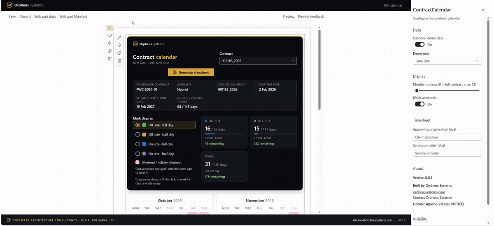

## Contents

- [Features](#features)
- [Architecture](#architecture)
- [Packages](#packages)
- [Quick start](#quick-start-local-workbench-with-demo-data)
- [Deploy to a site](#deploy-to-a-site)
- [The Copilot agent](#the-copilot-agent)
- [Tech stack](#tech-stack)
- [License & Attribution](#license--attribution)

## Features

### Contract calendar web part

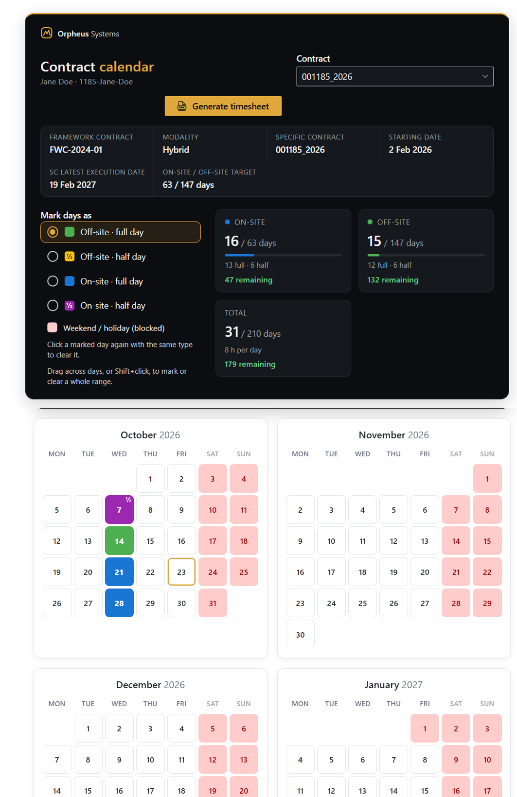

- Month grid for the whole contract period (or a fixed number of months), with on-site, off-site and half days in their own colours.
- Click a day or drag across a range; the selection type picker sets full or half, on-site or off-site. Weekends and public holidays of the contract's country are blocked.
- One entry per contractor per date, across all of their contracts. When a day falls in two overlapping contracts, the calendar asks which one to count it against.
- Used and remaining days per contract, recomputed after every change.
- Timesheet PDF for any period, generated in the browser: the built-in layout, or a site owner's HTML template ([authoring guide](docs/timesheet-templates.md), [sample PDF](docs/screenshots/timesheet-template-example.pdf)).
- Role-aware: contractors see their own contracts, contract managers the contracts they manage, site owners all of them.
- Runs on demo data in a debug build, with a switch between demo users, so it can be tried without creating any list.

| Range selection | Overlapping contracts | Timesheet |
|---|---|---|
| 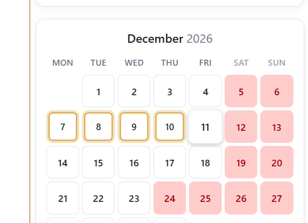 | 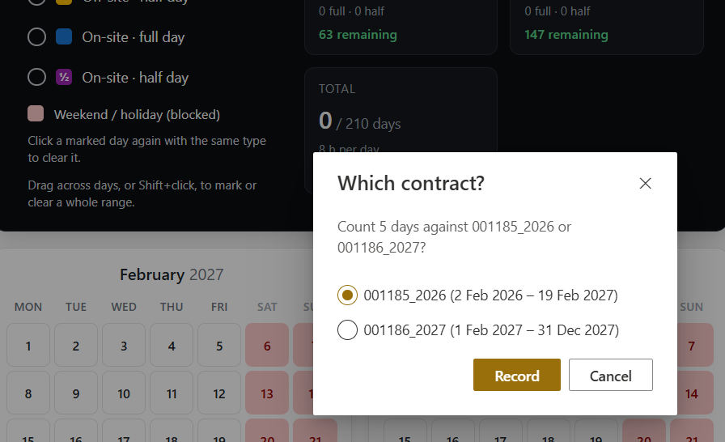 | 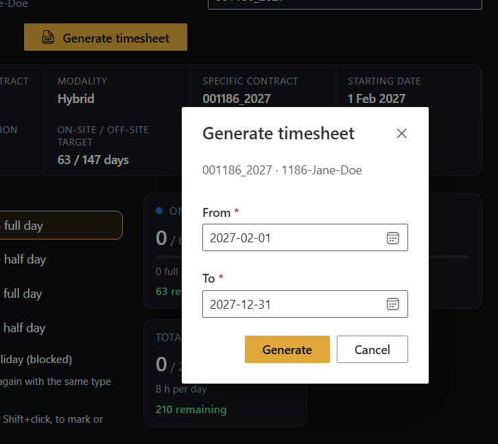 |

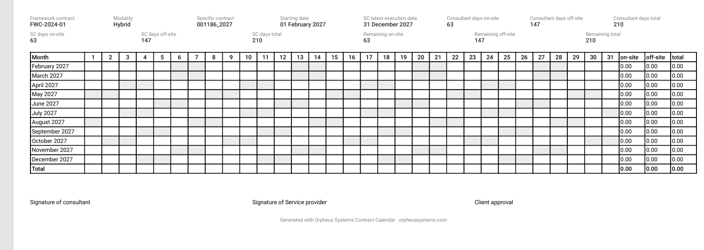

### Header and footer (application customizer)

An Orpheus header with a role-aware menu (My calendar · Contracts · Holidays) that collapses into a dropdown below 640 px, and a footer with contact and version.

| Header and footer | Compact menu |
|---|---|
| 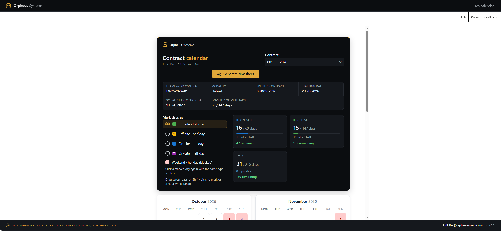 | 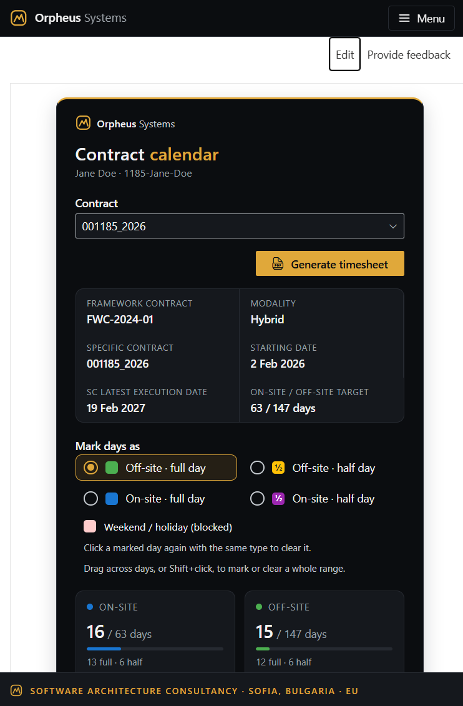 |

### Remaining-days bars (field customizer)

On the Contracts list, the `RemainingDays` column shows two compact bars per contract: on-site and off-site days left, or over.

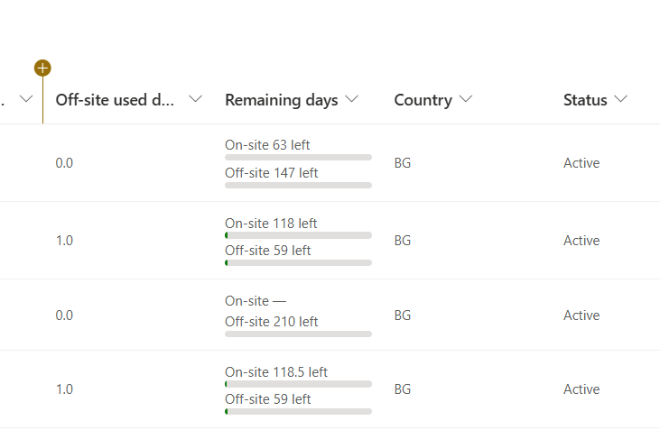

### Contract form (form customizer)

New, Edit and Display forms for contracts: validation as you type, people and date pickers, a warning when the contractor already has an overlapping contract, and an **Open calendar** link. Only a site admin or the contract's manager can edit.

<!-- screenshots pending:
| New | Edit | Display | Not allowed |
|---|---|---|---|
| 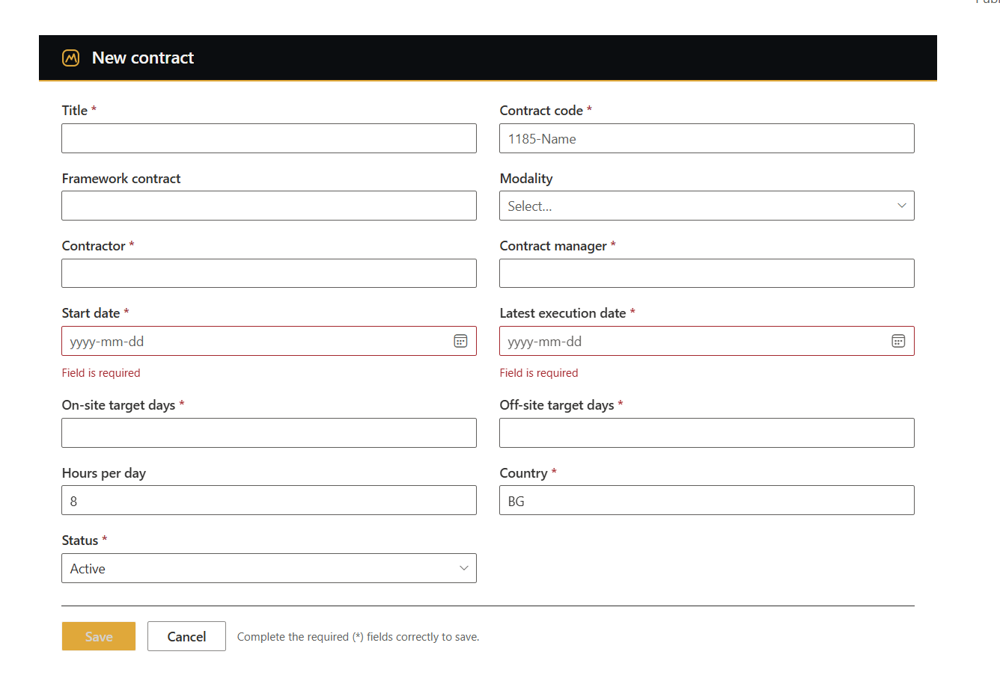 | 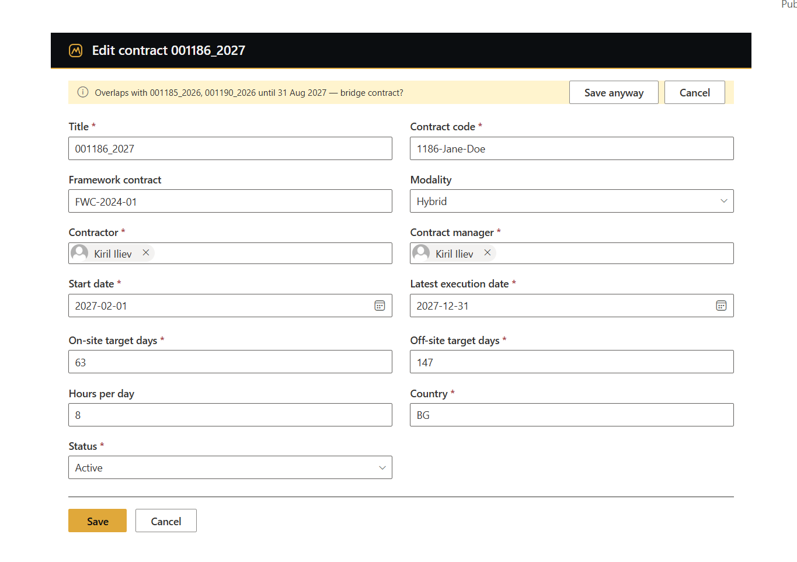 | 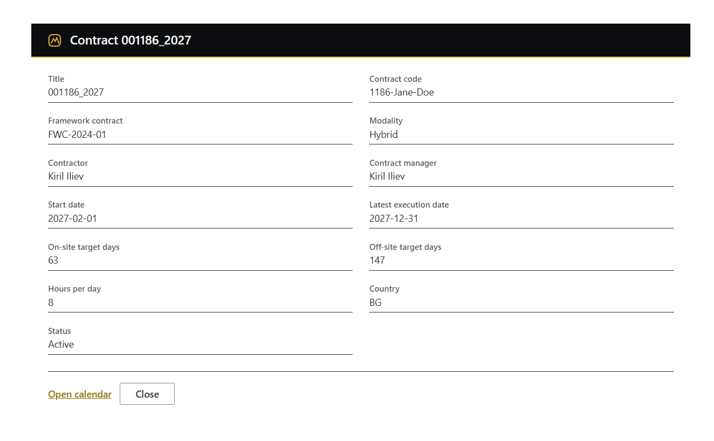 | 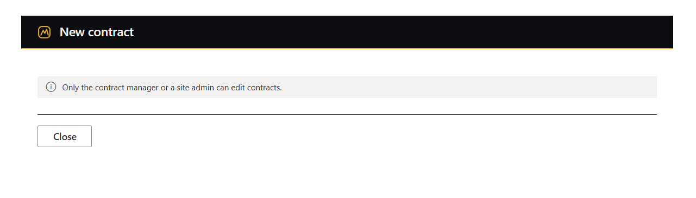 |
-->

### Toasts and packaging

Every component reports through one shared toast stack. The four SPFx solutions install from the site collection App Catalog.

| Toasts | App Catalog |
|---|---|
| 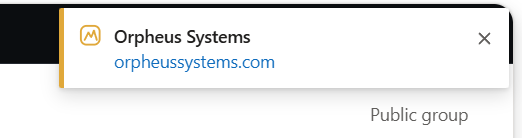 | 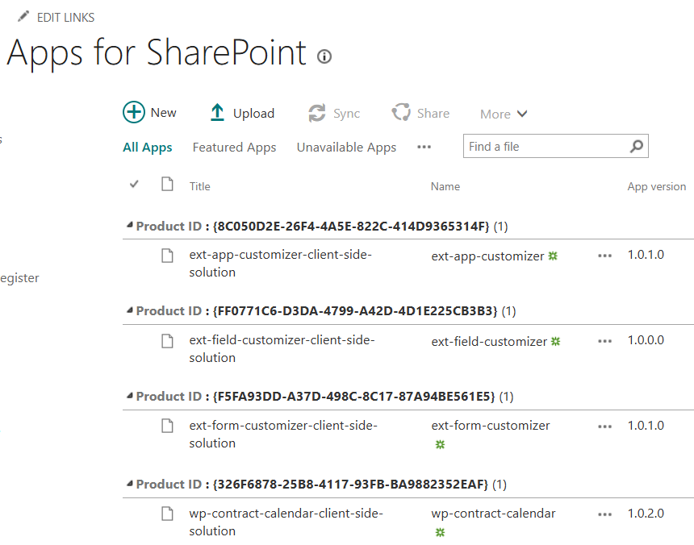 |

### Contract Calendar agent (Microsoft 365 Copilot)

"Book me on-site days from 1 to 5 December": a declarative agent in Copilot Chat books, removes and reads days through an MCP server that reuses the web part's own data layer, so both apply the same rules. See [The Copilot agent](#the-copilot-agent).

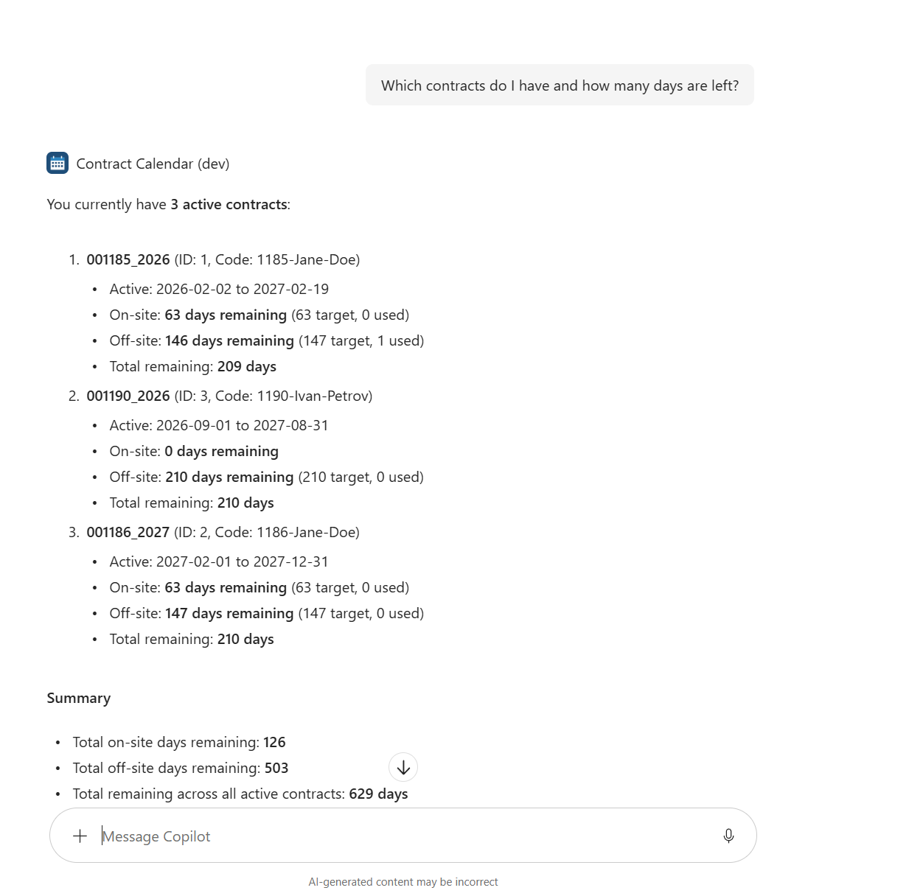

## Architecture

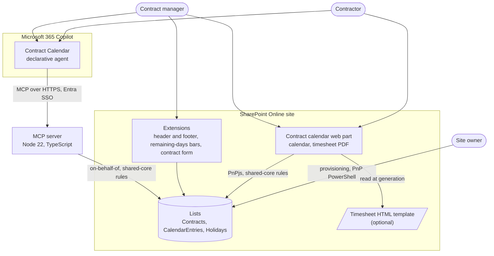

The web part and the MCP server read and write through one data layer, `IDataService` in `shared-core`, with a SharePoint implementation and a local one for demo data and tests. The business rules (one entry per contractor per date, blocked weekends and holidays, recomputed used days) live there once. The extensions use the same package's models, rules, role lookup and link helpers directly.

The full TOGAF documentation and the 16 architecture decision records are in [`architecture/`](architecture/README.md). Start with the [ADR index](architecture/adr/0000-index.md).

## Packages

| Package | Kind | What it does |
|---|---|---|
| [`shared-core`](packages/shared-core) | Library | Models, business rules, date handling and `IDataService` with `LocalDataService` and (under `/sharepoint`) the PnPjs `SharePointDataService` |
| [`shared-ui`](packages/shared-ui/README.md) | Library | Design tokens, brand, toasts, timesheet model and the PDF builders (pdfmake, html-to-pdfmake) |
| [`wp-contract-calendar`](packages/wp-contract-calendar/README.md) | SPFx web part | The contract calendar and the timesheet dialog |
| [`ext-app-customizer`](packages/ext-app-customizer/README.md) | SPFx application customizer | Header, role-aware menu and footer |
| [`ext-field-customizer`](packages/ext-field-customizer/README.md) | SPFx field customizer | Remaining-days bars on the `RemainingDays` column |
| [`ext-form-customizer`](packages/ext-form-customizer/README.md) | SPFx form customizer | Contract New / Edit / Display forms |
| [`mcp-contract-calendar`](packages/mcp-contract-calendar/README.md) | Node service | MCP server: the agent's six tools, Entra token validation, on-behalf-of to SharePoint, audit |
| [`agent-contract-calendar`](packages/agent-contract-calendar/README.md) | Agents Toolkit project | The declarative agent's manifests and instructions |

Other folders: [`infra/provisioning`](infra/provisioning/README.md) (PnP PowerShell site template and scripts), [`architecture`](architecture/README.md) (TOGAF and ADRs), [`docs`](docs) (developer guides).

## Quick start: local workbench with demo data

All Node tooling runs in the `docker.io/m365pnp/spfx:1.23.2` container through Podman; nothing is installed on the host. A Microsoft 365 tenant is still needed for the hosted workbench (SPFx 1.23 has no local workbench), but no list, app or permission on it: a debug build uses `LocalDataService` and its demo data.

1. Start Podman (Windows: a WSL machine):

   ```powershell
   podman machine init
   podman machine start
   ```

2. Install the dependencies into the container volumes:

   ```powershell
   podman compose run --rm fix-perms
   .\scripts\podman.ps1 install
   ```

3. Trust the development certificate once (copy the `.pem` out and import it on the host, see [dev-environment.md](docs/dev-environment.md#dev-certificate)):

   ```powershell
   .\scripts\podman.ps1 trust-dev-cert
   ```

4. Serve the web part:

   ```powershell
   .\scripts\podman.ps1 serve wp-contract-calendar
   ```

5. Open the hosted workbench, `https://{tenantDomain}/_layouts/15/workbench.aspx` (`{tenantDomain}` is your SharePoint host, for example `contoso.sharepoint.com`), and add **ContractCalendar**. In the property pane, **Use local demo data** is on, and **Demo user** switches between the demo contractor, manager and admin.

   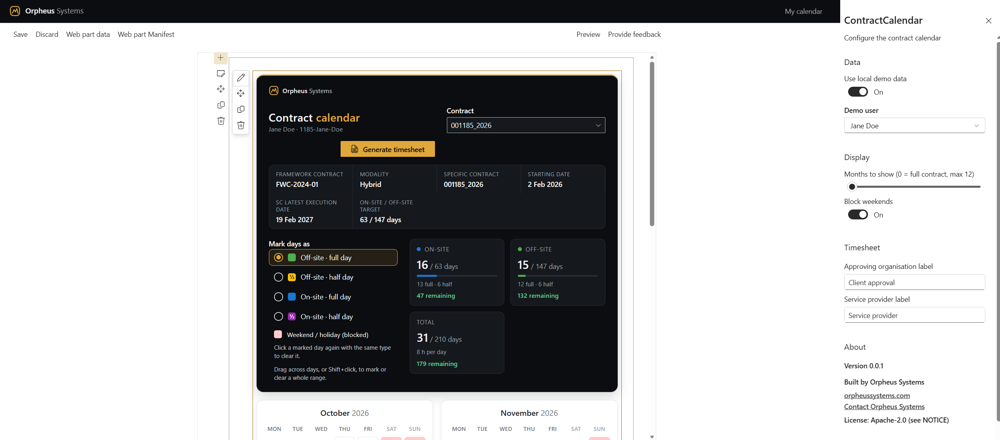

Tests run in the same container, one package at a time: `podman compose run --rm shell bash -c "npm test -w @orpheussystems/<package>"`. The extensions' debug URLs, packaging and troubleshooting are in [docs/dev-environment.md](docs/dev-environment.md); continuous integration is described in [docs/ci.md](docs/ci.md).

## Deploy to a site

In short: build the four `.sppkg` files (`.\scripts\podman.ps1 package`), create the lists with the provisioning script, add the apps to the site collection App Catalog, then create the calendar page and bind the three extensions. The step-by-step guide is [docs/deployment.md](docs/deployment.md); the provisioning script is described in [infra/provisioning](infra/provisioning/README.md).

Optional extras:

- **HTML timesheet template:** add the five template columns with `infra/provisioning/Add-TimesheetTemplateColumns.ps1`, upload an `.html` file and set its path in the web part. See [docs/timesheet-templates.md](docs/timesheet-templates.md).
- **Copilot agent:** see below.

## The Copilot agent

The Contract Calendar agent lets people work with the calendar in Microsoft 365 Copilot Chat:

- contractors book and remove on-site and off-site days in natural language, with the same weekend, holiday and one-entry-per-day rules as the web part;
- contract managers and HR read contracts grouped by vendor;
- every tool call is audited.

It is two packages. [`mcp-contract-calendar`](packages/mcp-contract-calendar/README.md) is the MCP server (Express, Entra SSO token validation, on-behalf-of to SharePoint, six tools). [`agent-contract-calendar`](packages/agent-contract-calendar/README.md) is the Agents Toolkit project with the manifests and the agent's instructions. The demo runs the server locally behind a dev tunnel; the Azure target is described in an ADR. The decisions are [ADR 0011](architecture/adr/0011-custom-mcp-server-in-typescript.md) to [ADR 0016](architecture/adr/0016-azure-target-apim-container-apps-terraform.md), still *Proposed* until the live check.

## Tech stack

| Area | Technology |
|---|---|
| SharePoint client | SharePoint Framework 1.23.2 (Heft toolchain), React 17, Fluent UI 8, PnPjs 4, PnP SPFx controls |
| PDF | pdfmake, html-to-pdfmake, all in the browser |
| Agent | Microsoft 365 Copilot declarative agent (Agents Toolkit), MCP TypeScript SDK, Express 5, jose, MSAL Node, zod |
| Language and tests | TypeScript 5.8, Jest 30 with ts-jest; Pester for the PowerShell scripts |
| Dev environment | Podman with `docker.io/m365pnp/spfx:1.23.2` (Node 22), devcontainer; no Node on the host |
| Provisioning | PnP PowerShell 3 on PowerShell 7.4, PnP site template |
| Architecture | TOGAF ADM documents, Structurizr-style ADRs, Mermaid |

## License & Attribution

This project is licensed under the Apache License, Version 2.0. See [LICENSE](LICENSE).

Redistributions and derivative works must keep a readable copy of the [NOTICE](NOTICE) file, which names Orpheus Systems as the original author (Apache-2.0, Section 4(d)). Nothing more is required. The Orpheus Systems branding in the UI (header, footer, About pane, console banner) and the attribution line in the PDF footer are appreciated but not required by the license. The reasoning is in [ADR 0009](architecture/adr/0009-apache-2-0-with-notice.md).

## Contact

Built by [Orpheus Systems](https://orpheussystems.com/). White-label builds, customisation and support: kiril.iliev@orpheussystems.com.
