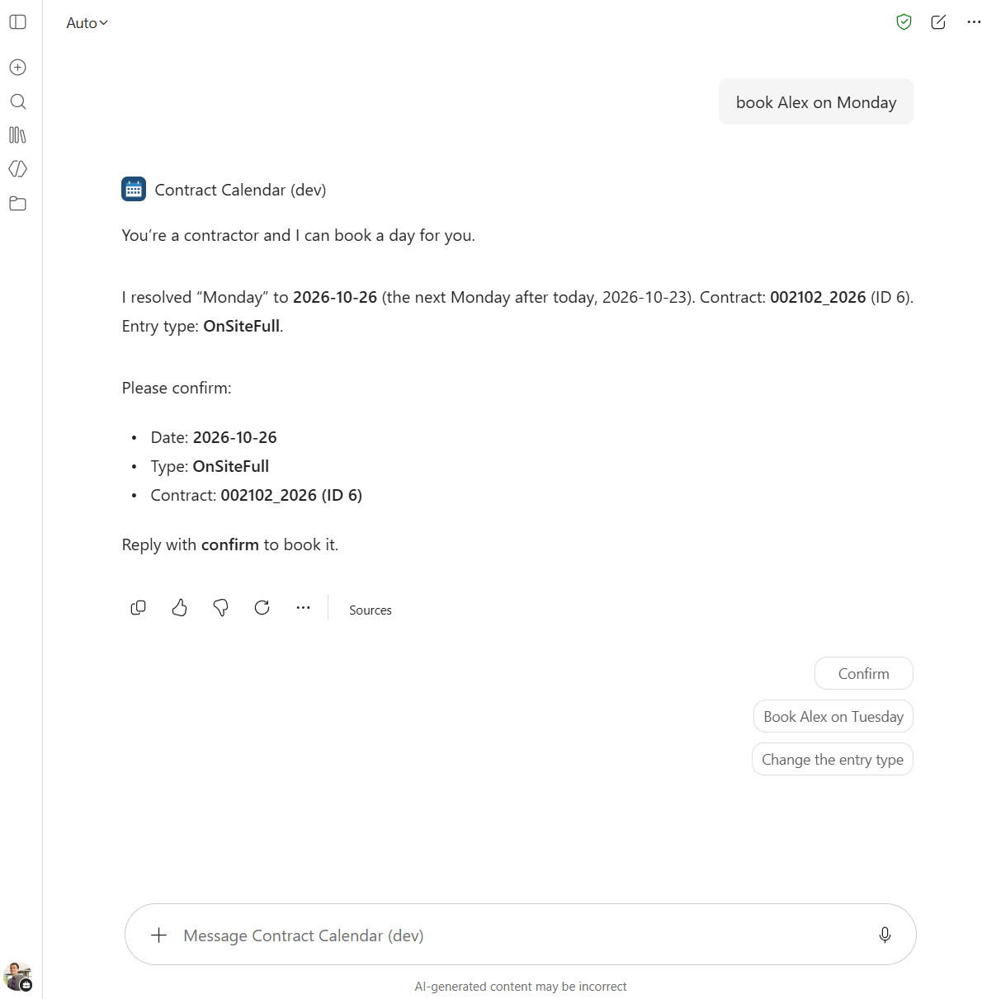
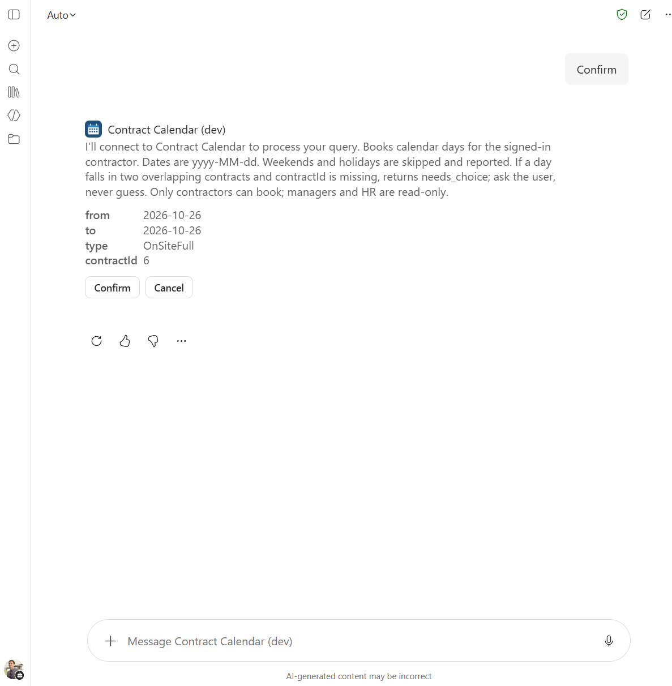
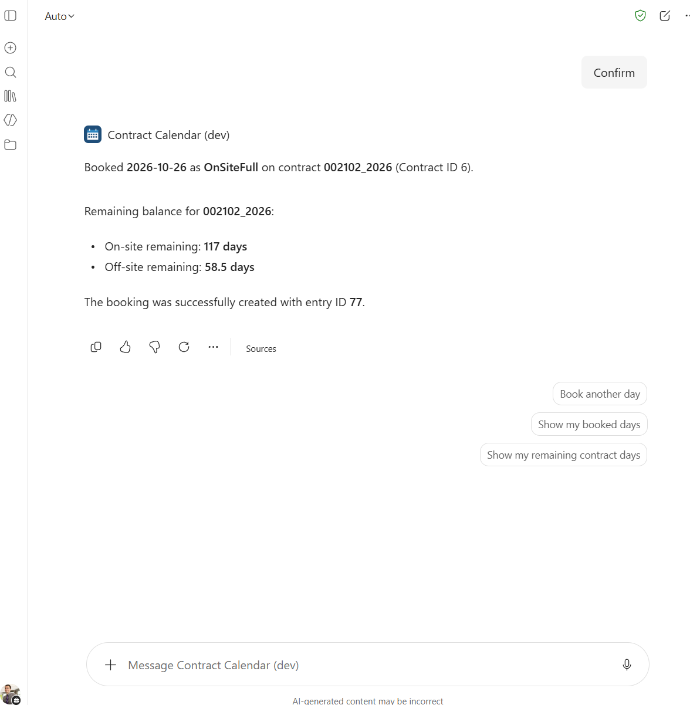
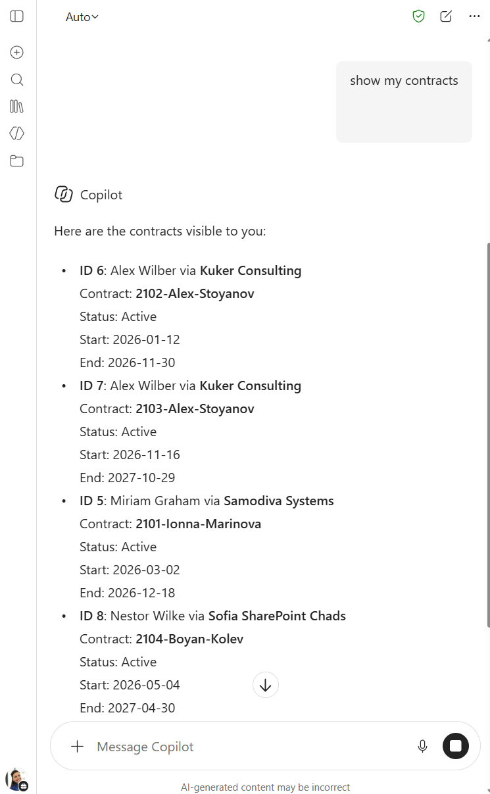
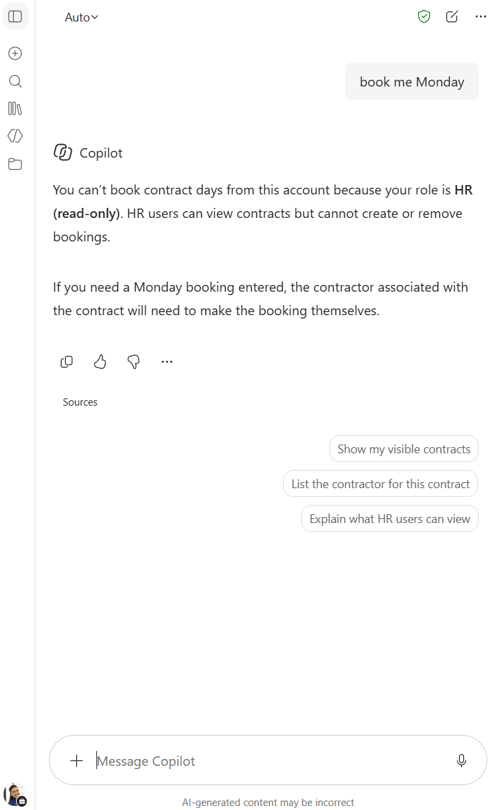
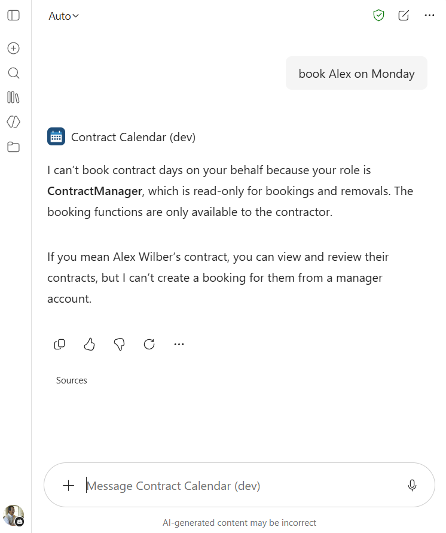
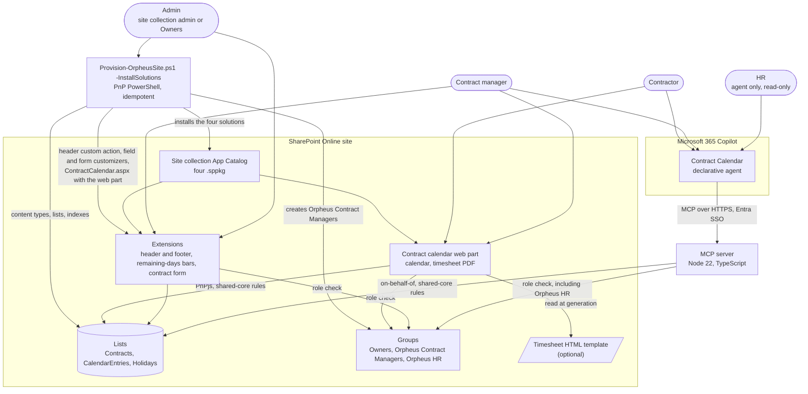
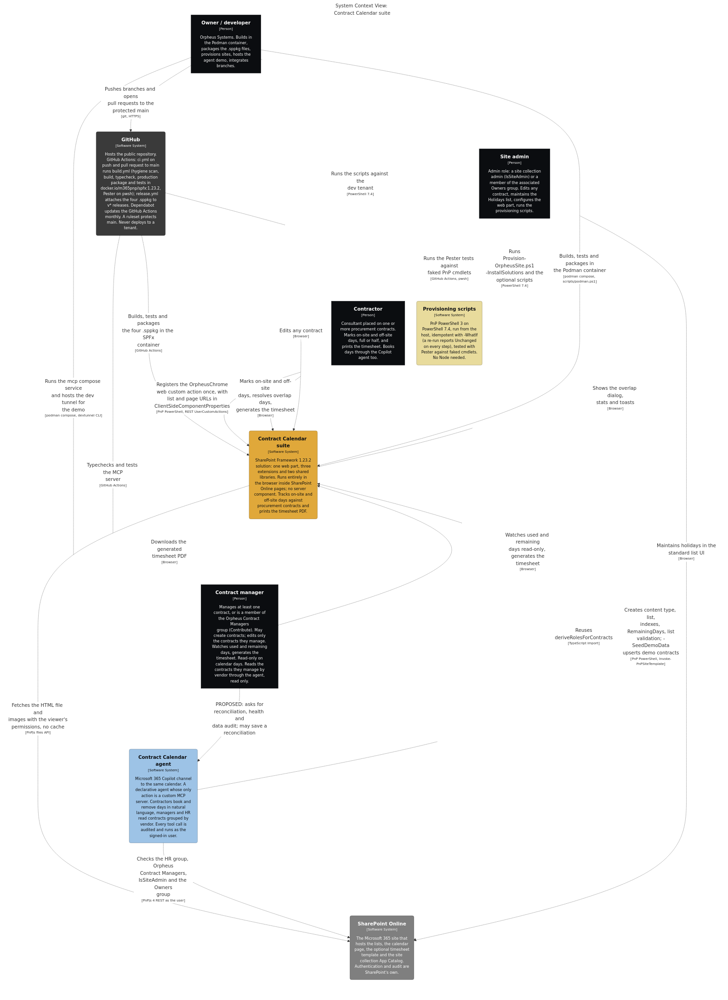

# Orpheus Systems — Contract Calendar for SharePoint

A SharePoint Online solution for tracking on-site and off-site work days against procurement contracts. Contractors mark full and half days on a calendar. Contract managers watch the remaining days and generate a timesheet PDF ready for signature, either in the built-in layout or in their own HTML template. A Microsoft 365 Copilot agent books and reads the same days in chat.

It is built with the SharePoint Framework (SPFx 1.23.2) as an npm-workspaces monorepo: one web part, three extensions, two shared libraries, an MCP server and a declarative agent. Everything runs client-side in SharePoint except the agent's MCP server.


## Contents

- [Features](#features)
- [Architecture](#architecture)
- [Architecture model (Structurizr)](#architecture-model-structurizr)
- [Packages](#packages)
- [Quick start](#quick-start-local-workbench-with-demo-data)
- [Deploy to a site](#deploy-to-a-site)
- [The Copilot agent](#the-copilot-agent)
- [Tech stack](#tech-stack)
- [Contributing and security](#contributing-and-security)
- [License & Attribution](#license--attribution)

## Features

### Contract calendar web part


- Month grid for the whole contract period (or a fixed number of months), with on-site, off-site and half days in their own colours.
- Click a day or drag across a range; the selection type picker sets full or half, on-site or off-site. Public holidays of the contract's country are always blocked. Weekends are blocked unless the web part's **Block weekends** setting is off; that setting applies to the web part's own writes only (the agent always blocks weekends, known gap G-1 in [Phase E](architecture/06-phase-e-opportunities-and-solutions.md)).
- One entry per contractor per date, across all of their contracts. When a day falls in two overlapping contracts, the calendar asks which one to count it against.
- Used and remaining days per contract, recomputed after every change. Only days inside the contract period count as used.
- Timesheet PDF for any period, generated in the browser: the built-in layout, or a site owner's HTML template ([authoring guide](docs/timesheet-templates.md), [sample PDF](docs/screenshots/timesheet-template-example.pdf)). Remaining days are calculated as of the end of the selected period, and the contract header repeats on every page.
- Role-aware: contractors see their own contracts, contract managers the contracts they manage, admins (site collection admins and members of the site's Owners group) all of them. See [Roles](#roles).
- Runs on demo data in a debug build, with a switch between demo users, so it can be tried without creating any list.

| Range selection | Overlapping contracts | Timesheet |
|---|---|---|
|  |  |  |


### Header and footer (application customizer)

An Orpheus header with a role-aware menu (My calendar · Contracts · Holidays) that collapses into a dropdown below 640 px, and a footer with contact and version.

| Header and footer | Compact menu |
|---|---|
|  |  |

### Remaining-days bars (field customizer)

On the Contracts list, the `RemainingDays` column shows two compact bars per contract: on-site and off-site days left, or over.


### Contract form (form customizer)

New, Edit and Display forms for contracts: validation as you type, people and date pickers, a warning when the contractor already has an overlapping contract, and an **Open calendar** link. Admins and contract managers can create contracts; only an admin or the contract's own manager can edit one. If the role check fails, the form denies access. When an edit changes the contract period, the form recomputes the used days and warns about booked days that now fall outside the period.

| New | Edit | Display | Not allowed |
|---|---|---|---|
|  |  |  |  |

### Toasts and packaging

Every component reports through one shared toast stack. The four SPFx solutions install from the site collection App Catalog; the provisioning script puts them there.

| Toasts | App Catalog |
|---|---|
|  |  |

### Contract Calendar agent (Microsoft 365 Copilot)

"Book me on-site days from 1 to 5 December": a declarative agent in Copilot Chat books, removes and reads days through an MCP server that reuses the web part's own data layer, so both apply the same rules. See [The Copilot agent](#the-copilot-agent).


Role checks, verified live on the dev tenant (the contractor books with a confirmation; HR and a contract manager are read-only):

| Contractor: agent restates the request | Contractor: Copilot confirmation card | Contractor: day booked |
|---|---|---|
|  |  |  |

| HR: all contracts, read-only | HR: booking refused | Contract manager: booking for someone else refused |
|---|---|---|
|  |  |  |

## Architecture



The web part and the MCP server read and write through one data layer, `IDataService` in `shared-core`, with a SharePoint implementation and a local one for demo data and tests. The business rules (one entry per contractor per date, blocked weekends and holidays, used days counted inside the contract period only) live there once. The extensions use the same package's models, rules, role lookup and link helpers directly.

### Roles

Roles are derived at runtime from the contracts and the site's groups. A user can hold several.

| Role | Who | What it allows |
|---|---|---|
| Contractor | Named as `Contractor` on at least one contract | Book and remove their own days; read their own contracts |
| Contract manager | Manages at least one contract, or is a member of `Orpheus Contract Managers` (Contribute) | Create contracts; edit the contracts they manage; read their contracts and the booked days |
| Admin | Site collection admin (`IsSiteAdmin`) or a member of the site's associated Owners group | Edit any contract, maintain holidays, configure the web part |
| HR | Member of `Orpheus HR` | Agent only: read all contracts grouped by vendor; no writes |

If the role check fails, no role is granted and access is denied. Visibility is filtering, not item-level permissions ([ADR 0005](architecture/adr/0005-web-part-filtering-over-item-level-permissions.md)).

The full TOGAF documentation and the 18 architecture decision records are in [`architecture/`](architecture/README.md). Start with the [ADR index](architecture/adr/0000-index.md). The same architecture is also a C4 model; see the next section.

## Architecture model (Structurizr)

[`architecture/structurizr/workspace.dsl`](architecture/structurizr/workspace.dsl) is a C4 model of the whole solution in Structurizr DSL. It carries the eleven TOGAF phase documents (`architecture/00-preliminary.md` to `architecture/10-requirements-management.md`, Preliminary to Requirements Management) as its documentation and imports the 18 ADRs as its decisions. Its views:

| Kind | Views |
|---|---|
| Landscape and context | `Landscape`, `SuiteContext`, `AgentContext` |
| Containers | `SuiteContainers`, `AgentContainers`, `SharePointSite` |
| Components | `SharedCoreComponents`, `SharedUiComponents`, `WebPartComponents`, `McpServerComponents` |
| Dynamic | `MarkADay`, `GenerateTimesheet`, `BookDaysViaAgent` |
| Deployment | `ProductionSite`, `AgentDemo`, `ContinuousIntegration`, `AgentAzureTarget` (Proposed) |



*The `SuiteContext` view, exported from the DSL with the Structurizr command line (`export -format mermaid`) and rendered with mermaid-cli.*

To browse every view, the decisions and the documentation locally, run from the repository root (Podman, nothing installed on the host):

```powershell
podman compose -f architecture/structurizr/compose.yml up
```

Then open http://localhost:8080. Stop it with `podman compose -f architecture/structurizr/compose.yml down`.

Notes on the model: [overview](architecture/structurizr/docs/01-overview.md) (what is modelled and the conventions), [model notes](architecture/structurizr/docs/02-model-notes.md) (where the model and the documents differ) and [how to render](architecture/structurizr/docs/03-how-to-render.md) (local mode, validation, export, memory limits).

## Packages

| Package | Kind | Solution version | What it does |
|---|---|---|---|
| [`shared-core`](packages/shared-core) | Library | bundled | Models, business rules, date handling, role derivation and `IDataService` with `LocalDataService` and (under `/sharepoint`) the PnPjs `SharePointDataService` |
| [`shared-ui`](packages/shared-ui/README.md) | Library | bundled | Design tokens, brand, toasts, timesheet model and the PDF builders (pdfmake, html-to-pdfmake) |
| [`wp-contract-calendar`](packages/wp-contract-calendar/README.md) | SPFx web part | 1.0.4.0 | The contract calendar and the timesheet dialog |
| [`ext-app-customizer`](packages/ext-app-customizer/README.md) | SPFx application customizer | 1.0.3.0 | Header, role-aware menu and footer. The package has no feature; the provisioning script registers the custom action |
| [`ext-field-customizer`](packages/ext-field-customizer/README.md) | SPFx field customizer | 1.0.2.0 | Remaining-days bars on the `RemainingDays` column |
| [`ext-form-customizer`](packages/ext-form-customizer/README.md) | SPFx form customizer | 1.0.3.0 | Contract New / Edit / Display forms |
| [`mcp-contract-calendar`](packages/mcp-contract-calendar/README.md) | Node service | — | MCP server: the agent's six tools, Entra token validation, on-behalf-of to SharePoint, audit |
| [`agent-contract-calendar`](packages/agent-contract-calendar/README.md) | Agents Toolkit project | — | The declarative agent's manifests and instructions |

Other folders: [`infra/provisioning`](infra/provisioning/README.md) (PnP PowerShell site template, the `OrpheusSolutions.psm1` module and scripts), [`architecture`](architecture/README.md) (TOGAF, ADRs and the Structurizr model), [`docs`](docs) (developer guides), [`.github/workflows`](.github/workflows) (CI).

## Quick start: local workbench with demo data

All Node tooling runs in the `docker.io/m365pnp/spfx:1.23.2` container through Podman; nothing is installed on the host. A Microsoft 365 tenant is still needed for the hosted workbench (SPFx 1.23 has no local workbench), but no list, app or permission on it: a debug build uses `LocalDataService` and its demo data.

1. Start Podman (Windows: a WSL machine):

   ```powershell
   podman machine init
   podman machine start
   ```

2. Install the dependencies into the container volumes:

   ```powershell
   podman compose run --rm fix-perms
   .\scripts\podman.ps1 install
   ```

3. Trust the development certificate once (copy the `.pem` out and import it on the host, see [dev-environment.md](docs/dev-environment.md#dev-certificate)):

   ```powershell
   .\scripts\podman.ps1 trust-dev-cert
   ```

4. Serve the web part:

   ```powershell
   .\scripts\podman.ps1 serve wp-contract-calendar
   ```

5. Open the hosted workbench, `https://{tenantDomain}/_layouts/15/workbench.aspx` (`{tenantDomain}` is your SharePoint host, for example `contoso.sharepoint.com`), and add **ContractCalendar**. In the property pane, **Use local demo data** is on, and **Demo user** switches between the demo contractor, manager and admin.

   

Tests run in the same container, one package at a time: `podman compose run --rm shell bash -c "npm test -w @orpheussystems/<package>"`. The extensions' debug URLs, packaging and troubleshooting are in [docs/dev-environment.md](docs/dev-environment.md); continuous integration is described in [docs/ci.md](docs/ci.md).

## Deploy to a site

Build the four `.sppkg` files (`.\scripts\podman.ps1 package`), then run the provisioning script once with `-InstallSolutions`, with `-WhatIf` first to see the plan:

```powershell
./infra/provisioning/Provision-OrpheusSite.ps1 -SiteUrl https://<tenant>.sharepoint.com/sites/<site> -ClientId <app-client-id> -InstallSolutions
```

One run does the whole setup. It creates the content types and lists, installs the four solutions into the site collection App Catalog (when a component's manifest stays empty after an install, it repairs it with a clean reinstall that `-Confirm` gates separately), registers the header custom action, binds the field and form customizers, creates the `Orpheus Contract Managers` group (Contribute), and creates or updates `SitePages/ContractCalendar.aspx` with the web part wired to the three lists. Running it again reports `Unchanged` for every step. The site needs a site collection App Catalog first. The step-by-step guide is [docs/deployment.md](docs/deployment.md); the script and its `OrpheusSolutions.psm1` module are described in [infra/provisioning](infra/provisioning/README.md).

Optional extras:

- **HTML timesheet template:** add the five template columns with `infra/provisioning/Add-TimesheetTemplateColumns.ps1`, upload an `.html` file and set its path in the web part. See [docs/timesheet-templates.md](docs/timesheet-templates.md).
- **Copilot agent:** see below.

## The Copilot agent

The Contract Calendar agent lets people work with the calendar in Microsoft 365 Copilot Chat:

- contractors book and remove on-site and off-site days in natural language, with the same weekend, holiday and one-entry-per-day rules as the web part;
- contract managers read the contracts they manage, and HR (members of `Orpheus HR`) reads all contracts, grouped by vendor; both are read-only in the agent, so a booking for someone else is refused;
- weekends and holidays are always blocked in the agent, whatever the web part's **Block weekends** setting (known gap G-1);
- every tool call is audited.

It is two packages. [`mcp-contract-calendar`](packages/mcp-contract-calendar/README.md) is the MCP server (Express, Entra SSO token validation, on-behalf-of to SharePoint, six tools). [`agent-contract-calendar`](packages/agent-contract-calendar/README.md) is the Agents Toolkit project with the manifests and the agent's instructions. The demo runs the server as the `mcp` service of the repository's default compose project, behind a dev tunnel ([demo procedure](packages/agent-contract-calendar/demo/demo-procedure.md)).

Decisions: [ADR 0011](architecture/adr/0011-custom-mcp-server-in-typescript.md) to [ADR 0015](architecture/adr/0015-dev-tunnel-for-the-agent-demo.md) are *Accepted*. The Azure target ([ADR 0016](architecture/adr/0016-azure-target-apim-container-apps-terraform.md)) is *Proposed*. [ADR 0017](architecture/adr/0017-sharepoint-placement-waits-for-agent-chat-web-part.md) (*Accepted*) keeps the agent off SharePoint pages until the Agent Chat web part is available. [ADR 0018](architecture/adr/0018-oversight-agent-reusing-pnp-sharepoint-skills.md), a second agent for contract oversight, is *Proposed* at the decision level only; nothing of it is built.

## Tech stack

| Area | Technology |
|---|---|
| SharePoint client | SharePoint Framework 1.23.2 (Heft toolchain), React 17, Fluent UI 8, PnPjs 4, PnP SPFx controls |
| PDF | pdfmake, html-to-pdfmake, all in the browser |
| Agent | Microsoft 365 Copilot declarative agent (Agents Toolkit), MCP TypeScript SDK, Express 5, jose, MSAL Node, zod |
| Language and tests | TypeScript 5.8, Jest 30 with ts-jest; Pester for the PowerShell scripts |
| Dev environment | Podman with `docker.io/m365pnp/spfx:1.23.2` (Node 22), devcontainer; no Node on the host |
| Provisioning | PnP PowerShell 3 on PowerShell 7.4, PnP site template, `OrpheusSolutions.psm1` for the App Catalog, custom action, customizer bindings, group and page |
| CI and repository | GitHub Actions: build, tests, production packaging, Pester and a hygiene scan, and the `.sppkg` files on tagged releases ([docs/ci.md](docs/ci.md)). Dependabot runs monthly. A ruleset protects `main` |
| Architecture | TOGAF ADM documents, ADRs, Mermaid, and a Structurizr DSL C4 model that imports the ADRs ([workspace](architecture/structurizr/workspace.dsl)) |

## Contributing and security

How to set up, test and submit a change is in [CONTRIBUTING.md](CONTRIBUTING.md). Report a vulnerability privately as described in [SECURITY.md](SECURITY.md), not in a public issue.

## License & Attribution

This project is licensed under the Apache License, Version 2.0. See [LICENSE](LICENSE).

Redistributions and derivative works must keep a readable copy of the [NOTICE](NOTICE) file, which names Orpheus Systems as the original author (Apache-2.0, Section 4(d)). Nothing more is required. The Orpheus Systems branding in the UI (header, footer, About pane, console banner) and the attribution line in the PDF footer are appreciated but not required by the license. The reasoning is in [ADR 0009](architecture/adr/0009-apache-2-0-with-notice.md).

## Contact

Built by [Orpheus Systems](https://orpheussystems.com/). White-label builds, customisation and support: kiril.iliev@orpheussystems.com.
