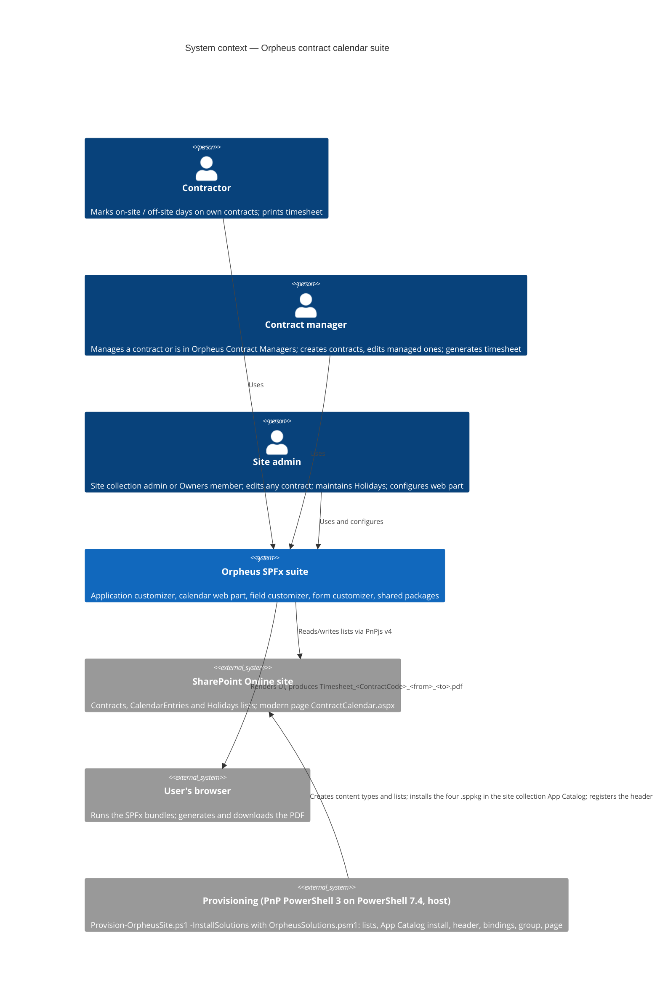

# Phase A — Architecture Vision

## 1. Statement of architecture work

**Problem.** The current repository is a skeleton that does not build (one
package is a lone `tsconfig.json`, another is referenced but absent) and still
carries naming from a previous employer. It cannot be published as it is.

**Scope.** Turn it into a public, portfolio-grade SharePoint Framework monorepo
under Orpheus Systems that:

1. builds from a clean clone with nothing but Podman installed;
2. demonstrates all four SPFx extension types plus a real web part;
3. solves one concrete business problem end to end: tracking a contractor's
   on-site / off-site days against a procurement contract and printing the
   signed timesheet.

**Desired outcomes** (design §2, goals):

| # | Goal |
|---|------|
| G1 | Clean public repo: no previous-employer references, Orpheus authorship and contact, Apache-2.0 licence with NOTICE, README a stranger can follow. |
| G2 | npm-workspaces monorepo on SPFx 1.23.2; every package builds, bundles and packages into `.sppkg` inside `m365pnp/spfx:1.23.2` via Podman; no Node on the host. |
| G3 | Four deployable SPFx artefacts (`.sppkg`): application customizer, calendar web part, field customizer, form customizer, each bundling the shared packages it uses. |
| G4 | The calendar web part works fully in the local workbench with fixtures, and against real SharePoint lists in production. |
| G5 | One-page landscape PDF timesheet generated in the browser matching the reference layout. |
| G6 | This TOGAF-structured `architecture/` folder. |

**Out of scope for this iteration** (design §2, non-goals): SharePoint
item-level permissions; automatic holiday population by an agent; approval
workflow / e-signature; SharePoint on-premises; multi-language UI (strings
structure kept so it can be added).

**Anti-goals** (would make the result a failure even if it works): anything
that identifies a previous employer or a real client; builds that only work on
the author's machine; fake-looking demo data.

## 2. Stakeholders

| Stakeholder | Role | Interest | Influence |
|-------------|------|----------|-----------|
| Kiril Iliev, Orpheus Systems | Owner, architect, builder, approver | Credible public showcase; working product for contract tracking | Decides |
| Contractor (end user) | Marks on-site / off-site days on their own contract(s) | Fast, unambiguous day entry; can print and sign the timesheet | Uses |
| Contract manager (end user) | Creates and edits the contracts they manage; generates the timesheet | Correct totals and remaining days; read-only calendar | Uses |
| Site admin (end user) | Edits any contract; maintains Holidays; configures the web part | Simple provisioning and configuration | Uses, operates |
| Approving organisation | Signs the printed timesheet (third signature box) | A readable, correct one-page timesheet | Receives output; never named in code — configurable label, default "Client approval" |
| Public repository visitors | Evaluate the work | Clean clone builds; README and screenshots | Observe |

> ⚠️ **Open:** The design does not say who the first real tenant users are or
> how many; the SharePoint Online tenant is described only as "available for
> verification".

## 3. Business drivers

- Make the repository public and worth showing (portfolio value for Orpheus Systems).
- Replace a non-building skeleton with a product that builds reproducibly.
- Solve a real, recurring need: counting a consultant's on-site and off-site
  days per contract, including bridge contracts that overlap, and producing
  the timesheet the approving organisation signs.

## 4. Constraints (design §3)

| Constraint | Value |
|------------|-------|
| SPFx version | 1.23.2 (latest stable as of 2026-10-22; 1.24 is RC only) |
| Runtime inside container | Node 22.14+; TypeScript per the SPFx 1.23 toolchain |
| Container image | `docker.io/m365pnp/spfx:1.23.2`, run with Podman (host has Podman 6.1.4, no Node) |
| Package manager | npm workspaces |
| Data access | PnPjs v4 (`@pnp/sp` 4.22) |
| UI | Fluent UI React as shipped with SPFx 1.23, Orpheus theme tokens over it |
| Repository / scope | GitHub `orpheussystems/sharepoint`; npm scope `@orpheussystems` |
| Hosting | SharePoint Online only; a tenant is available for verification |
| Host OS | Windows 11, PowerShell primary; scripts must also work from bash inside the container |

> ⚠️ **Open:** The org/repo and npm-scope reading of the namespace
> "orpheussystems.sharepoint" is marked "confirm" in the design (§3, §11).

> ⚠️ **Open:** Timeline and budget are not stated in the design.

## 5. System context

## 6. Success measures

| Measure | Target |
|---------|--------|
| Clean-clone build | `podman compose run build` and `package` succeed on a clean clone with only Podman installed |
| Hygiene | The case-insensitive hygiene grep defined in design §8 returns nothing in working tree and history |
| Artefacts | Four `.sppkg` files produced with `--production` (the shared packages are bundled into them) |
| Workbench | Calendar web part fully usable with fixtures, both demo roles selectable |
| Production | Web part, customizers and forms verified on the real tenant; README screenshots come from a real site |
| PDF | Landscape A4, one page per 12 months, layout as design §6.5 |

## 7. Initial risk register

| ID | Risk | Impact | Mitigation / path |
|----|------|--------|-------------------|
| R-SEC-1 | Visibility is enforced only by filtering in the web part; contractors hold Contribute on all three lists, so a user with list UI access can read or edit other contractors' rows. | H | Accepted for this iteration (ADR-005). Hardening option recorded: per-item permission breaking on Contracts and CalendarEntries via provisioning-time event receiver or Power Automate, plus read-restricted views. Roadmap item in Phase E. |
| R-BUILD-1 | Container-only build diverges from a developer's expectations (certificates, ports, volumes). | M | `compose.yml` services `shell`, `install`, `build`, `serve`, `package`; `.devcontainer` reuses the image; `heft trust-dev-cert` documented. |
| R-PDF-1 | pdfmake bundle size exceeds SPFx guidance. | M | Fallback to jsPDF + autotable (ADR-004); left to the builder. |
| R-DATA-1 | Duplicate calendar entries for one contractor on one date across overlapping contracts. | H | Service enforces one entry per contractor per date; overlap dialog moves the day (ADR-008). |
| R-DATA-2 | `OnSiteUsedDays` / `OffSiteUsedDays` drift from the actual entries. | M | Service recalculates on every entry write, and the contract form on a period change, counting only entries inside the contract period; contractors need Contribute on Contracts for this. |
| R-HYG-1 | Previous-employer fingerprints survive in history. | H | Fresh orphan branch (ADR-007); grep criterion applies to history. |
| R-CFG-1 | A real organisation name leaks via labels. | H | Labels are web part properties with neutral defaults ("Client approval", "Service provider"). |
| T-1 | The entry upsert deletes and re-adds the item, so SharePoint version history of a calendar entry is lost. | L | Accepted trade-off; entries carry no content worth versioning. The audit layers (ADR-014) record only the agent's writes; web part writes are not audited by the app, and an entry's Created/Author metadata reflects its last write. |
| T-2 | Batched entry writes are not atomic: a failure part-way leaves earlier items written (see R-AGT-1). | M | Accepted trade-off; the used days are recalculated on the next write and self-correct. |
| R-SCOPE-1 | Reference timesheet image contains real client identifiers. | H | Image is not committed; design §6.5 is the full layout description. |

## 8. Assumptions

> 📝 **Assumption:** A single SharePoint Online site hosts all three lists and
> the calendar page; multi-site deployment is not addressed in the design.

> 📝 **Assumption:** Hours per day default to 8 and half days print as `4.00`;
> non-default `HoursPerDay` values print `HoursPerDay` and `HoursPerDay / 2`.
> The design states the default and the printed values but not the general rule.
