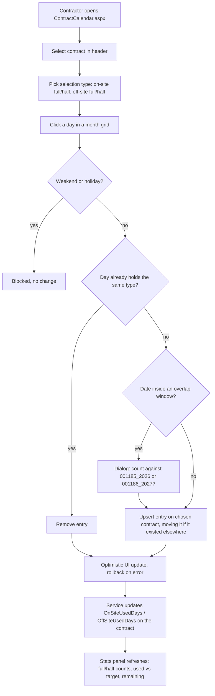
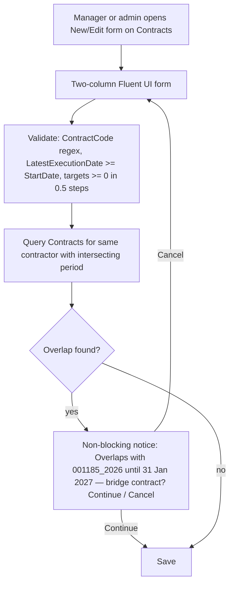

# Phase B — Business Architecture

## 1. Business context

A consultancy places consultants on procurement contracts. Each specific
contract (e.g. `001185_2026`, under a framework contract such as
`FWC/2021/907`) grants a number of on-site and off-site days. The consultant
records which days were worked on-site or off-site, in full or half days; the
contract manager monitors used versus target days; at period end a one-page
timesheet is printed and signed by the consultant, the service provider and
the approving organisation.

Contracts may overlap ("bridge" contracts: `1185` until 31 Jan, `1186` from
15 Jan), but on any given day a contractor's work counts against exactly one
contract.

## 2. Roles (design §6.1)

| Role | Can do | Cannot do |
|------|--------|-----------|
| Contractor | See only own contract(s); mark days on-site / off-site, full or half; on overlap days choose which contract the day counts against; generate the timesheet (builder's call, recommended yes — needs to sign it) | Edit contracts (kept out by the form customizer, not by permissions) |
| Contract manager | Create and edit contracts they manage (form customizer); see only those; generate the PDF timesheet | Edit calendar days (read-only view) |
| Site admin | Edit any contract; maintain the Holidays list through any SharePoint list UI; configure the web part (list selection, labels) | — |

Admin rule: a site collection admin (`currentUser.IsSiteAdmin`) or a member of
the associated Owners group is Admin. If the `IsSiteAdmin` read fails, role
derivation rejects (fail closed) instead of falling back to a lower role.

Managers group: a user is also ContractManager when they manage at least one
contract or are a member of the SharePoint group `Orpheus Contract Managers`
(exact title, case-sensitive). Members of that group can create contracts
(`canCreateContract`). Editing stays limited to Admin and the contract's own
manager. The owner manages the group's members; provisioning only creates it.

Role derivation at runtime, in order: appears as `Contractor` on at least one
contract → contractor; appears as `ContractManager` → manager; member of the
site Owners group → admin. A user can hold more than one role.

> ⚠️ **Open:** Whether contractors get the **Generate timesheet** button is
> left to the builder (design §9, recommended yes).

## 3. Business capability map

| Capability | Sub-capability | Realised by |
|------------|----------------|-------------|
| Contract management | Create / edit / display contract; validate dates, codes and targets; detect overlapping contracts for the same contractor | Form customizer on Contracts |
| | Monitor remaining days at a glance | Field customizer (`RemainingDays` column) |
| Day tracking | Mark a day on-site / off-site, full / half; remove a marking; resolve overlap days | Calendar web part |
| | Block weekends and holidays | Web part rule (weekends configurable) + Holidays list |
| | Show used vs target and remaining, warn when over target | Web part stats panel; `OnSiteUsedDays` / `OffSiteUsedDays` kept by the service |
| Reporting | Generate a one-page landscape timesheet PDF for a period | `shared-ui/pdf` (pdfmake) |
| Reference data | Maintain holidays per country (`*` = all) | Holidays list; future holiday agent |
| Navigation and identity | Branded header / footer, role-aware menu, deep link to a contract's calendar | Application customizer; `contractId` query parameter |
| Site setup | Provision content types, lists, page, bindings, starter holidays | `Provision-OrpheusSite.ps1` |

## 4. Key business processes

### 4.1 Mark a day

### 4.2 Create or edit a contract

### 4.3 Generate the timesheet

1. Manager (or contractor, if enabled) presses **Generate timesheet** on the
   calendar page, or follows the link on the contract Display form, which
   opens the calendar with the contract preselected.
2. Dialog defaults the period to the full contract span; from/to dates can
   trim it.
3. PDF is built in the browser and downloaded as
   `Timesheet_<ContractCode>_<from>_<to>.pdf`.
4. Signing is offline: consultant, service provider, approving organisation
   (label configurable, default "Client approval").

### 4.4 Maintain holidays

Site admin edits the Holidays list in the standard SharePoint UI. `Source` is
`Manual`; the `Agent` value is reserved for the future holiday agent.

## 5. Business rules

| ID | Rule | Where enforced |
|----|------|----------------|
| BR-1 | A calendar entry always references a contract, never just a person. | Data model (lookup), service |
| BR-2 | One entry per contractor per date across all their contracts; choosing a contract in the overlap dialog moves the day, never duplicates it. | Service (ADR-008) |
| BR-3 | Clicking a day that already holds the selected type removes the entry. | Web part |
| BR-4 | Saturday and Sunday are blocked by default (configurable per web part instance); holidays for the contract's country or `*` are blocked. | Web part |
| BR-5 | Full day counts 1, half day 0.5, against on-site or off-site target respectively; warning colour when used exceeds target. | Web part stats; PDF totals |
| BR-6 | `LatestExecutionDate` ≥ `StartDate`; targets ≥ 0 in 0.5 steps; `ContractCode` matches `^\d{4}-[A-Za-z]+(-[A-Za-z]+)*$` (regex configurable). | Form customizer |
| BR-7 | Contract periods may overlap; overlap is a warning, not an error. | Form customizer |
| BR-8 | Remaining-days bar turns amber at ≥ 80 % used and red when over. | Field customizer |
| BR-9 | `HoursPerDay` defaults to 8; the PDF prints `8.00` for a full day and `4.00` for a half day. | PDF model builder |
| BR-10 | Contractors see `Contractor eq me`; managers see `ContractManager eq me`. | Data service (ADR-005) |
| BR-11 | Menu items whose `roles` do not include the current user's role are hidden. | Application customizer |

> ⚠️ **Open:** The design does not say what `Modality = Hybrid` changes in
> behaviour, if anything, nor who moves `Status` to `Closed` or what a closed
> contract blocks.

## 6. Organisation and external actors

| Actor | Relationship |
|-------|--------------|
| Orpheus Systems | Service provider; owns the solution and the public repository |
| Consultant / contractor | Orpheus or partner staff placed on a contract |
| Approving organisation | The client that signs the timesheet; never named — configurable label |

## 7. Baseline vs target

| Aspect | Baseline | Target |
|--------|----------|--------|
| Day tracking | Interactive HTML mock (`docs/mocks/onsite_calendar.html`), localStorage, single contract, no roles | SPFx web part with contract selection, roles, overlap handling, SharePoint persistence |
| Timesheet | Reference image (not committed) | Client-side PDF generated from recorded entries |
| Contract data | None in the repo | Contracts / CalendarEntries / Holidays lists with content types |
| Repository | Non-building skeleton with prior-employer naming | Public monorepo, clean history |
