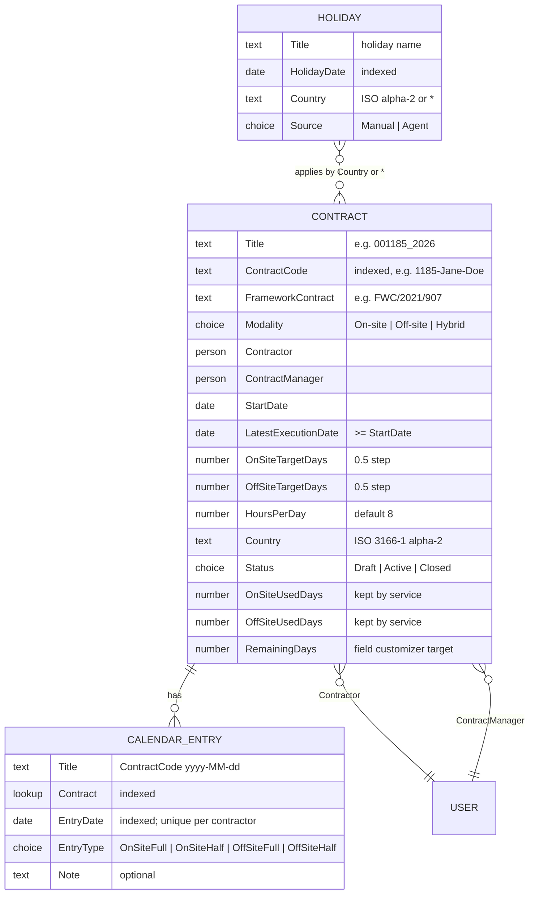
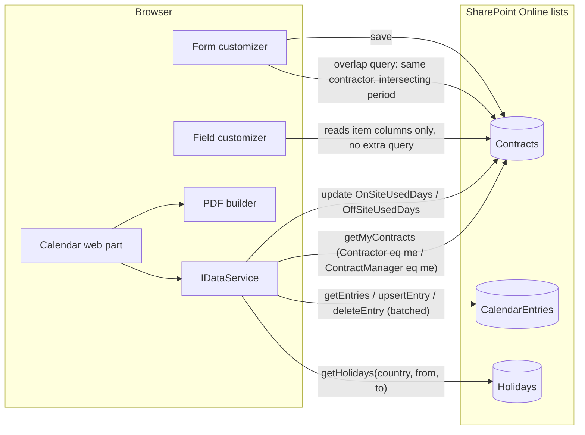

# Phase C — Data Architecture

Mutable document: list and column definitions change with the provisioning
script. Keep in step with `infra/provisioning`.

## 1. Entity model

## 2. SharePoint lists (design §6.2)

All three lists carry a dedicated content type so the web part's list picker
can offer only matching lists. All three stay at site-default permissions this
iteration (ADR-005); contractors therefore hold Contribute on Contracts too,
which is what lets the service keep the used-days columns current.

### 2.1 Contracts — content type `Orpheus Contract`

| Column | Type | Notes |
|--------|------|-------|
| Title | text | Specific contract number, e.g. `001185_2026` (display) |
| ContractCode | text, indexed | Short code used in folder/file names, e.g. `1185-Jane-Doe` |
| FrameworkContract | text | e.g. `FWC/2021/907` |
| Modality | choice | On-site / Off-site / Hybrid |
| Contractor | person | The consultant |
| ContractManager | person | The vendor/contract manager |
| StartDate | date | |
| LatestExecutionDate | date | Must be ≥ StartDate |
| OnSiteTargetDays | number (0.5 step) | |
| OffSiteTargetDays | number (0.5 step) | |
| HoursPerDay | number | Default 8; printed as `8.00` / `4.00` |
| Country | text | ISO 3166-1 alpha-2; selects which holidays apply |
| Status | choice | Draft / Active / Closed |
| OnSiteUsedDays | number | Kept up to date by the service on every entry write (design §6.7) |
| OffSiteUsedDays | number | As above |
| RemainingDays | calculated/number | Created by the provisioning script; the field customizer is bound to it |

### 2.2 CalendarEntries — content type `Orpheus Calendar Entry`

| Column | Type | Notes |
|--------|------|-------|
| Title | text | `<ContractCode> <yyyy-MM-dd>` for readability |
| Contract | lookup → Contracts, indexed | |
| EntryDate | date, indexed | One entry per contractor per date across all their contracts, enforced in the service (ADR-008) |
| EntryType | choice | OnSiteFull / OnSiteHalf / OffSiteFull / OffSiteHalf |
| Note | text, optional | |

### 2.3 Holidays — content type `Orpheus Holiday`

| Column | Type | Notes |
|--------|------|-------|
| Title | text | Holiday name |
| HolidayDate | date, indexed | |
| Country | text | ISO alpha-2; `*` = all countries |
| Source | choice | Manual / Agent (reserved for the future holiday agent) |

Weekends are not stored; the calendar treats Saturday/Sunday as blocked by
default (configurable per web part instance).

> ⚠️ **Open:** `RemainingDays` is described as "a calculated/number column";
> the design does not fix which, nor its formula if calculated (the field
> customizer reads the target and used columns itself, so the column may only
> need to exist as an anchor).

## 3. Derived values

| Value | Derivation |
|-------|------------|
| Used on-site days | Σ entries of a contract: OnSiteFull = 1, OnSiteHalf = 0.5 |
| Used off-site days | Σ entries of a contract: OffSiteFull = 1, OffSiteHalf = 0.5 |
| Remaining | Target − used, per category and total |
| Cell hours on PDF | Full = `HoursPerDay` printed `8.00`; half printed `4.00` |
| Per-month totals on PDF | Per month on-site, off-site, total; grand totals in the last row |

## 4. Data flows

## 5. Local fixtures (`LocalDataService`)

Bundled JSON used in the workbench or when `useLocalData` is on. Minimum
content (design §6.3):

- one active contract;
- one bridge pair with a 2-week overlap;
- half days;
- a holiday set for `BG` and for `*`;
- two users (a contractor and a manager) selectable in the property pane.

Writes are in-memory. Fixture content beyond this minimum is left to the
builder.

## 6. Data classification

| Entity | Classification | Note |
|--------|----------------|------|
| Contracts | Internal / personal data (names of contractor and manager, contract numbers) | Visibility filtered per role (ADR-005) |
| CalendarEntries | Internal / personal data (work pattern of a named person) | As above |
| Holidays | Internal, non-personal | Editable by site admin |
| Fixtures | Public (shipped in the repository) | Must be fictitious and must not resemble a real client |

> ⚠️ **Open:** Retention, deletion and backup requirements are not stated; the
> design relies on SharePoint Online platform behaviour. GDPR handling of
> contractor names in a public demo tenant is not addressed.

## 7. Authoritative sources and keys

| Entity | Authoritative source | Natural key |
|--------|----------------------|-------------|
| Contract | Contracts list | `ContractCode` (indexed); `Title` for display |
| Calendar entry | CalendarEntries list | (`Contract`, `EntryDate`); plus the service-level rule (contractor, `EntryDate`) |
| Holiday | Holidays list, later also the agent | (`HolidayDate`, `Country`) |

## 8. Query patterns

- Reads use CAML/OData filters on indexed columns (`ContractCode`, `Contract`,
  `EntryDate`, `HolidayDate`).
- Writes are batched (PnPjs v4 batching).
- The field customizer uses the list item's own columns only; no extra query
  per row.
