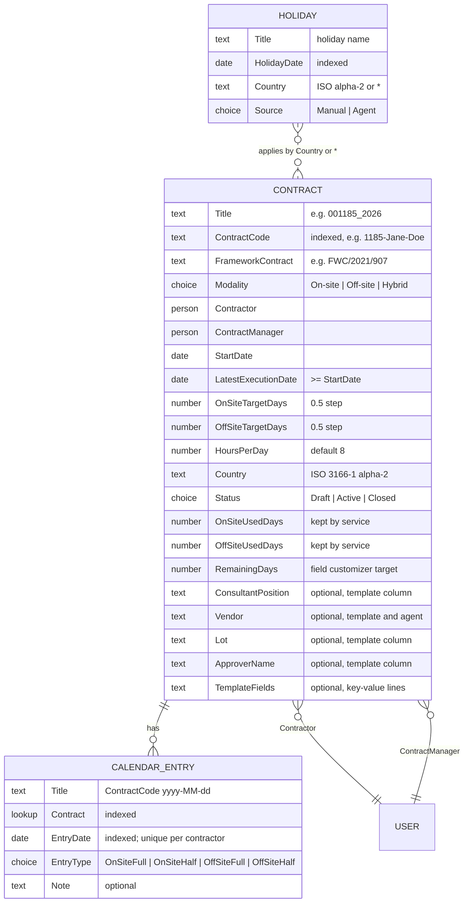
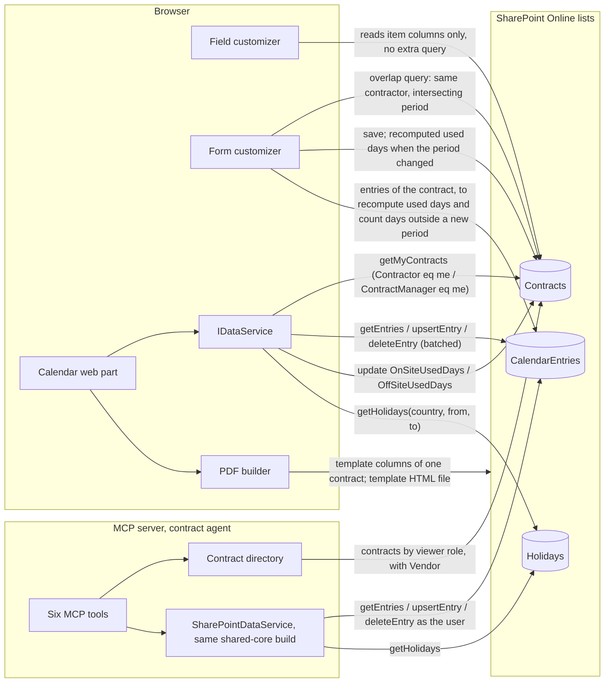

# Phase C — Data Architecture

Mutable document: list and column definitions change with the provisioning
script. Keep in step with `infra/provisioning`.

## 1. Entity model

## 2. SharePoint lists (design §6.2)

All three lists carry a dedicated content type so the web part's list picker
can offer only matching lists. All three stay at site-default permissions this
iteration (ADR-005); contractors therefore hold Contribute on Contracts too,
which is what lets the service keep the used-days columns current.

### 2.1 Contracts — content type `Orpheus Contract`

| Column | Type | Notes |
|--------|------|-------|
| Title | text | Specific contract number, e.g. `001185_2026` (display) |
| ContractCode | text, indexed | Short code used in folder/file names, e.g. `1185-Jane-Doe` |
| FrameworkContract | text | e.g. `FWC/2021/907` |
| Modality | choice | On-site / Off-site / Hybrid |
| Contractor | person | The consultant |
| ContractManager | person | The vendor/contract manager |
| StartDate | date | |
| LatestExecutionDate | date | Must be ≥ StartDate |
| OnSiteTargetDays | number (0.5 step) | |
| OffSiteTargetDays | number (0.5 step) | |
| HoursPerDay | number | Default 8; printed as `8.00` / `4.00` |
| Country | text | ISO 3166-1 alpha-2; selects which holidays apply |
| Status | choice | Draft / Active / Closed |
| OnSiteUsedDays | number | Kept up to date by the service on every entry write, and by the contract form when an edit changes the period, counting only entries inside the contract period (design §6.7) |
| OffSiteUsedDays | number | As above |
| RemainingDays | calculated/number | Created by the provisioning script; the field customizer is bound to it |

#### Optional columns (HTML template and contract agent)

Five optional columns feed the HTML timesheet template
([ADR-010](adr/0010-html-template-timesheet.md)); one of them, `Vendor`, is
also read by the contract agent ([ADR-013](adr/0013-vendor-column-and-hr-group-for-the-agent.md)).
They are not in the main site template (`template.xml`). Two separate
idempotent scripts add them: `infra/provisioning/Add-TimesheetTemplateColumns.ps1`
(all five) and `packages/mcp-contract-calendar/setup/Setup-AgentDemo.ps1`
(`Vendor` only). All are site columns in the group `Orpheus Systems` with
fixed IDs, added to the `Orpheus Contract` content type with `-UpdateChildren`.

| Column | Type | Display name | Notes |
|--------|------|--------------|-------|
| ConsultantPosition | text (255) | Consultant position | `{{contract.position}}` in a template |
| Vendor | text (255) | Vendor (service provider) | ID `{582b1c53-77a2-4a1b-918f-14e0b9eaff06}`; `{{contract.vendor}}` / `{{contract.serviceProvider}}` in a template; the agent groups and filters contracts by it |
| Lot | text (64) | Lot | `{{contract.lot}}` |
| ApproverName | text (255) | Approver name | `{{contract.approverName}}` |
| TemplateFields | note (6 lines, plain text) | Template fields | One `key: value` per line; `{{custom.<key>}}` in a template |

Both scripts create `Vendor` with the same ID, so whichever runs first creates
it and the other reports it unchanged. Each script stops before any write if
a name or ID clashes with a different column. The web part reads the columns
tolerantly: on a site without them the values are empty and everything else
works. Column details and the template syntax are in the
[timesheet template guide](../docs/timesheet-templates.md).

`Vendor` is free text, so spelling variants are separate vendors; the agent
matches a vendor filter case-insensitively. A Vendors list with a lookup
stays a later option ([ADR-013](adr/0013-vendor-column-and-hr-group-for-the-agent.md)).

### 2.2 CalendarEntries — content type `Orpheus Calendar Entry`

| Column | Type | Notes |
|--------|------|-------|
| Title | text | `<ContractCode> <yyyy-MM-dd>` for readability |
| Contract | lookup → Contracts, indexed | |
| EntryDate | date, indexed | One entry per contractor per date across all their contracts, enforced in the service (ADR-008) |
| EntryType | choice | OnSiteFull / OnSiteHalf / OffSiteFull / OffSiteHalf |
| Note | text, optional | |

### 2.3 Holidays — content type `Orpheus Holiday`

| Column | Type | Notes |
|--------|------|-------|
| Title | text | Holiday name |
| HolidayDate | date, indexed | |
| Country | text | ISO alpha-2; `*` = all countries |
| Source | choice | Manual / Agent (reserved for the future holiday agent) |

Weekends are not stored; the calendar treats Saturday/Sunday as blocked by
default (configurable per web part instance).

> ⚠️ **Open:** `RemainingDays` is described as "a calculated/number column";
> the design does not fix which, nor its formula if calculated (the field
> customizer reads the target and used columns itself, so the column may only
> need to exist as an anchor).

### 2.4 Security groups

| Group | Permission level | Created by | Meaning |
|-------|------------------|------------|---------|
| Site Owners | Full Control | SharePoint | Admin role in the web part ([ADR-005](adr/0005-web-part-filtering-over-item-level-permissions.md)) |
| `Orpheus HR` | Read | `Setup-AgentDemo.ps1` | HR role for the contract agent: sees all contracts, read only. Name configurable (`HR_GROUP`); the server matches the group title exactly, case-sensitive ([ADR-013](adr/0013-vendor-column-and-hr-group-for-the-agent.md)) |
| `Orpheus Contract Managers` | Contribute | `Provision-OrpheusSite.ps1` | Members get the ContractManager role and can create contracts. The owner maintains the members; provisioning never changes them. Exact title, case-sensitive. Contribute is granted at the web, so it applies site-wide to every list that inherits permissions, Holidays and CalendarEntries included; members can also read every contract in the list UI. Filtering is app-level only ([ADR-005](adr/0005-web-part-filtering-over-item-level-permissions.md)) |

Contractor and manager roles are not groups; they are derived from the
`Contractor` and `ContractManager` columns (ADR-005).

## 3. Derived values

| Value | Derivation |
|-------|------------|
| Used on-site days | Σ entries of a contract: OnSiteFull = 1, OnSiteHalf = 0.5 |
| Used off-site days | Σ entries of a contract: OffSiteFull = 1, OffSiteHalf = 0.5 |
| Remaining | Target − used, per category and total |
| Cell hours on PDF | Full = `HoursPerDay` printed `8.00`; half printed `4.00` |
| Per-month totals on PDF | Per month on-site, off-site, total; grand totals in the last row |

## 4. Data flows

The PDF builder reads the five optional template columns of the selected
contract and, when the web part has a template path, the template HTML file
from a site library, both with the viewer's permissions
([ADR-010](adr/0010-html-template-timesheet.md)). The MCP server reaches the
same lists with a delegated on-behalf-of token for the calling user
([ADR-011](adr/0011-custom-mcp-server-in-typescript.md),
[ADR-012](adr/0012-declarative-agent-entra-sso-obo.md)); all agent writes go
through `upsertEntry` / `deleteEntry`, so the ADR-008 invariants and the
used-days counters hold for agent writes too.

## 5. Local fixtures (`LocalDataService`)

Bundled JSON used in the workbench or when `useLocalData` is on. Minimum
content (design §6.3):

- one active contract;
- one bridge pair with a 2-week overlap;
- half days;
- a holiday set for `BG` and for `*`;
- two users (a contractor and a manager) selectable in the property pane.

Writes are in-memory. Fixture content beyond this minimum is left to the
builder.

The MCP server uses `LocalDataService` with the same fixtures in its unit
tests and in `DATA_MODE=local`, with demo vendors attached.

### 5.1 Seed and demo series on a tenant site

| Series | Created by | Content |
|--------|------------|---------|
| 001xxx (e.g. `001185_2026`) | `Provision-OrpheusSite.ps1 -SeedDemoData` | The web part's seed contracts. `Add-TimesheetTemplateColumns.ps1 -SeedDemoData` sets the template column values on `1185-Jane-Doe` only |
| 002xxx (e.g. `002101_2026`) | `Setup-AgentDemo.ps1` from `setup/demo-data.json` | Four contract agent demo contracts with vendors, their entries, and recomputed used days. The script reads and writes only 002xxx items and never touches 001xxx |

Demo people are passed to the agent setup script as UPN parameters and never
committed; vendor names in `demo-data.json` are fictional.

## 6. Data classification

| Entity | Classification | Note |
|--------|----------------|------|
| Contracts | Internal / personal data (names of contractor and manager, contract numbers) | Visibility filtered per role (ADR-005) |
| CalendarEntries | Internal / personal data (work pattern of a named person) | As above |
| Holidays | Internal, non-personal | Editable by site admin |
| Fixtures | Public (shipped in the repository) | Must be fictitious and must not resemble a real client |
| Template columns (`Vendor`, `Lot`, `ApproverName`, …) | Internal; `ApproverName` is personal data | Read with the viewer's permissions, printed on the timesheet |
| Timesheet template file | Internal | Edit rights only for site owners: an editor changes what appears on signed documents (ADR-010 R2) |
| Agent audit events | Internal / personal data (user `oid`, `upn`, SharePoint user id, tool arguments) | One JSON line per tool call; no prompt text ([ADR-014](adr/0014-three-layer-audit-for-agent-actions.md)) |

> ⚠️ **Open:** Retention, deletion and backup requirements are not stated; the
> design relies on SharePoint Online platform behaviour. GDPR handling of
> contractor names in a public demo tenant is not addressed.

## 7. Authoritative sources and keys

| Entity | Authoritative source | Natural key |
|--------|----------------------|-------------|
| Contract | Contracts list | `ContractCode` (indexed); `Title` for display |
| Calendar entry | CalendarEntries list | (`Contract`, `EntryDate`); plus the service-level rule (contractor, `EntryDate`) |
| Holiday | Holidays list, later also the agent | (`HolidayDate`, `Country`) |

## 8. Query patterns

- Reads use CAML/OData filters on indexed columns (`ContractCode`, `Contract`,
  `EntryDate`, `HolidayDate`; on Contracts also `Contractor`,
  `ContractManager` and `Status`, which the provisioning script indexes).
- Writes are batched (PnPjs v4 batching).
- The field customizer uses the list item's own columns only; no extra query
  per row.
- The timesheet PDF reads the five template columns of one contract by id
  (`getContractTemplateData`, `TEMPLATE_DATA_SELECT` in `shared-core`); a
  400 response (columns not provisioned) gives empty values.

Contract agent queries (`packages/mcp-contract-calendar`):

| Query | How |
|-------|-----|
| Contracts by viewer role, with `Vendor` | OData pre-filter by role: `ContractorId eq me`, `ContractManagerId eq me`, both combined with `or`, or no role filter for HR and site owners; `Status ne 'Closed'` unless closed contracts are asked for; optional `ContractManagerId eq <id>`. Select is the web part's `CONTRACT_SELECT` plus `Vendor` and the used-days columns. Every item is re-checked for visibility in memory |
| Vendor filter | In memory, case-insensitive, not in OData |
| Manager lookup by name or email | In memory over the managers of the contracts the caller can see: exact email, exact display name, or one word of the display name. Several matches return `needs_choice` |
| Calendar, holidays, writes | `SharePointDataService` (`getEntries`, `getHolidays`, `upsertEntry`, `deleteEntry`), unchanged |
| Setup script | Contracts with `startswith(Title,'002')`, so 001xxx items are never fetched |

Indexes: `Title` and `Vendor` are not indexed. The setup script's
`startswith` filter on `Title`, and vendor filtering if it moves into OData,
will need an index once Contracts grows past the list view threshold.

Known risk: `SharePointDataService.upsertEntry` deletes the sibling entry
(ADR-008) and adds the new one in one batch, but the batch is not
transactional. The delete can succeed while the add fails, which leaves the
day empty. This affects the web part and the agent; `book_days` reports such a
day as failed. The fix belongs in `shared-core` (add first, or verify and
restore). Recorded as R-AGT-1 in
[ADR-011](adr/0011-custom-mcp-server-in-typescript.md).
