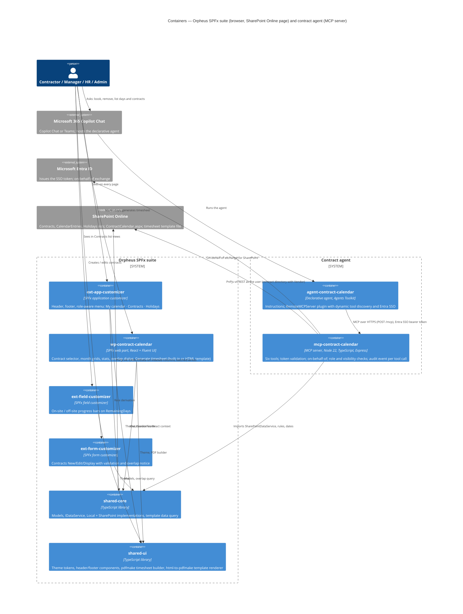

# Phase C — Application Architecture

## 1. Architectural style

A modular monorepo of SPFx solutions sharing two library packages. The SPFx
suite runs in the browser inside SharePoint Online pages and has no
server-side component; that includes the HTML template timesheet, which is
rendered client-side ([ADR-010](adr/0010-html-template-timesheet.md)). One
data access seam (`IDataService`) separates UI from storage (ADR-003).

The contract agent adds the one server component: an MCP server
(`mcp-contract-calendar`, Node 22) behind a declarative agent in Microsoft 365
Copilot Chat ([ADR-011](adr/0011-custom-mcp-server-in-typescript.md),
[ADR-012](adr/0012-declarative-agent-entra-sso-obo.md)). It imports
`shared-core` and writes through the same `IDataService` implementation as
the web part, so both channels enforce the same booking rules from the same
code. ADR-011 to ADR-015 were accepted after the live check on the dev tenant
(2026-10-23); ADR-016, the Azure production target, stays Proposed.

## 2. Package catalog (design §4)

| Package | npm name | Kind | Responsibility |
|---------|----------|------|----------------|
| `packages/shared-core` | `@orpheussystems/shared-core` | library | Models, `IDataService`, `LocalDataService`, `SharePointDataService`, period / overlap / totals logic |
| `packages/shared-ui` | `@orpheussystems/shared-ui` | library | Orpheus theme tokens, header/footer components, PDF renderer (`shared-ui/pdf`) |
| `packages/ext-app-customizer` | `@orpheussystems/ext-app-customizer` | SPFx application customizer | Header and footer placeholders, role-aware menu |
| `packages/wp-contract-calendar` | `@orpheussystems/wp-contract-calendar` | SPFx web part | Calendar, stats, overlap dialog, timesheet generation |
| `packages/ext-field-customizer` | `@orpheussystems/ext-field-customizer` | SPFx field customizer | Remaining-days bars on the Contracts list |
| `packages/ext-form-customizer` | `@orpheussystems/ext-form-customizer` | SPFx form customizer | New / Edit / Display forms for Contracts |
| `packages/mcp-contract-calendar` | `@orpheussystems/mcp-contract-calendar` | MCP server, Node 22, TypeScript | Action layer of the contract agent: six tools over stateless Streamable HTTP, Entra token validation, on-behalf-of to SharePoint, audit event per tool call ([README](../packages/mcp-contract-calendar/README.md)) |
| `packages/agent-contract-calendar` | `@orpheussystems/agent-contract-calendar` | Declarative agent (Agents Toolkit project, no dependencies, no build) | "Contract Calendar" agent manifest, instructions and `RemoteMCPServer` plugin with Entra SSO ([README](../packages/agent-contract-calendar/README.md)) |

Build order via TypeScript project references: `shared-core` → `shared-ui` →
the four SPFx packages; `mcp-contract-calendar` builds after `shared-core`
(`npm run build:shared` first). The agent package is provisioned by the
Agents Toolkit, not built. Each SPFx package stays a standard Yeoman-generated
project; shared packages are added via workspace symlinks and path mapping in
`tsconfig.base.json`. No prior-employer identifiers (design §8) remain anywhere.

## 3. Container view



The agent path is Copilot Chat → declarative agent → MCP server →
SharePoint. The server never uses app-only access; every SharePoint call
carries the calling user's delegated token
([ADR-012](adr/0012-declarative-agent-entra-sso-obo.md)).

## 4. Data access layer — `IDataService` (design §6.3)

```ts
interface IDataService {
  getMyContracts(): Promise<Contract[]>;            // role-filtered, see security model
  getEntries(contractId, from, to): Promise<CalendarEntry[]>;
  upsertEntry(entry): Promise<CalendarEntry>;
  deleteEntry(contractId, date): Promise<void>;
  getHolidays(country, from, to): Promise<Holiday[]>;
  getCurrentUser(): Promise<UserInfo>;
}
```

| Implementation | Selected when | Behaviour |
|----------------|---------------|-----------|
| `LocalDataService` | `Environment.type === Local` (workbench) or web part property `useLocalData` is on | Bundled JSON fixtures; in-memory writes; demo user (contractor or manager) chosen in the property pane |
| `SharePointDataService` | Otherwise | PnPjs v4 against the three lists chosen in the property pane; CAML/OData filters on indexed columns; batched writes; keeps `OnSiteUsedDays` / `OffSiteUsedDays` current |

Service selection happens once in the web part's `onInit` and is injected into
the React tree via context. No component talks to SharePoint directly.

Service-level invariants: one entry per contractor per date across all their
contracts (ADR-008); `upsertEntry` on a date already held by another of the
contractor's contracts moves the entry.

The MCP server is a third consumer of `IDataService`. Per request it creates a
`SharePointDataService` from an `SPFI` built with the user's on-behalf-of
token, and it uses `LocalDataService` in its unit tests and in
`DATA_MODE=local`. Every agent write goes through `upsertEntry` /
`deleteEntry`, so the invariants above hold for agent writes too
([ADR-011](adr/0011-custom-mcp-server-in-typescript.md)).

## 5. Component descriptions

### 5.1 Calendar web part — `wp-contract-calendar` (design §6.4)

Behaviour rebuilt in React with Fluent UI from `docs/mocks/onsite_calendar.html`.

**Property pane**

| Property | Default | Note |
|----------|---------|------|
| Contracts / CalendarEntries / Holidays list pickers | — | Filtered by content type |
| `useLocalData` | off | Forces `LocalDataService` |
| Demo user | contractor | Local only |
| Months to show | Contract span, capped at 12 | |
| Treat weekends as blocked | on | |
| Approving-organisation label | "Client approval" | Printed on the third signature box |
| Service-provider label | "Service provider" | Printed on the second signature box |
| Timesheet template (optional) (`timesheetTemplateUrl`) | empty | Site-relative or server-relative path to an `.html` / `.htm` file on the site; empty means the built-in layout ([ADR-010](adr/0010-html-template-timesheet.md)) |

**UI**

- Header: contract selector (only contracts the user may see), contract
  metadata strip in the same order as the PDF header, targets and remaining.
- Selection type radio: on-site full / half, off-site full / half.
- Month grids, Monday-first; holidays and weekends blocked; click toggles the
  selected type on the day; clicking a day already holding the same type
  removes it; a day in an overlap window opens a choice ("Count against
  001185_2026 or 001186_2027?") before saving.
- Stats panel: full / half counts, used vs target, remaining, warning colour
  when over target.
- Managers get the same view read-only plus **Generate timesheet**;
  contractors also get the button (builder's call, recommended yes).
- All writes go through `IDataService`; optimistic UI with rollback on error.
- The page honours a `contractId` query parameter for deep links.

Mock behaviours carried over: Monday-first grid offset; toggle-off on same
type; half = 0.5, full = 1; "good" vs "warning" colouring of remaining;
blocked days are not clickable. Mock behaviours **not** carried over:
localStorage persistence (replaced by `IDataService`), JSON export, editable
targets in the UI (targets come from the contract).

### 5.2 Timesheet PDF — `shared-ui/pdf` (design §6.5)

Client-side with pdfmake (ADR-004). Landscape A4, one page per 12 months.

- Row 1: Framework contract · Modality · Specific contract · Starting date ·
  SC latest execution date · Consultant days on-site · off-site · total.
- Row 2: SC days on-site · off-site · total · Remaining on-site · off-site ·
  total. "Consultant days" and "SC days" print the same numbers under two
  labels — by design. Remaining is as of the end of the selected period: the
  target minus all in-contract days up to that date, including days before the
  period.
- Grid: one row per month in the period, columns 1–31, cell text is hours
  (`8.00` full, `4.00` half); fill blue `#9DC3E6` for on-site, yellow
  `#E8DB9C` for off-site, empty when not worked, grey for holidays/weekends;
  right-hand columns per-month on-site, off-site, total; grand totals in the
  last row. Header labels grey `#7F7F7F`, values `#262626`, Segoe UI /
  Calibri-like sans.
- Footer: three signature boxes — "Signature of consultant", "Signature of
  service provider", `<approving-organisation label>`.
- Period defaults to the full contract span; the dialog allows trimming.
  Output `Timesheet_<ContractCode>_<from>_<to>.pdf`.
- Saving to a document library is a documented extension point, not built.

**HTML template** ([ADR-010](adr/0010-html-template-timesheet.md),
[authoring guide](../docs/timesheet-templates.md)). When the web part
property `Timesheet template (optional)` holds a path, the page layout comes
from an HTML file stored on the site instead of the built-in layout:

- The file is fetched on every generation, with no cache, using the viewer's
  permissions, so it must be readable by every web part user and editable
  only by site owners.
- Placeholders `{{contract.*}}`, `{{contractor.*}}`, `{{period.*}}`,
  `{{totals.*}}`, `{{labels.*}}`, `{{generatedOn}}` and `{{custom.<key>}}`
  insert text. Blocks `{{grid}}`, `{{grid.days}}`, `{{totals}}`, `{{header}}`
  and `{{signatures}}` are generated by the same code as the built-in PDF and
  swapped in, so a template cannot break the grid or the numbers.
- The filled HTML is converted with html-to-pdfmake into the same pdfmake
  pipeline. Only its HTML subset works (inline `style`, no `<style>` blocks,
  no scripts); Roboto is the only font; images are PNG/JPEG from the same site
  or `data:` URLs, SVG inline.
- The five optional contract columns (`ConsultantPosition`, `Vendor`, `Lot`,
  `ApproverName`, `TemplateFields`; see
  [Phase C data, §2.1](03-phase-c-data-architecture.md)) supply the extra
  values and are read tolerantly.
- The Orpheus attribution line is appended to every template-rendered PDF.
- A broken template gives no fallback to the built-in layout: the user sees
  the error list and nothing is downloaded.
- html-to-pdfmake loads only in the lazy `orpheus-timesheet-pdf` chunk with
  pdfmake. The built-in layout's doc definition is unchanged and guarded by a
  golden test.

### 5.3 Application customizer — `ext-app-customizer` (design §6.6, §6.9)

- Top placeholder: dark bar `#0B0D10`, Orpheus mark + "**Orpheus** Systems"
  wordmark left, right-aligned menu. Items come from
  `ClientSideComponentProperties` JSON (label, url, roles); default set
  **My calendar · Contracts · Holidays** ("Reports" dropped; timesheet is
  generated from the calendar page). Items whose `roles` exclude the current
  user's role are hidden.
- Bottom placeholder: same palette, small-caps amber kicker ("SOFTWARE
  ARCHITECTURE CONSULTANCY · SOFIA, BULGARIA · EU"), support mail link
  `kiril.iliev@orpheussystems.com`, solution version from the manifest.
- Properties also carry the relative URLs of the Contracts list (for role
  derivation) and the calendar page; the provisioning script writes them.

> ⚠️ **Open:** Final wording of the footer kicker, and whether the Orpheus
> logo SVG is available or must be redrawn (design §11).

### 5.4 Field customizer — `ext-field-customizer` (design §6.7)

Bound at deployment to `RemainingDays` on Contracts. Renders two slim progress
bars (on-site and off-site used vs target) with the remaining number as text;
amber at ≥ 80 % used, red when over. Reads `OnSiteTargetDays`,
`OffSiteTargetDays`, `OnSiteUsedDays`, `OffSiteUsedDays` from the item itself.

### 5.5 Form customizer — `ext-form-customizer` (design §6.8)

Replaces New / Edit / Display forms of Contracts.

- Two-column Fluent UI layout; people pickers for contractor and manager;
  modality dropdown; date pickers.
- Validation: `ContractCode` regex `^\d{4}-[A-Za-z]+(-[A-Za-z]+)*$`
  (configurable in component properties); `LatestExecutionDate` ≥
  `StartDate`; targets ≥ 0 in 0.5 steps.
- Overlap detection on save: non-blocking notice with Continue / Cancel.
- Display form: same layout read-only plus a "Generate timesheet" link that
  opens the calendar page with the contract preselected.

### 5.6 Contract agent — `agent-contract-calendar` and `mcp-contract-calendar`

Contractors book and remove days, and contract managers and HR read
contracts grouped by vendor, by talking to the "Contract Calendar" agent in
Copilot Chat ([ADR-011](adr/0011-custom-mcp-server-in-typescript.md),
[ADR-012](adr/0012-declarative-agent-entra-sso-obo.md)).

**Declarative agent** ([README](../packages/agent-contract-calendar/README.md)).
Manifest-only Agents Toolkit project: app manifest, declarative agent
manifest, instructions (`instruction.txt`) and one action, a
`RemoteMCPServer` plugin (manifest v2.4) with dynamic tool discovery
(`functions` empty, `run_for_functions: ["*"]`) and Entra SSO. Copilot reads
the tool list and schemas from the server at runtime, so the package does not
change when a tool changes. The instructions require one confirmation before
`book_days` and `remove_days`.

**MCP server** ([README](../packages/mcp-contract-calendar/README.md)).
Express app on port 8787 with stateless Streamable HTTP: `POST /mcp` for MCP
requests, `GET /healthz` for liveness, `GET` / `DELETE /mcp` return 405. It
reuses `shared-core` (`SharePointDataService`, `deriveRoles`, `rules.ts`,
`dates.ts`) unchanged and adds only what the web part lacks: role and
visibility checks for the agent's users including HR, the vendor read side,
range orchestration, and the audit event.

| Tool | Who | What |
|------|-----|------|
| `get_my_contracts` | all | The caller's visible contracts with vendor, period, used and remaining days, plus the caller's roles and today's date |
| `list_contracts` (`vendor?`, `manager?`, `includeClosed?`) | managers, HR, admins | Contracts grouped by vendor; `manager` takes a name or email; several matching people give `needs_choice` |
| `get_calendar` (`contractId`, `from`, `to`) | all, within visibility | Entries, holidays, totals and remaining days of one contract (max 366 days) |
| `book_days` (`from`, `to`, `type?`, `contractId?`, `note?`) | contractors | Books business days, max 31 per call; weekends, holidays and days outside the contract are skipped and reported; an overlap day without `contractId` returns `needs_choice` and writes nothing; per-day result `booked`, `skipped`, `failed` |
| `remove_days` (`from`, `to`, `contractId`) | contractors | Removes days from one own active contract; days without an entry come back as `notFound` |
| `get_holidays` (`country`, `from`, `to`) | all | Public holidays of a country (max 366 days) |

With six tools the plugin stays under Microsoft's guidance of at most ten. Tool errors
come back as MCP tool results with `isError` and a code (`not_found`,
`forbidden`, `invalid_input`, `internal`). Run modes combine `AUTH_MODE`
(`entra` default, or `none`) and `DATA_MODE` (`sharepoint` default, or
`local`); `none` with `sharepoint` is rejected at start-up.

The contract agent does not maintain holidays; it only reads them. The
holiday agent (RM-1 in Phase E) stays a separate item.

## 6. Security model (design §7)

- Role derived at runtime: `Contractor` on ≥ 1 contract → contractor;
  `ContractManager` on ≥ 1 contract, or a member of `Orpheus Contract
  Managers` → manager; a site collection admin (`IsSiteAdmin`) or a member of
  the associated Owners group → admin. Roles can combine. If any role read
  fails, derivation rejects (fail closed): the header shows no role links, the
  form allows no editing, the web part shows an error and the agent rejects
  the request.
- All visibility is filtered in the web part / data service: contractors get
  `Contractor eq me`, managers `ContractManager eq me`. Agreed sufficient for
  now (ADR-005).
- Documented later option, not built: per-item permission breaking on
  Contracts and CalendarEntries via provisioning-time event receiver or
  Power Automate, plus a read-restricted view for the lists. Recorded as risk
  R-SEC-1 with this mitigation path.
- Authentication is SharePoint Online's own; no additional identity provider.

**Contract agent** ([ADR-012](adr/0012-declarative-agent-entra-sso-obo.md),
[ADR-013](adr/0013-vendor-column-and-hr-group-for-the-agent.md)):

- Identity: Copilot sends an Entra SSO token for the server's Application ID
  URI. The server validates it itself (jose, RS256; issuer pinned to the
  tenant in v1 and v2 forms; audience equal to the Application ID URI or
  client id) and exchanges it on behalf of the user (msal-node) for a
  delegated SharePoint token with `AllSites.Write`. No app-only access; the
  provisioning app registration is not reused. A consent or interaction
  error returns 401 with `WWW-Authenticate: Bearer`, so Copilot shows the
  sign-in prompt.
- HR role: members of the SharePoint group `Orpheus HR` (Read; name set by
  `HR_GROUP`, exact case-sensitive title match) see all contracts, read only.
  The HR role exists only in the agent, not in the web part.
- Visibility is the web part's: a contractor sees own contracts, a manager
  managed ones, HR and site owners all, a user with no role nothing. The
  server enforces it itself: an OData pre-filter plus an in-memory re-check
  of every item.
- Server-side write check: only the contract's contractor can book or remove
  days. Anyone else, managers, HR and admins included, gets `forbidden` from
  the server, not only from the agent instructions.
- Confirmation: with dynamic tool discovery the plugin manifest carries no
  per-function confirmation hint for the write tools (R-AGT-6). Mitigated by
  the agent instructions (one confirmation before `book_days` /
  `remove_days`), the server-side write check, and MCP tool annotations set by
  the server: `readOnlyHint: true` on the four read tools,
  `destructiveHint: false` on `book_days`, `destructiveHint: true` on
  `remove_days`. Copilot reads these to decide when to confirm.
- The contractor Contribute-on-Contracts gap (R-SEC-1) is unchanged by the
  agent; the server, like the web part, is what stops a contractor editing a
  contract.
- Audit: three layers, Purview `CopilotInteraction`, SharePoint `ListItem*`
  records with the real user as actor, and one JSON audit line per tool call
  from the server ([ADR-014](adr/0014-three-layer-audit-for-agent-actions.md)).

> ⚠️ **Open:** Guest contractors are not verified with declarative agents and
> Copilot Chat (R-AGT-4). This can block the channel for contractors who are
> guest users.

## 7. Integration points

| From | To | Mechanism |
|------|----|-----------|
| `SharePointDataService` | SharePoint lists | PnPjs v4 REST |
| Form customizer Display form | Calendar page | Link with `contractId` query parameter |
| Application customizer menu | Calendar page, lists | Relative URLs from component properties |
| Provisioning script | Customizers | Writes `ClientSideComponentProperties`, binds field and content type |
| Web part PDF builder | Timesheet template file and its images on the site | PnPjs `getFileByServerRelativePath` with the viewer's permissions, on every generation ([ADR-010](adr/0010-html-template-timesheet.md)) |
| Web part PDF builder | Contracts (template columns) | `getContractTemplateData` in `shared-core`, one item by id |
| Copilot Chat (declarative agent) | MCP server | MCP over HTTPS, stateless Streamable HTTP `POST /mcp`, Entra SSO bearer token ([ADR-012](adr/0012-declarative-agent-entra-sso-obo.md)) |
| MCP server | Microsoft Entra ID | On-behalf-of exchange (msal-node) for a delegated SharePoint token |
| MCP server | SharePoint lists | PnPjs v4 REST as the user, through `SharePointDataService` and the server's contract directory |
| MCP server | Audit sink | One JSON line per tool call to stdout or `AUDIT_LOG_PATH`; Log Analytics in the Azure target ([ADR-014](adr/0014-three-layer-audit-for-agent-actions.md)) |

## 8. Left to the builder (design §9)

- Exact Fluent UI component choices and CSS module structure.
- pdfmake vs jsPDF if bundle size exceeds SPFx guidance.
- Contractor access to **Generate timesheet** (recommended yes).
- Fixture content beyond the minimum.
- Test strategy details: unit tests for the data services, the period /
  overlap / totals logic and the PDF model builder expected; UI snapshot tests
  optional.
