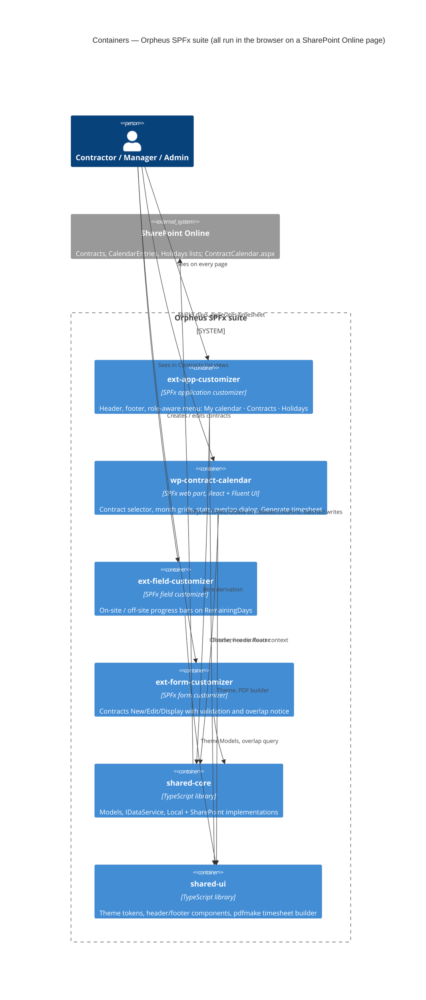

# Phase C — Application Architecture

## 1. Architectural style

A modular monorepo of SPFx solutions sharing two library packages. Everything
runs in the browser inside SharePoint Online pages; there is no server-side
component. One data access seam (`IDataService`) separates UI from storage
(ADR-003).

## 2. Package catalog (design §4)

| Package | npm name | Kind | Responsibility |
|---------|----------|------|----------------|
| `packages/shared-core` | `@orpheussystems/shared-core` | library | Models, `IDataService`, `LocalDataService`, `SharePointDataService`, period / overlap / totals logic |
| `packages/shared-ui` | `@orpheussystems/shared-ui` | library | Orpheus theme tokens, header/footer components, PDF renderer (`shared-ui/pdf`) |
| `packages/ext-app-customizer` | `@orpheussystems/ext-app-customizer` | SPFx application customizer | Header and footer placeholders, role-aware menu |
| `packages/wp-contract-calendar` | `@orpheussystems/wp-contract-calendar` | SPFx web part | Calendar, stats, overlap dialog, timesheet generation |
| `packages/ext-field-customizer` | `@orpheussystems/ext-field-customizer` | SPFx field customizer | Remaining-days bars on the Contracts list |
| `packages/ext-form-customizer` | `@orpheussystems/ext-form-customizer` | SPFx form customizer | New / Edit / Display forms for Contracts |

Build order via TypeScript project references: `shared-core` → `shared-ui` →
the four SPFx packages. Each SPFx package stays a standard Yeoman-generated
project; shared packages are added via workspace symlinks and path mapping in
`tsconfig.base.json`. No prior-employer identifiers (design §8) remain anywhere.

## 3. Container view



## 4. Data access layer — `IDataService` (design §6.3)

```ts
interface IDataService {
  getMyContracts(): Promise<Contract[]>;            // role-filtered, see security model
  getEntries(contractId, from, to): Promise<CalendarEntry[]>;
  upsertEntry(entry): Promise<CalendarEntry>;
  deleteEntry(contractId, date): Promise<void>;
  getHolidays(country, from, to): Promise<Holiday[]>;
  getCurrentUser(): Promise<UserInfo>;
}
```

| Implementation | Selected when | Behaviour |
|----------------|---------------|-----------|
| `LocalDataService` | `Environment.type === Local` (workbench) or web part property `useLocalData` is on | Bundled JSON fixtures; in-memory writes; demo user (contractor or manager) chosen in the property pane |
| `SharePointDataService` | Otherwise | PnPjs v4 against the three lists chosen in the property pane; CAML/OData filters on indexed columns; batched writes; keeps `OnSiteUsedDays` / `OffSiteUsedDays` current |

Service selection happens once in the web part's `onInit` and is injected into
the React tree via context. No component talks to SharePoint directly.

Service-level invariants: one entry per contractor per date across all their
contracts (ADR-008); `upsertEntry` on a date already held by another of the
contractor's contracts moves the entry.

## 5. Component descriptions

### 5.1 Calendar web part — `wp-contract-calendar` (design §6.4)

Behaviour rebuilt in React with Fluent UI from `docs/mocks/onsite_calendar.html`.

**Property pane**

| Property | Default | Note |
|----------|---------|------|
| Contracts / CalendarEntries / Holidays list pickers | — | Filtered by content type |
| `useLocalData` | off | Forces `LocalDataService` |
| Demo user | contractor | Local only |
| Months to show | Contract span, capped at 12 | |
| Treat weekends as blocked | on | |
| Approving-organisation label | "Client approval" | Printed on the third signature box |
| Service-provider label | "Service provider" | Printed on the second signature box |

**UI**

- Header: contract selector (only contracts the user may see), contract
  metadata strip in the same order as the PDF header, targets and remaining.
- Selection type radio: on-site full / half, off-site full / half.
- Month grids, Monday-first; holidays and weekends blocked; click toggles the
  selected type on the day; clicking a day already holding the same type
  removes it; a day in an overlap window opens a choice ("Count against
  001185_2026 or 001186_2027?") before saving.
- Stats panel: full / half counts, used vs target, remaining, warning colour
  when over target.
- Managers get the same view read-only plus **Generate timesheet**;
  contractors also get the button (builder's call, recommended yes).
- All writes go through `IDataService`; optimistic UI with rollback on error.
- The page honours a `contractId` query parameter for deep links.

Mock behaviours carried over: Monday-first grid offset; toggle-off on same
type; half = 0.5, full = 1; "good" vs "warning" colouring of remaining;
blocked days are not clickable. Mock behaviours **not** carried over:
localStorage persistence (replaced by `IDataService`), JSON export, editable
targets in the UI (targets come from the contract).

### 5.2 Timesheet PDF — `shared-ui/pdf` (design §6.5)

Client-side with pdfmake (ADR-004). Landscape A4, one page per 12 months.

- Row 1: Framework contract · Modality · Specific contract · Starting date ·
  SC latest execution date · Consultant days on-site · off-site · total.
- Row 2: SC days on-site · off-site · total · Remaining on-site · off-site ·
  total. "Consultant days" and "SC days" print the same numbers under two
  labels — by design.
- Grid: one row per month in the period, columns 1–31, cell text is hours
  (`8.00` full, `4.00` half); fill blue `#9DC3E6` for on-site, yellow
  `#E8DB9C` for off-site, empty when not worked, grey for holidays/weekends;
  right-hand columns per-month on-site, off-site, total; grand totals in the
  last row. Header labels grey `#7F7F7F`, values `#262626`, Segoe UI /
  Calibri-like sans.
- Footer: three signature boxes — "Signature of consultant", "Signature of
  service provider", `<approving-organisation label>`.
- Period defaults to the full contract span; the dialog allows trimming.
  Output `Timesheet_<ContractCode>_<from>_<to>.pdf`.
- Saving to a document library is a documented extension point, not built.

### 5.3 Application customizer — `ext-app-customizer` (design §6.6, §6.9)

- Top placeholder: dark bar `#0B0D10`, Orpheus mark + "**Orpheus** Systems"
  wordmark left, right-aligned menu. Items come from
  `ClientSideComponentProperties` JSON (label, url, roles); default set
  **My calendar · Contracts · Holidays** ("Reports" dropped; timesheet is
  generated from the calendar page). Items whose `roles` exclude the current
  user's role are hidden.
- Bottom placeholder: same palette, small-caps amber kicker ("SOFTWARE
  ARCHITECTURE CONSULTANCY · SOFIA, BULGARIA · EU"), support mail link
  `kiril.iliev@orpheussystems.com`, solution version from the manifest.
- Properties also carry the relative URLs of the Contracts list (for role
  derivation) and the calendar page; the provisioning script writes them.

> ⚠️ **Open:** Final wording of the footer kicker, and whether the Orpheus
> logo SVG is available or must be redrawn (design §11).

### 5.4 Field customizer — `ext-field-customizer` (design §6.7)

Bound at deployment to `RemainingDays` on Contracts. Renders two slim progress
bars (on-site and off-site used vs target) with the remaining number as text;
amber at ≥ 80 % used, red when over. Reads `OnSiteTargetDays`,
`OffSiteTargetDays`, `OnSiteUsedDays`, `OffSiteUsedDays` from the item itself.

### 5.5 Form customizer — `ext-form-customizer` (design §6.8)

Replaces New / Edit / Display forms of Contracts.

- Two-column Fluent UI layout; people pickers for contractor and manager;
  modality dropdown; date pickers.
- Validation: `ContractCode` regex `^\d{4}-[A-Za-z]+(-[A-Za-z]+)*$`
  (configurable in component properties); `LatestExecutionDate` ≥
  `StartDate`; targets ≥ 0 in 0.5 steps.
- Overlap detection on save: non-blocking notice with Continue / Cancel.
- Display form: same layout read-only plus a "Generate timesheet" link that
  opens the calendar page with the contract preselected.

## 6. Security model (design §7)

- Role derived at runtime: `Contractor` on ≥ 1 contract → contractor;
  `ContractManager` → manager; site Owners group member → admin. Roles can
  combine.
- All visibility is filtered in the web part / data service: contractors get
  `Contractor eq me`, managers `ContractManager eq me`. Agreed sufficient for
  now (ADR-005).
- Documented later option, not built: per-item permission breaking on
  Contracts and CalendarEntries via provisioning-time event receiver or
  Power Automate, plus a read-restricted view for the lists. Recorded as risk
  R-SEC-1 with this mitigation path.
- Authentication is SharePoint Online's own; no additional identity provider.

## 7. Integration points

| From | To | Mechanism |
|------|----|-----------|
| `SharePointDataService` | SharePoint lists | PnPjs v4 REST |
| Form customizer Display form | Calendar page | Link with `contractId` query parameter |
| Application customizer menu | Calendar page, lists | Relative URLs from component properties |
| Provisioning script | Customizers | Writes `ClientSideComponentProperties`, binds field and content type |

## 8. Left to the builder (design §9)

- Exact Fluent UI component choices and CSS module structure.
- pdfmake vs jsPDF if bundle size exceeds SPFx guidance.
- Contractor access to **Generate timesheet** (recommended yes).
- Fixture content beyond the minimum.
- Test strategy details: unit tests for the data services, the period /
  overlap / totals logic and the PDF model builder expected; UI snapshot tests
  optional.
