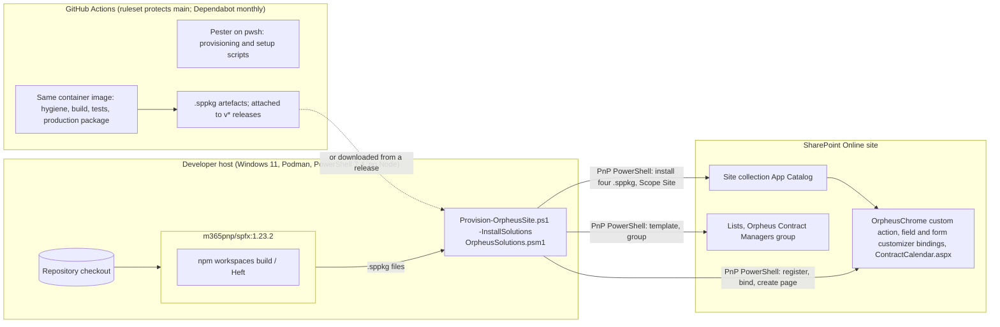
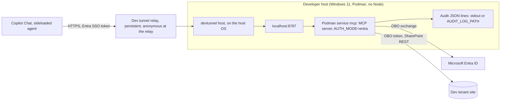

# Phase D — Technology Architecture

Mutable document: versions and services change with the toolchain. Keep in
step with `compose.yml`, `.devcontainer/` and `.github/workflows/ci.yml`.

## 1. Technology stack

| Layer | Technology | Version / note | ADR |
|-------|------------|----------------|-----|
| Hosting | SharePoint Online | Only target; no on-premises | — |
| Framework | SharePoint Framework | 1.23.2 (1.24 is RC only as of 2026-10-22) | ADR-001 |
| Language | TypeScript | Per the SPFx 1.23 toolchain | ADR-001 |
| Runtime (build) | Node | 22.14+ inside the container only | ADR-002 |
| Container image | `docker.io/m365pnp/spfx:1.23.2` (https://github.com/pnp/docker-spfx) | Run with Podman 6.1.4 on the host | ADR-002 |
| Package manager | npm workspaces | Existing convention | ADR-001 |
| Data access | PnPjs v4 (`@pnp/sp` 4.22) | | ADR-003 |
| UI | Fluent UI React, version shipped with SPFx 1.23 | Orpheus theme tokens over it | — |
| PDF | pdfmake; fallback jsPDF + autotable | | ADR-004 |
| PDF from an HTML template | html-to-pdfmake 2.5 | In the lazy `orpheus-timesheet-pdf` chunk with pdfmake, never in the main bundle | [ADR-010](adr/0010-html-template-timesheet.md) |
| Provisioning | PnP PowerShell 3 on PowerShell 7.4 (host), Pester tests | `Provision-OrpheusSite.ps1` + PnP site template + `OrpheusSolutions.psm1` (`-InstallSolutions`); `Add-TimesheetTemplateColumns.ps1` for the optional template columns | ADR-006, [ADR-010](adr/0010-html-template-timesheet.md) |
| Agent setup | PnP PowerShell 3 on PowerShell 7.4 (host), Pester tests | `Setup-AgentDemo.ps1`: `Vendor` column, `Orpheus HR` group, 002xxx demo data | [ADR-013](adr/0013-vendor-column-and-hr-group-for-the-agent.md) |
| Agent server runtime | Node 22, TypeScript | In the same `m365pnp/spfx` container image (`mcp` compose service); no Node on the host | [ADR-011](adr/0011-custom-mcp-server-in-typescript.md), ADR-002 |
| MCP | MCP TypeScript SDK (`@modelcontextprotocol/sdk` 1.x), zod 3.25 | Stateless Streamable HTTP; tools registered through a loosely typed wrapper | [ADR-011](adr/0011-custom-mcp-server-in-typescript.md) |
| HTTP | Express 5 | `POST /mcp`, `GET /healthz` | [ADR-011](adr/0011-custom-mcp-server-in-typescript.md) |
| Token validation | jose 6 | RS256, tenant issuer, audience | [ADR-012](adr/0012-declarative-agent-entra-sso-obo.md) |
| On-behalf-of | msal-node 3 (`@azure/msal-node`) | Delegated SharePoint `AllSites.Write` | [ADR-012](adr/0012-declarative-agent-entra-sso-obo.md) |
| Server data access | PnPjs v4 with `@pnp/nodejs` | Same `shared-core` build as the web part | [ADR-011](adr/0011-custom-mcp-server-in-typescript.md) |
| Agent | Microsoft 365 Agents Toolkit (VS Code extension or CLI) | Declarative agent manifest v1.8, app manifest 1.30, plugin manifest v2.4, `m365agents.yml` | [ADR-012](adr/0012-declarative-agent-entra-sso-obo.md) |
| Agent tunnel (demo) | Microsoft dev tunnels (`devtunnel` CLI on the host) | Persistent tunnel to port 8787 | [ADR-015](adr/0015-dev-tunnel-for-the-agent-demo.md) |
| Agent hosting (target, not built) | Azure API Management, Container Apps, Key Vault, Log Analytics, Container Registry; Terraform | See §3.2 | [ADR-016](adr/0016-azure-target-apim-container-apps-terraform.md) |
| CI | GitHub Actions, Dependabot, repository ruleset | `ci.yml` / `build.yml`: hygiene scan, build, tests, production package in the same container image, Pester on pwsh; uploads `.sppkg` artefacts; `release.yml` attaches them to `v*` releases. Dependabot (GitHub Actions) monthly; a ruleset protects `main`. See `docs/ci.md` | — |
| Editor | VS Code dev container | `.devcontainer/devcontainer.json` reuses the same image | ADR-002 |
| Source control | Git, public GitHub `orpheussystems/sharepoint` | Fresh orphan branch | ADR-007 |
| Licence | Apache-2.0 with NOTICE, © 2026 Orpheus Systems | | — |

## 2. Developer environment and Podman workflow (design §5)

`compose.yml` defines one image and these services, all mounting the
repo at `/usr/app/spfx` and the npm cache as a named volume:

| Service | What it does |
|---------|--------------|
| `shell` | Interactive bash in the container |
| `install` | `npm ci` for the whole workspace |
| `build` | `npm run build` (all packages, dev) |
| `serve` | `npm run serve` (`heft --unmanaged start --clean --nobrowser`) for one package; ports 4321/35729 exposed; package chosen via `PKG` env |
| `package` | `npm run package` producing every `.sppkg` (`--ship`) |
| `mcp` | `npm run start -w @orpheussystems/mcp-contract-calendar`; port 8787 published; reads `packages/mcp-contract-calendar/.env` if present. Runs from the main checkout with the default compose project |

Node memory caps: the MCP SDK's zod-driven generics once pushed `tsc` to about
4.2 GB and crashed the host. Every Node run in the container for the server
is capped with `NODE_OPTIONS=--max-old-space-size=1536`, a `timeout` around
the command, and `--maxWorkers=2` for Jest
([server README](../packages/mcp-contract-calendar/README.md)).

Top-level npm scripts: `build`, `serve:<pkg>`, `package`, `clean`, `provision`.

- Developer certificate: `heft --unmanaged trust-dev-cert` handled once inside the
  container and documented (hosted workbench needs HTTPS).
- README documents PowerShell and bash forms of every command and Docker
  Desktop → Podman equivalents (file sharing; SELinux `:Z` flag not needed on
  Windows, noted for Linux users).
- Host: Windows 11, PowerShell primary; scripts must also work from bash
  inside the container.

## 3. Deployment topology

### 3.1 SPFx suite

> **Update (2026-10-23):** Deployment goes to the **site collection** App
> Catalog and is done by `Provision-OrpheusSite.ps1 -InstallSolutions`
> (ADR-006 amendment), run from the host. CI builds, tests and packages but
> never deploys to a tenant and holds no tenant secrets.

The HTML timesheet template adds no deployment unit: it is an HTML file a site
owner uploads to a library, and the web part property points at it
([ADR-010](adr/0010-html-template-timesheet.md)).

### 3.2 Contract agent

**Now (demo, [ADR-015](adr/0015-dev-tunnel-for-the-agent-demo.md)).** Nothing
is deployed to Azure in this version. The MCP server runs in the local Podman
`mcp` service on port 8787. Copilot calls plugins from Microsoft's cloud and
cannot reach `localhost`, so a persistent Microsoft dev tunnel exposes the
port with a stable host name, and the agent is provisioned once with
`MCP_SERVER_URL=https://<tunnel-host>/mcp`. The tunnel allows anonymous
access at the relay because Copilot cannot sign in to it; the server still
runs with `AUTH_MODE=entra` and rejects every request without a valid token.
The agent package is sideloaded with the Agents Toolkit.

A tunnel has no SLA, gateway, rate limit, managed secret store or central
log; it is for the demo only. Stop `devtunnel host` when not demoing and
delete the tunnel when the demo work is done.

**Later (client deployment, [ADR-016](adr/0016-azure-target-apim-container-apps-terraform.md),
not built).** All in Terraform, one state per client environment:

- API Management is the only public entry: `validate-jwt` (issuer, audience)
  and a per-user rate limit keyed on `oid`. The server keeps validating the
  token itself.
- Azure Container Apps runs the server image with `minReplicas: 1`, so there
  is no cold start inside the roughly 10 second action timeout; ingress allows
  only API Management.
- A managed identity pulls the image from the container registry and reads
  Key Vault, which holds the OBO credential (preferably a certificate).
- Log Analytics receives container logs, gateway logs and a dedicated audit
  table with its own retention.

The edge stays public because the caller is Copilot in Microsoft's cloud; a
private endpoint would make the server unreachable. No code change between
demo and target: same build output, `AUTH_MODE=entra` and variables; only
`MCP_SERVER_URL` changes. Still to do for the target: a Dockerfile (Node 22
slim, production dependencies, non-root), image build and push, and the
Terraform modules.

> ⚠️ **Open:** Whether a client provides an Azure subscription for the target
> (R-AGT-11). Functions Flex Consumption or App Service under an existing
> subscription are the fallback; the server is portable.

## 4. Provisioning (design §6.9, ADR-006)

`Provision-OrpheusSite.ps1` wraps a PnP site template
(`Invoke-PnPSiteTemplate`, re-runnable). Runs from PowerShell 7.4 with PnP
PowerShell 3 on the host, needs no Node. Parameters: `-SiteUrl`, `-ClientId`,
`-Country`, `-SeedDemoData`, `-InstallSolutions`, `-WhatIf`. With
`-InstallSolutions` it calls `Invoke-OrpheusSolutionInstall` in
`infra/provisioning/OrpheusSolutions.psm1`. Every step is idempotent: a re-run
on a provisioned site reports `Unchanged` (deployment guide:
`docs/deployment.md`).

Order of provisioning:

1. Content types and the three lists with indexes, and the Contracts list
   validation (template).
2. With `-SeedDemoData`: demo contracts, entries and the holidays of
   `-Country` plus `*`.
3. With `-InstallSolutions`, from the module:
   1. the four `.sppkg` files installed into the site collection App Catalog,
      with a clean reinstall (own `-Confirm` gate) when a component manifest
      stays empty;
   2. the `OrpheusChrome` application customizer custom action, with the
      relative URLs of the Contracts list and the calendar page (the package
      has no feature and does not register itself);
   3. `RemainingDays` bound to the field customizer;
   4. `Orpheus Contract` content type bound to the form customizer;
   5. the `Orpheus Contract Managers` group with Contribute;
   6. `SitePages/ContractCalendar.aspx` created or updated with the calendar
      web part wired to the three lists.

Optional follow-up scripts, each idempotent with `-WhatIf`, run after
`Provision-OrpheusSite.ps1` (they need the `Orpheus Contract` content type
and the Contracts list):

| Script | Adds | ADR |
|--------|------|-----|
| `infra/provisioning/Add-TimesheetTemplateColumns.ps1` | The five optional template columns; `-SeedDemoData` sets values on `1185-Jane-Doe` | [ADR-010](adr/0010-html-template-timesheet.md) |
| `packages/mcp-contract-calendar/setup/Setup-AgentDemo.ps1` | `Vendor` column, `Orpheus HR` group (Read) with the HR member, 002xxx demo contracts and entries, recomputed used days | [ADR-013](adr/0013-vendor-column-and-hr-group-for-the-agent.md) |

Both create `Vendor` with the same fixed ID, so they can run in either order.
Neither changes `template.xml`; the plan is for the main template to absorb
`Vendor` later, which turns both column steps into no-ops.

## 5. Non-functional requirements

| NFR | Statement | Source |
|-----|-----------|--------|
| Reproducibility | Clean clone + Podman builds and packages everything | Design §2 G2, anti-goals |
| Bundle size | Within SPFx guidance; pdfmake → jsPDF fallback if exceeded | Design §6.5, §9 |
| Performance | Field customizer makes no extra queries per row; reads filter on indexed columns; writes batched | Design §6.3, §6.7 |
| Usability | Optimistic UI with rollback on error; Monday-first grids; blocked days visibly non-clickable | Design §6.4 |
| Portability of scripts | PowerShell and bash forms of every command | Design §3, §5 |
| Localisation | English only; strings file structure kept so languages can be added | Design §2 non-goals |
| Bundle size (HTML template) | html-to-pdfmake loads only in the lazy PDF chunk | [ADR-010](adr/0010-html-template-timesheet.md) R1 |
| Agent latency | A tool call completes within Copilot's roughly 10 second action timeout; a five-day `book_days` is measured on the dev tenant first | [ADR-011](adr/0011-custom-mcp-server-in-typescript.md), [ADR-016](adr/0016-azure-target-apim-container-apps-terraform.md) R-AGT-9 |
| Agent tool count | At most ten tools in the plugin (six today) | [ADR-011](adr/0011-custom-mcp-server-in-typescript.md) R-AGT-2 |

> ⚠️ **Open:** Availability, RTO/RPO, monitoring and observability are not
> stated; the SPFx suite inherits SharePoint Online's platform SLAs and has no
> component of its own to monitor. The contract agent's MCP server is the
> exception: in the demo it is up only while the developer host and tunnel
> are, and its availability target for the Azure target is not stated. No
> explicit scale figures (users, number of contracts or entries) are given.

## 6. Security and secrets

- Authentication and authorisation are SharePoint Online's; the solution adds
  role derivation and filtering (ADR-005).
- No secrets are stored in the repository; the provisioning script
  authenticates interactively through PnP PowerShell.
- The HTML template and its images are read with the viewer's permissions;
  edit rights on the template file stay with site owners
  ([ADR-010](adr/0010-html-template-timesheet.md)).
- The MCP server has its own Entra app registration: exposed API with an
  Application ID URI, `oAuthConsentRedirect` redirect URI, the Enterprise
  token store client pre-authorised, delegated SharePoint `AllSites.Write`
  with admin consent, and a credential for the on-behalf-of exchange. It is
  separate from the provisioning app registration (which has
  `AllSites.FullControl`) and from the PnP PowerShell app the setup scripts
  sign in with ([ADR-012](adr/0012-declarative-agent-entra-sso-obo.md)).
- The OBO credential is a client secret in the gitignored
  `packages/mcp-contract-calendar/.env` for the demo, and a Key Vault
  certificate read through a managed identity in the Azure target. Tenant
  id, client id, audience and site URL are configuration, never committed.
- `AUTH_MODE=none` is allowed only with `DATA_MODE=local` (fixtures) and is
  never exposed through the tunnel; a missing `AUTH_MODE` means `entra`.
- Logs: audit lines carry no prompt text; error lines and the optional
  first-request header log redact bearer tokens, JWT-shaped strings and
  cookie headers.

> ⚠️ **Open:** The PnP PowerShell authentication method (interactive,
> device code, app registration) is not specified.
