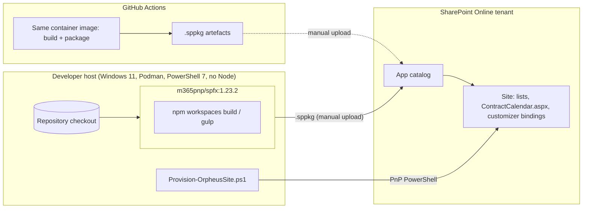

# Phase D — Technology Architecture

Mutable document: versions and services change with the toolchain. Keep in
step with `podman-compose.yml`, `.devcontainer/` and `.github/workflows/ci.yml`.

## 1. Technology stack

| Layer | Technology | Version / note | ADR |
|-------|------------|----------------|-----|
| Hosting | SharePoint Online | Only target; no on-premises | — |
| Framework | SharePoint Framework | 1.23.2 (1.24 is RC only as of 2026-10-22) | ADR-001 |
| Language | TypeScript | Per the SPFx 1.23 toolchain | ADR-001 |
| Runtime (build) | Node | 22.14+ inside the container only | ADR-002 |
| Container image | `docker.io/m365pnp/spfx:1.23.2` (https://github.com/pnp/docker-spfx) | Run with Podman 6.1.4 on the host | ADR-002 |
| Package manager | npm workspaces | Existing convention | ADR-001 |
| Data access | PnPjs v4 (`@pnp/sp` 4.22) | | ADR-003 |
| UI | Fluent UI React, version shipped with SPFx 1.23 | Orpheus theme tokens over it | — |
| PDF | pdfmake; fallback jsPDF + autotable | | ADR-004 |
| Provisioning | PnP PowerShell on PowerShell 7 (host) | `Provision-OrpheusSite.ps1` + PnP site template | ADR-006 |
| CI | GitHub Actions | Runs the container build; uploads `.sppkg` artefacts | — |
| Editor | VS Code dev container | `.devcontainer/devcontainer.json` reuses the same image | ADR-002 |
| Source control | Git, public GitHub `orpheussystems/sharepoint` | Fresh orphan branch | ADR-007 |
| Licence | Apache-2.0 with NOTICE, © 2026 Orpheus Systems | | — |

## 2. Developer environment and Podman workflow (design §5)

`podman-compose.yml` defines one image and these services, all mounting the
repo at `/usr/app/spfx` and the npm cache as a named volume:

| Service | What it does |
|---------|--------------|
| `shell` | Interactive bash in the container |
| `install` | `npm ci` for the whole workspace |
| `build` | `npm run build` (all packages, dev) |
| `serve` | `gulp serve --nobrowser` for one package; ports 4321/35729 exposed; package chosen via `PKG` env |
| `package` | `npm run package` producing every `.sppkg` (`--ship`) |

Top-level npm scripts: `build`, `serve:<pkg>`, `package`, `clean`, `provision`.

- Developer certificate: `gulp trust-dev-cert` handled once inside the
  container and documented (hosted workbench needs HTTPS).
- README documents PowerShell and bash forms of every command and Docker
  Desktop → Podman equivalents (file sharing; SELinux `:Z` flag not needed on
  Windows, noted for Linux users).
- Host: Windows 11, PowerShell primary; scripts must also work from bash
  inside the container.

## 3. Deployment topology

> ⚠️ **Open:** The design has CI build and upload the `.sppkg` artefacts; it
> does not describe automated deployment to the app catalog, tenant secrets
> in CI, or tenant-scoped vs site-scoped app catalog. Deployment is assumed
> manual for now.

## 4. Provisioning (design §6.9, ADR-006)

`Provision-OrpheusSite.ps1` wraps a PnP site template
(`Invoke-PnPSiteTemplate`, re-runnable). Runs from PowerShell 7 on the host,
needs no Node. Parameters: `-SiteUrl`, `-Country`, `-WhatIf`.

Order of provisioning:

1. Content types and the three lists with indexes.
2. `RemainingDays` column with the field customizer bound to it.
3. `Orpheus Contract` content type bound to the form customizer.
4. Modern page `ContractCalendar.aspx` hosting the calendar web part with the
   three lists preselected.
5. Starter Holidays set for the given country.
6. Application customizer registration with properties: relative URLs of the
   Contracts list and the calendar page.

## 5. Non-functional requirements

| NFR | Statement | Source |
|-----|-----------|--------|
| Reproducibility | Clean clone + Podman builds and packages everything | Design §2 G2, anti-goals |
| Bundle size | Within SPFx guidance; pdfmake → jsPDF fallback if exceeded | Design §6.5, §9 |
| Performance | Field customizer makes no extra queries per row; reads filter on indexed columns; writes batched | Design §6.3, §6.7 |
| Usability | Optimistic UI with rollback on error; Monday-first grids; blocked days visibly non-clickable | Design §6.4 |
| Portability of scripts | PowerShell and bash forms of every command | Design §3, §5 |
| Localisation | English only; strings file structure kept so languages can be added | Design §2 non-goals |

> ⚠️ **Open:** Availability, RTO/RPO, monitoring and observability are not
> stated; the solution inherits SharePoint Online's platform SLAs and has no
> component of its own to monitor. No explicit scale figures (users, number of
> contracts or entries) are given.

## 6. Security and secrets

- Authentication and authorisation are SharePoint Online's; the solution adds
  role derivation and filtering (ADR-005).
- No secrets are stored in the repository; the provisioning script
  authenticates interactively through PnP PowerShell.

> ⚠️ **Open:** The PnP PowerShell authentication method (interactive,
> device code, app registration) is not specified.
