# Phase E — Opportunities and Solutions

## 1. Work packages for the target architecture

| WP | Name | Content | Depends on | Produces |
|----|------|---------|------------|----------|
| WP-0 | Repository clean-room | Remove the prior-employer utilities package, path alias, URL and any other fingerprint listed in design §8; repo-local git author; Apache-2.0 `LICENSE` and `NOTICE`; `package.json` author / repository / homepage; fresh orphan branch | — | Clean tree and history (ADR-007) |
| WP-1 | Toolchain | `compose.yml` (shell, install, build, serve, package), `.devcontainer`, `tsconfig.base.json`, root `package.json` workspaces and scripts, dev certificate note | WP-0 | Clean-clone build (ADR-001, ADR-002) |
| WP-2 | `shared-core` | Models, `IDataService`, `LocalDataService` with fixtures, `SharePointDataService` (PnPjs v4), period / overlap / totals logic, one-entry-per-date rule | WP-1 | Library (ADR-003, ADR-008) |
| WP-3 | `shared-ui` | Theme tokens, header/footer components, pdfmake timesheet builder | WP-2 | Library (ADR-004) |
| WP-4 | `wp-contract-calendar` | Property pane, header, grids, stats, overlap dialog, Generate timesheet, `contractId` deep link | WP-2, WP-3 | `.sppkg` |
| WP-5 | `ext-app-customizer` | Header, footer, role-aware menu from component properties | WP-2, WP-3 | `.sppkg` |
| WP-6 | `ext-field-customizer` | Remaining-days bars on `RemainingDays` | WP-3 | `.sppkg` |
| WP-7 | `ext-form-customizer` | Contracts New/Edit/Display, validation, overlap notice, Display-form timesheet link | WP-2, WP-3 | `.sppkg` |
| WP-8 | Provisioning | `Provision-OrpheusSite.ps1` + PnP site template; content types, lists, indexes, `RemainingDays`, bindings, page, starter holidays, customizer properties | WP-4..7 (component IDs) | Repeatable site (ADR-006) |
| WP-9 | CI | GitHub Actions: container build, package, upload `.sppkg` artefacts | WP-1 | Pipeline |
| WP-10 | Verification and README | Deploy to the tenant, verify every package, screenshots from a real site, README (what it is, Podman quick start, package table, data model, provisioning, deployment, roadmap) | WP-4..9 | Public-ready repo |
| WP-11 | Architecture folder | This scaffold | Design approval | `architecture/` |
| WP-12 | HTML template timesheet | Web part property `Timesheet template (optional)`; placeholders and generated blocks rendered with html-to-pdfmake into the pdfmake pipeline; template data query in `shared-core`; `Add-TimesheetTemplateColumns.ps1` for five optional contract columns; sample template and [authoring guide](../docs/timesheet-templates.md). Status: built | WP-3, WP-4, WP-8 | Site-owned timesheet layouts ([ADR-010](adr/0010-html-template-timesheet.md), Accepted) |
| WP-13 | Contract agent | MCP server `mcp-contract-calendar` (six tools, Entra SSO and on-behalf-of, audit event); declarative agent `agent-contract-calendar`; `Setup-AgentDemo.ps1` (`Vendor`, `Orpheus HR`, 002xxx demo data); local demo through a dev tunnel. Status: built and verified live on the dev tenant (2026-10-23); ADR-011 to ADR-015 Accepted, ADR-016 (Azure target) Proposed | WP-2, WP-8 | Copilot Chat channel for booking and reading days ([ADR-011](adr/0011-custom-mcp-server-in-typescript.md) to [ADR-015](adr/0015-dev-tunnel-for-the-agent-demo.md)) |

## 2. Transition states

| State | Description |
|-------|-------------|
| T0 (baseline) | Non-building skeleton with prior-employer naming; HTML mock as the only working behaviour |
| T1 | Clean, building monorepo; web part works in the local workbench with fixtures (WP-0..4) |
| T2 | All five artefacts packaged; provisioning script creates the site; verified on the tenant (WP-5..10) |
| T3 (target) | Public repository with CI, README, screenshots and this architecture folder |
| T3a | HTML template timesheet available on provisioned sites (WP-12) |
| T3b | Contract agent demonstrated on the dev tenant through a dev tunnel; agent ADRs accepted or revised after the live check (WP-13) |

## 3. Roadmap (post-target, not built in this iteration)

| Item | Description | Preparation already in the design | Trigger to start |
|------|-------------|-----------------------------------|------------------|
| RM-1 Holiday agent per country | A SharePoint agent populates the Holidays list automatically per country | `Country` column on Contracts and Holidays; `Source = Agent` choice reserved; `*` for all countries | Demand for more than one country or recurring manual maintenance |
| RM-2 Permissions hardening | Per-item permission breaking on Contracts and CalendarEntries via provisioning-time event receiver or Power Automate, plus read-restricted views; drop Contribute for contractors on Contracts | Risk R-SEC-1 recorded with mitigation path; service already keeps used-days columns (would need a different writer) | Any tenant where contractors must not be able to see each other's rows through the list UI |
| RM-3 PDF storage in a document library | Save the generated timesheet to a document library instead of (or as well as) downloading it | Documented extension point in `shared-ui/pdf`; `ContractCode` meant for folder/file names | Need to keep signed/unsigned timesheets alongside the contract |
| RM-4 Contract agent on Azure | Host the MCP server on the Azure target: API Management, Container Apps (`minReplicas: 1`), managed identity, Key Vault, Log Analytics audit table, Terraform | [ADR-016](adr/0016-azure-target-apim-container-apps-terraform.md); same build output and configuration as the local run | A client deployment of the agent; needs an Azure subscription |

RM-1 stays separate from the contract agent (WP-13). The contract agent reads
holidays through `get_holidays` but does not maintain them; populating the
Holidays list per country is still RM-1's job, and its runtime is still a
candidate decision.

> ⚠️ **Open:** None of RM-1 to RM-3 has a design yet (holiday agent
> runtime, who owns permission breaking, library structure and naming). Each
> should get its own ADR when picked up (Phase H). RM-4 has a Proposed design
> (ADR-016) but nothing of it is built.

## 4. Build / buy / reuse

| Capability | Decision | Note |
|------------|----------|------|
| Build toolchain | Reuse `m365pnp/spfx` image | ADR-002 |
| Data access | Reuse PnPjs v4 | ADR-003 |
| PDF | Reuse pdfmake | ADR-004 |
| Provisioning | Reuse PnP PowerShell site templates | ADR-006 |
| HTML to PDF for templates | Reuse html-to-pdfmake over the existing pdfmake pipeline; no server | [ADR-010](adr/0010-html-template-timesheet.md) |
| Agent front end | Reuse: declarative agent in Copilot Chat (Agents Toolkit) | [ADR-012](adr/0012-declarative-agent-entra-sso-obo.md) |
| Agent action layer | Build: own MCP server in TypeScript reusing `shared-core`; off-the-shelf SharePoint MCP servers, Copilot Studio and API plugins rejected | [ADR-011](adr/0011-custom-mcp-server-in-typescript.md) |
| Agent audit | Reuse Purview for Copilot and SharePoint records; build only the per-tool-call event | [ADR-014](adr/0014-three-layer-audit-for-agent-actions.md) |
| Calendar UI, forms, bars, header/footer | Build | Core of the showcase |
| Approval / e-signature | Not built; signing is offline | Non-goal |

## 5. Roadmap diagram

```mermaid
gantt
  title Delivery order (sequence only; the design gives no dates)
  dateFormat X
  axisFormat %s
  section Foundation
  WP-0 Clean-room            :0, 1
  WP-1 Toolchain             :1, 2
  WP-2 shared-core           :2, 3
  WP-3 shared-ui             :3, 4
  section Solutions
  WP-4 Calendar web part     :4, 5
  WP-5 App customizer        :4, 5
  WP-6 Field customizer      :4, 5
  WP-7 Form customizer       :4, 5
  section Delivery
  WP-8 Provisioning          :5, 6
  WP-9 CI                    :2, 3
  WP-10 Verify + README      :6, 7
  section Extensions
  WP-12 HTML template        :7, 8
  WP-13 Contract agent       :7, 8
  section Roadmap
  RM-1 Holiday agent         :8, 9
  RM-2 Permissions hardening :8, 9
  RM-3 PDF to library        :8, 9
  RM-4 Agent on Azure        :8, 9
```

> ⚠️ **Open:** Timeline and effort are not stated; the Gantt shows ordering only.
