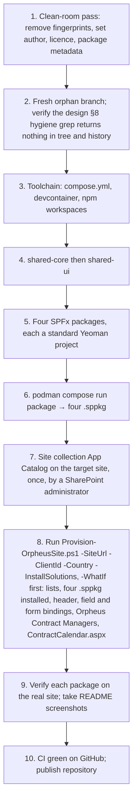
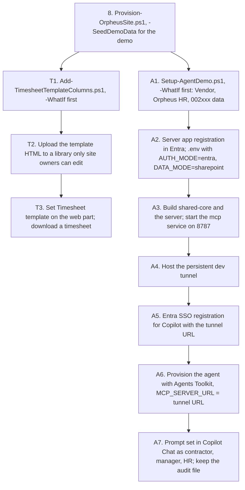

# Phase F — Migration Planning

This is a repository and site migration, not a data migration: there is no
existing production data to carry over. The design's only data input is the
HTML mock, which held selections in browser localStorage.

## 1. Current state to migrate from

- A skeleton repository that does not build: one package is a lone
  `tsconfig.json`, another is referenced but absent.
- Prior-employer naming (the utilities package, path alias and URL listed in
  design §8) in the tree and in the three existing commits.
- `docs/mocks/onsite_calendar.html` as the behavioural reference.

## 2. Migration strategy

Re-architect, not lift-and-shift. The public repository starts from a fresh
orphan branch (ADR-007); the three existing commits are not carried over.

## 3. Sequence

Step 8 depends on step 7 because the script installs the solutions into the
site's own App Catalog and then binds the field and form customizers and places
the web part by component ID. The script does both in one run, installing
before it binds (amendment of 2026-10-23 to ADR-006); a re-run reports
`Unchanged` for every step.

### 3.1 Extensions: HTML template and contract agent

Both slot in after step 8, on a site that `Provision-OrpheusSite.ps1` has
already created. Neither changes the main site template, so steps 1 to 10
stay as they are.

| Step | Notes |
|------|-------|
| T1 | `infra/provisioning/Add-TimesheetTemplateColumns.ps1` adds `ConsultantPosition`, `Vendor`, `Lot`, `ApproverName`, `TemplateFields`; stops with "run Provision-OrpheusSite.ps1 first" if the content type or Contracts list is missing. `-SeedDemoData` sets demo values on `1185-Jane-Doe`, seeded in step 8 ([ADR-010](adr/0010-html-template-timesheet.md)) |
| T2, T3 | Optional per site; an empty property keeps the built-in layout ([guide](../docs/timesheet-templates.md)) |
| A1 | `packages/mcp-contract-calendar/setup/Setup-AgentDemo.ps1`; UPNs are parameters and never committed. A second run must report every step unchanged; exit code 1 on a conflicting `Vendor` field means nothing was written ([ADR-013](adr/0013-vendor-column-and-hr-group-for-the-agent.md)) |
| A2 to A7 | As in `packages/agent-contract-calendar/demo/demo-procedure.md` ([ADR-012](adr/0012-declarative-agent-entra-sso-obo.md), [ADR-015](adr/0015-dev-tunnel-for-the-agent-demo.md)). A5 needs the tunnel host from A4, so it comes after it |

T1 and A1 are independent and can run in either order: both create `Vendor`
with the same fixed ID, and the second reports it unchanged. The template
branch and the agent branch need none of each other's steps.

For a client deployment, A2 to A4 are replaced by the Azure target
([ADR-016](adr/0016-azure-target-apim-container-apps-terraform.md)): Terraform
for API Management, Container Apps, Key Vault and Log Analytics, an image
build and push, then A5 and A6 with the API Management URL. None of it is
built yet.

## 4. Cutover and rollback

| Concern | Approach |
|---------|----------|
| Cutover | Big bang for the repository (new public repo); the old skeleton is simply not published. |
| Site provisioning | Idempotent; re-running the script is the recovery path. `-WhatIf` previews changes. |
| Solution rollback | Remove or downgrade the `.sppkg` in the site collection App Catalog; lists and data are unaffected. |
| HTML template rollback | Clear the `Timesheet template (optional)` property; the built-in layout returns. The optional columns can stay; nothing reads them in the built-in layout. |
| Agent rollback | Stop `devtunnel host` and the `mcp` service, remove the sideloaded agent; delete the tunnel when the demo work is done. The 002xxx demo data, `Vendor` and `Orpheus HR` stay until removed by hand. The web part shows 002xxx contracts like any other; `Orpheus HR` has no meaning in the web part, and `Vendor` is shared with the HTML template. |
| Downtime | Not applicable; no existing users on the target site. |

> ⚠️ **Open:** The design does not say whether a staging site or a second
> tenant is used before the verification site, nor how schema changes to the
> lists will be rolled out once real data exists (the script is re-runnable,
> but column removals or type changes are not covered).

## 5. Data migration

| Source | Target | Action |
|--------|--------|--------|
| Mock localStorage selections | — | Not migrated; demo only |
| Fixture JSON | `LocalDataService` | Shipped in the bundle; no tenant data |
| Starter holidays for `-Country` | Holidays list | Created by the provisioning script with `-SeedDemoData` |
| `shared-core` fixture `templateData.json` | Template columns on `1185-Jane-Doe` | `Add-TimesheetTemplateColumns.ps1 -SeedDemoData`, only where values differ |
| `setup/demo-data.json` | 002xxx contracts and entries, `Vendor` on them | `Setup-AgentDemo.ps1`; only 002xxx items, used days recomputed |

## 6. Responsibilities

| Activity | Owner |
|----------|-------|
| All steps above | Kiril Iliev (single owner) |
| Tenant access for verification | Owner's SharePoint Online tenant |

## 7. Exit criteria

- Clean clone + `podman compose run build` and `package` succeed.
- Four `.sppkg` files produced with `--production` (the shared libraries are bundled, not packaged).
- Script provisions a fresh site end to end and can be re-run without error.
- All roles verified on the real site; screenshots in README.
- Hygiene grep clean in tree and history.
- HTML template: a timesheet downloads from a site-hosted template, and
  clearing the property restores the built-in layout.
- Contract agent: setup script re-run reports unchanged; the prompt set
  passes for contractor, manager and HR on the dev tenant; the verification
  log in the demo procedure is filled in. This live check decides whether
  ADR-011 to ADR-016 move from Proposed to Accepted.
