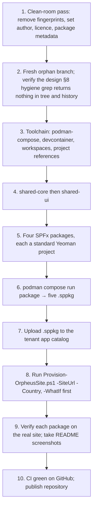

# Phase F — Migration Planning

This is a repository and site migration, not a data migration: there is no
existing production data to carry over. The design's only data input is the
HTML mock, which held selections in browser localStorage.

## 1. Current state to migrate from

- A skeleton repository that does not build: one package is a lone
  `tsconfig.json`, another is referenced but absent.
- Prior-employer naming (the utilities package, path alias and URL listed in
  design §8) in the tree and in the three existing commits.
- `docs/mocks/onsite_calendar.html` as the behavioural reference.

## 2. Migration strategy

Re-architect, not lift-and-shift. The public repository starts from a fresh
orphan branch (ADR-007); the three existing commits are not carried over.

## 3. Sequence

Step 8 depends on step 7 because the script binds the field and form
customizers and places the web part by component ID, which exist only once the
solutions are in the app catalog.

## 4. Cutover and rollback

| Concern | Approach |
|---------|----------|
| Cutover | Big bang for the repository (new public repo); the old skeleton is simply not published. |
| Site provisioning | Idempotent; re-running the script is the recovery path. `-WhatIf` previews changes. |
| Solution rollback | Remove or downgrade the `.sppkg` in the app catalog; lists and data are unaffected. |
| Downtime | Not applicable; no existing users on the target site. |

> ⚠️ **Open:** The design does not say whether a staging site or a second
> tenant is used before the verification site, nor how schema changes to the
> lists will be rolled out once real data exists (the script is re-runnable,
> but column removals or type changes are not covered).

## 5. Data migration

| Source | Target | Action |
|--------|--------|--------|
| Mock localStorage selections | — | Not migrated; demo only |
| Fixture JSON | `LocalDataService` | Shipped in the bundle; no tenant data |
| Starter holidays for `-Country` | Holidays list | Created by the provisioning script |

## 6. Responsibilities

| Activity | Owner |
|----------|-------|
| All steps above | Kiril Iliev (single owner) |
| Tenant access for verification | Owner's SharePoint Online tenant |

## 7. Exit criteria

- Clean clone + `podman compose run build` and `package` succeed.
- Five `.sppkg` files produced with `--ship`.
- Script provisions a fresh site end to end and can be re-run without error.
- All roles verified on the real site; screenshots in README.
- Hygiene grep clean in tree and history.
