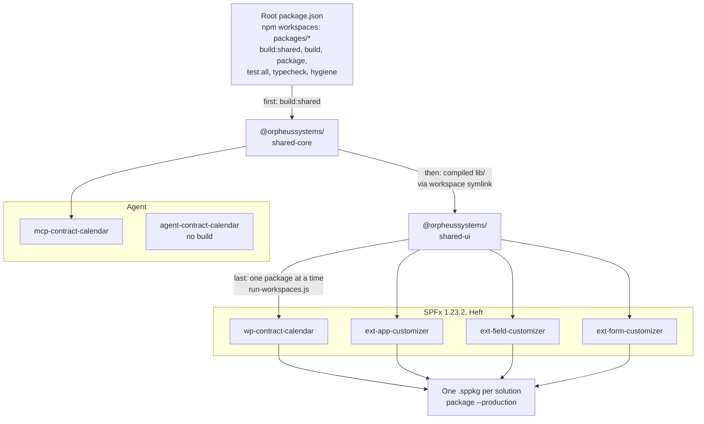

# 1. SPFx 1.23.2 on an npm-workspaces monorepo

## Date: 2026-10-22

## Status

Accepted

---

## Problem

The repository must become a public SPFx monorepo holding four extensions, a
web part and two shared libraries, and every package must build, bundle and
package to `.sppkg`. The existing repository already uses npm workspaces but
does not build. SPFx 1.23.2 is the latest stable release as of 2026-10-22;
1.24 is RC only. The SPFx toolchain expects each solution to be a standard
Yeoman-generated project.

> 📝 **Assumption:** Staying on the Yeoman project shape keeps the SPFx
> upgrade path (`m365 spfx project upgrade` or equivalent) usable per package.

---

## Decision

We will build on **SPFx 1.23.2** with **npm workspaces** as the monorepo
mechanism. Each SPFx package remains a standard Yeoman-generated project on the
Heft toolchain. Shared packages (`@orpheussystems/shared-core`,
`@orpheussystems/shared-ui`) are workspace dependencies (`"*"`), resolved
through npm's workspace symlinks to their compiled `lib/`;
`tsconfig.base.json` holds shared compiler options only. Build order is
enforced by the root scripts: `build:shared` compiles `shared-core`, then
`shared-ui`; then every other workspace is built or packaged one at a time
(`scripts/ci/run-workspaces.js`). Top-level scripts: `build`, `build:shared`,
`package` (a production `.sppkg` per SPFx solution), `test:all`, `typecheck`,
`hygiene`, `clean`. A package is served with `npm run serve -w <package>`;
provisioning is a separate PowerShell script (ADR-006). Packages are named
`@orpheussystems/<name>`. Besides the four SPFx solutions, the workspace
holds the MCP server and the agent project (ADR-011, ADR-012).

---

## Considered Options

| Option | Summary | Pros | Cons |
|--------|---------|------|------|
| ✅ **SPFx 1.23.2 + npm workspaces** | Latest stable; existing convention | Stable toolchain; no extra tooling; Yeoman shape preserved | Workspaces offer less orchestration than dedicated monorepo tools |
| SPFx 1.24 RC | Newer | Newer features | Release candidate; not acceptable for a public showcase |
| pnpm / Yarn / Nx / Turborepo | Alternative monorepo tooling | Richer caching and task graphs | Not the existing convention; extra tooling inside the container; not required at this size |
| Separate repositories per solution | No monorepo | Simplest per package | Shared code duplication; the point is one coherent suite |

---

## Consequences

**Positive:**
- One `npm ci` installs the whole workspace inside the container.
- Shared models, services and theme live once and are consumed by every solution.
- Each solution still looks like a normal SPFx project to the toolchain.

**Negative / Trade-offs:**
- Build order lives in the root scripts; a new shared package must be added to `build:shared`.
- Version pinned to 1.23.2; a bump touches every package and ADR-002's image tag.

**Risks:**
| Risk ID | Description | Impact (E/H/M/L) | Mitigation |
|---------|-------------|------------------|------------|
| R1 | SPFx bundler mishandles symlinked workspace packages | M | Shared packages are consumed as compiled `lib/` through the symlinks; verified by the clean-clone build in CI |
| R2 | SPFx 1.24 GA soon after release makes 1.23.2 look dated | L | Supersede this ADR at the bump; the container tag makes the upgrade one-line for the environment |

---

## Amendments

**2026-10-23** — The decision (SPFx 1.23.2 on npm workspaces) is unchanged; the
mechanics were brought in line with the code:

- No TypeScript path mapping or project references. The shared packages are
  resolved through workspace symlinks to their compiled `lib/`, and the build
  order comes from the root scripts (`build:shared`, then
  `scripts/ci/run-workspaces.js`).
- The top-level scripts are `build`, `build:shared`, `package`, `test:all`,
  `typecheck`, `hygiene` and `clean`. There is no `serve:<pkg>` (use
  `npm run serve -w <package>`) and no `provision` (ADR-006 is a PowerShell
  script). SPFx 1.23 packages with Heft's `--production`, not gulp's `--ship`.
- The Problem's "four extensions" is three extensions (application, field and
  form customizer) plus the web part.
- The workspace now also contains `mcp-contract-calendar` and
  `agent-contract-calendar` (ADR-011, ADR-012).

---

## Related

- Related ADRs: ADR-002 (container), ADR-003 (shared-core seam)
- Related requirements: NFR-02
- Related documents: design §3, §4; Phase D
- TOGAF phase: D — Technology Architecture
- Decision maker(s): Kiril Iliev (owner)
- Stakeholders: Builder; public repository visitors
