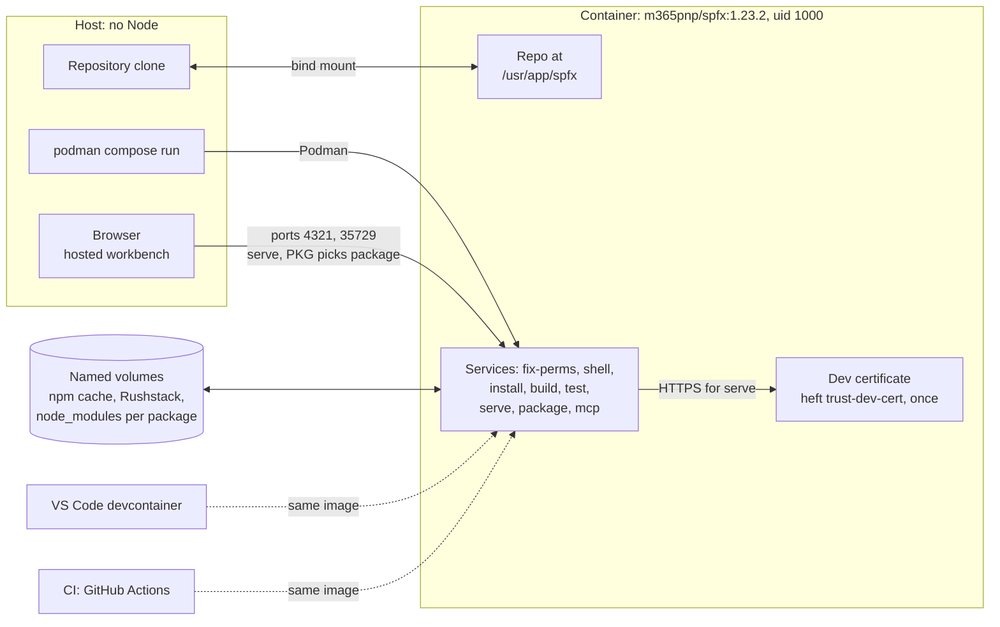

# 2. Podman with the `m365pnp/spfx:1.23.2` container; no Node on the host

## Date: 2026-10-22

## Status

Accepted

---

## Problem

A build that only works on the author's machine is an explicit anti-goal.
The host is Windows 11 with Podman 6.1.4 and no Node installed. SPFx 1.23
needs Node 22.14+ and a specific toolchain. The PnP community publishes
`docker.io/m365pnp/spfx` images matching SPFx versions
(https://github.com/pnp/docker-spfx).

---

## Decision

We will run every build, serve and package step inside
`docker.io/m365pnp/spfx:1.23.2` using **Podman**. `compose.yml`
defines services `fix-perms`, `shell`, `install`, `build`, `test`, `serve`
(ports 4321/35729, package chosen via `PKG`), `package` and `mcp` (the agent's
MCP server, port 8787), all mounting the repo at `/usr/app/spfx` and running
as uid 1000. The npm cache, the Rushstack folder and every `node_modules` are
named volumes; `fix-perms` makes them writable once. A
`.devcontainer/devcontainer.json` reuses the same image for VS Code. The dev
certificate (`heft trust-dev-cert`) is created once inside the container and
documented. CI (GitHub Actions) uses the same image. No Node is required on
the host.

---

## Considered Options

| Option | Summary | Pros | Cons |
|--------|---------|------|------|
| ✅ **Podman + `m365pnp/spfx:1.23.2`** | Container-only toolchain | Reproducible; matches host; same image for dev, devcontainer and CI | Port forwarding and certificates need documenting; Podman-specific notes for Linux users (`:Z`) |
| Node installed on host (nvm) | Classic SPFx setup | Familiar | Violates the "nothing but Podman" goal; version drift between machines |
| Docker Desktop | Same image, different runtime | Widely known | Not installed on the host; licence considerations; Podman already present |
| GitHub Codespaces only | Hosted dev | Zero local setup | Does not satisfy local clean-clone build |

---

## Consequences

**Positive:**
- Clean clone + Podman is the whole prerequisite list.
- Identical toolchain in local, devcontainer and CI.

**Negative / Trade-offs:**
- Every command is wrapped in `podman compose run …`; README must show the
  PowerShell and bash forms.
- Hosted workbench over HTTPS needs the certificate step inside the container.

**Risks:**
| Risk ID | Description | Impact (E/H/M/L) | Mitigation |
|---------|-------------|------------------|------------|
| R1 | Podman file-sharing or volume behaviour differs from Docker on Windows | M | Named volume for npm cache; documented Docker → Podman equivalents |
| R2 | Image tag lags behind an SPFx release | L | Pin the tag; bump together with ADR-001 |

---

## Amendments

**2026-10-23** — The decision is unchanged; the description follows the code:

- The compose file is `compose.yml` (not `podman-compose.yml`), with the extra
  services `fix-perms`, `test` and `mcp`.
- `node_modules` of the root and of every package live in named volumes, next
  to the npm cache and the Rushstack folder (dev certificate). `npm install`
  fails with `EPERM` when it writes bin links onto the Windows bind mount.
- The services run as uid 1000, the bind mount's owner, because the Windows
  mount refuses `chmod` from any other uid (Heft's copy steps need it).
- SPFx 1.23 uses Heft, so the certificate command is `heft trust-dev-cert`.
- On Windows the Podman machine is a WSL distribution shared by every running
  container; container runs cap Node with `--max-old-space-size=1536`.
  Details: `docs/dev-environment.md`.

---

## Related

- Related ADRs: ADR-001
- Related requirements: NFR-01, NFR-09
- Related documents: design §3, §5; Phase D
- TOGAF phase: D — Technology Architecture
- Decision maker(s): Kiril Iliev (owner)
- Stakeholders: Builder; CI; public repository visitors
