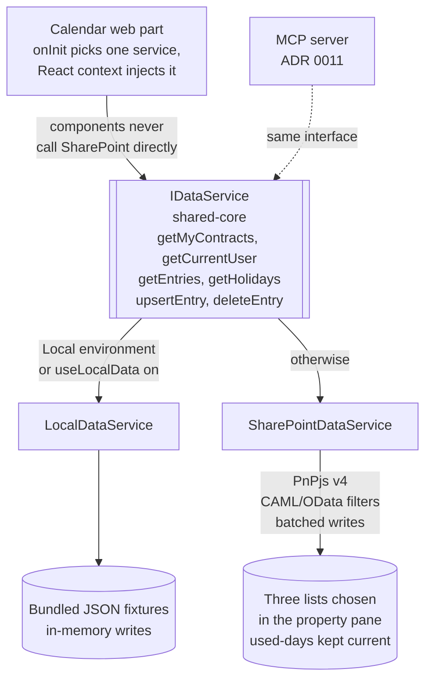

# 3. `IDataService` with Local and SharePoint implementations

## Date: 2026-10-22

## Status

Accepted

---

## Problem

The calendar web part must work fully in the local workbench with bundled
fixture data and against real SharePoint lists in production. Both demo roles
must be showable without a tenant. Data access is PnPjs v4 (`@pnp/sp` 4.22).
The field and form customizers and the application customizer also need
models and role derivation.

---

## Decision

We will define one interface in `shared-core`:

```ts
interface IDataService {
  getMyContracts(): Promise<Contract[]>;            // role-filtered
  getEntries(contractId, from, to): Promise<CalendarEntry[]>;
  upsertEntry(entry): Promise<CalendarEntry>;
  deleteEntry(contractId, date): Promise<void>;
  getHolidays(country, from, to): Promise<Holiday[]>;
  getCurrentUser(): Promise<UserInfo>;
}
```

with two implementations:

- `LocalDataService` — bundled JSON fixtures, in-memory writes; used when
  `Environment.type === Local` or the web part property `useLocalData` is on.
  Fixtures: one active contract, a bridge pair with a 2-week overlap, half
  days, holidays for BG and `*`, two demo users selectable in the property pane.
- `SharePointDataService` — PnPjs v4 against the three lists chosen in the
  property pane; CAML/OData filters on indexed columns; batched writes; keeps
  `OnSiteUsedDays` / `OffSiteUsedDays` on the contract current.

The service is chosen once in the web part's `onInit` and injected into the
React tree via context. No component talks to SharePoint directly.





---

## Considered Options

| Option | Summary | Pros | Cons |
|--------|---------|------|------|
| ✅ **Interface + Local + SharePoint implementations** | One seam, two back ends | Workbench demo without tenant; testable logic; one place for role filtering and invariants | Fixtures must be maintained alongside the schema |
| PnPjs calls inside components | No abstraction | Less code | No workbench demo; untestable; invariants scattered |
| Mock PnPjs at the HTTP layer in the workbench | Intercept requests | Reuses the SharePoint path | Fragile; harder to express demo roles |

---

## Consequences

**Positive:**
- Screenshots and demos work from a clean clone.
- Period / overlap / totals logic and the one-entry rule (ADR-008) live in
  one testable place.

**Negative / Trade-offs:**
- Two implementations to keep behaviourally identical.
- `SharePointDataService` writing used-days columns requires contractors to
  hold Contribute on Contracts (see ADR-005).

**Risks:**
| Risk ID | Description | Impact (E/H/M/L) | Mitigation |
|---------|-------------|------------------|------------|
| R1 | Local and SharePoint implementations diverge | M | Shared unit tests run against both |
| R2 | Used-days columns drift from entries | M | Recalculate on every write; roadmap option to recompute on read |

---

## Related

- Related ADRs: ADR-005, ADR-008
- Related requirements: FR-07, FR-18, FR-22
- Related documents: design §6.3; Phase C (application)
- TOGAF phase: C — Application Architecture
- Decision maker(s): Kiril Iliev (owner)
- Stakeholders: Builder; contractors and managers (end users)
