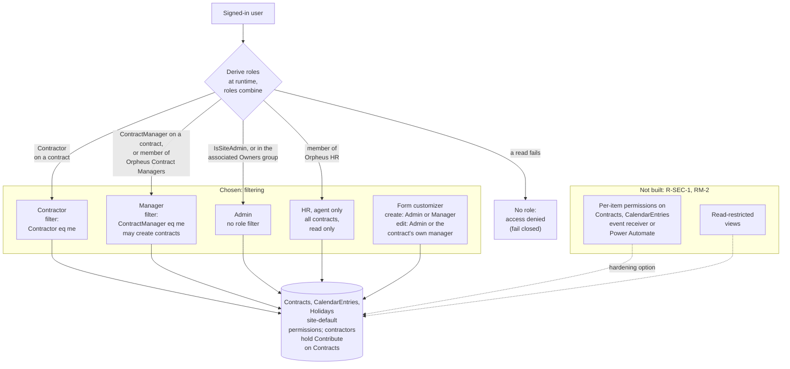

# 5. Visibility by filtering in the web part rather than item-level permissions

## Date: 2026-10-22

## Status

Accepted

---

## Problem

Contractors should see only their own contracts and managers only the ones
they manage. SharePoint can enforce this with item-level permissions, but
that requires breaking inheritance per item (event receiver or flow), makes
provisioning heavier, and the service also needs to update
`OnSiteUsedDays` / `OffSiteUsedDays` on Contracts on every entry write.

---

## Decision

We will keep all three lists at **site-default permissions** this iteration
and enforce visibility **by filtering in the web part / data service**:
contractors get `Contractor eq me`, managers get `ContractManager eq me`.
Role is derived at runtime in order: appears as `Contractor` on at least one
contract → contractor; appears as `ContractManager` → manager; member of the
site Owners group → admin; roles can combine. Contractors therefore hold
Contribute on Contracts; the form customizer, not permissions, keeps them out
of contract editing. This is agreed to be sufficient for now.

**Recorded alternative (hardening option, not built):** per-item permission
breaking on Contracts and CalendarEntries via a provisioning-time event
receiver or Power Automate, plus a read-restricted view for the lists. Tracked
as risk R-SEC-1 and roadmap item RM-2.

---

## Considered Options

| Option | Summary | Pros | Cons |
|--------|---------|------|------|
| ✅ **Filtering in the data service** | Site-default permissions; role-based OData filters | Simple provisioning; service can maintain used-days columns; adequate for a demo/portfolio tenant | Users with list UI access can read or edit others' rows; relies on the form customizer for contract editing |
| Item-level permissions (event receiver / Power Automate) | Break inheritance per item on create | Enforced by the platform | Extra moving parts; used-days writes need a privileged writer; re-provisioning complexity |
| Separate lists per contractor | Partition by user | Platform-enforced | Does not scale; web part list picker becomes per user |
| Read-restricted views only | Hide rows in views | Easy | Not a security boundary |

---

## Consequences

**Positive:**
- Provisioning stays one idempotent script (ADR-006).
- Used-days columns can be updated by the contractor's own session.

**Negative / Trade-offs:**
- Not a security boundary; acceptable only where users are trusted or data is
  demo data.

**Risks:**
| Risk ID | Description | Impact (E/H/M/L) | Mitigation |
|---------|-------------|------------------|------------|
| R-SEC-1 | A contractor reads or edits another contractor's rows via the list UI | H | Hardening path above; pick up RM-2 before any multi-tenant or sensitive use |

---

## Amendments

**Amendment (2026-10-23)** — The decision stands: visibility is still
filtering on site-default permissions. The role rules it relies on changed in
wave 2 and are now:

- **Admin:** a site collection admin (`currentUser.IsSiteAdmin`) or a member of
  the site's associated Owners group. Previously only the Owners group.
- **ContractManager:** appears as `ContractManager` on at least one contract,
  or is a member of the SharePoint group `Orpheus Contract Managers` (exact
  title). Provisioning creates the group with Contribute (ADR-006); the owner
  manages its members. Managers may create contracts (`canCreateContract`);
  editing a contract stays limited to Admin and that contract's own manager
  (`canEditContract`).
- **HR:** a member of `Orpheus HR` (ADR-013). The role exists only in the
  agent, sees all contracts and is read-only.
- **Fail closed:** if any read during role derivation fails (including the
  `IsSiteAdmin` read), derivation rejects and the user gets no role, so the
  form denies access. The header falls back to a menu without role items.
- `Orpheus Contract Managers` holds Contribute at the web, so its members can
  write to every list that inherits permissions. That widens R-SEC-1; the app
  still filters what they see, SharePoint does not.

---

## Related

- Related ADRs: ADR-003, ADR-006, ADR-013
- Related requirements: FR-01, FR-03, FR-23
- Related documents: design §6.2, §7; Phase A risk register; Phase E RM-2
- TOGAF phase: C — Application Architecture (security model)
- Decision maker(s): Kiril Iliev (owner)
- Stakeholders: Contractors, contract managers, site admins
