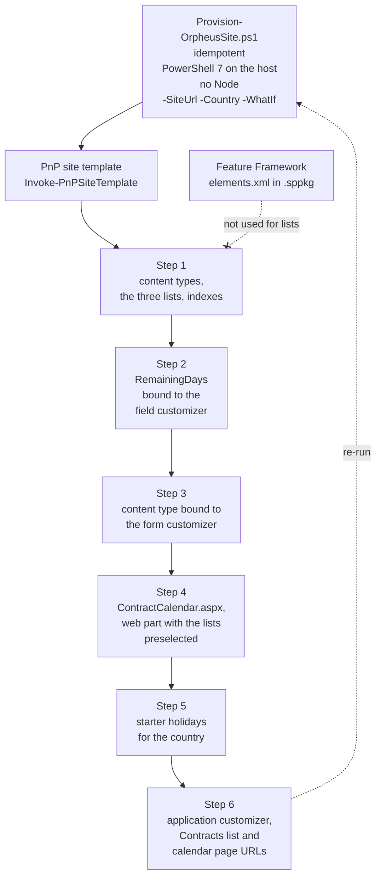

# 6. Idempotent PnP PowerShell provisioning instead of Feature Framework

## Date: 2026-10-22

## Status

Accepted

---

## Problem

The solutions assume three lists with content types and indexes, a
`RemainingDays` column bound to the field customizer, the `Orpheus Contract`
content type bound to the form customizer, a modern page hosting the calendar
web part with the lists preselected, a starter holiday set, and application
customizer properties carrying list and page URLs. Two mechanisms were checked.

---

## Decision

We will provision with an **idempotent PnP PowerShell script**,
`Provision-OrpheusSite.ps1`, wrapping a PnP site template
(`Invoke-PnPSiteTemplate`, re-runnable). It runs from PowerShell 7 on the
host, needs no Node, and takes `-SiteUrl`, `-Country`, `-WhatIf`. It
provisions, in order: content types and the three lists with indexes;
`RemainingDays` with the field customizer bound; the content type bound to
the form customizer; `ContractCalendar.aspx` with the web part and lists
preselected; starter holidays for the country; application customizer
registration with the Contracts list and calendar page URLs.

Feature Framework (`elements.xml` inside the `.sppkg`) is **not** used for
lists.

---

## Considered Options

| Option | Summary | Pros | Cons |
|--------|---------|------|------|
| ✅ **PnP PowerShell site template script** | Re-runnable script on the host | Idempotent; can create page, place web part, bind customizers, write properties; `-WhatIf` | Separate step after `.sppkg` deployment; needs PnP PowerShell on the host |
| Feature Framework in `.sppkg` | `elements.xml` list and content-type definitions | Ships with the solution | Site-scoped; runs only on first install; cannot re-run to upgrade a schema; cannot create the page, place the web part or bind customizers |
| Manual setup | Click through SharePoint UI | No tooling | Not repeatable; violates clean-clone goal in spirit |
| Site designs / site scripts | Tenant-level JSON | Native | Limited actions; cannot bind customizers or place web part with properties as needed |

---

## Consequences

**Positive:**
- One script creates everything the solutions assume and can be re-run to
  repair or upgrade.
- Deep links (`contractId`), menu URLs and customizer properties are written
  consistently.

**Negative / Trade-offs:**
- Two-step deployment: app catalog upload, then script.
- Script depends on component IDs of the deployed solutions.

**Risks:**
| Risk ID | Description | Impact (E/H/M/L) | Mitigation |
|---------|-------------|------------------|------------|
| R1 | Script run before solutions are in the app catalog fails to bind customizers | M | Documented order in Phase F; `-WhatIf` |
| R2 | Destructive schema changes not handled by re-run | M | Open item OR-09; treat column removals as manual steps |

---

## Related

- Related ADRs: ADR-002 (no Node on host), ADR-005 (default permissions)
- Related requirements: FR-05, FR-20
- Related documents: design §6.9; Phase D §4; Phase F
- TOGAF phase: D — Technology Architecture
- Decision maker(s): Kiril Iliev (owner)
- Stakeholders: Site admins; builder
