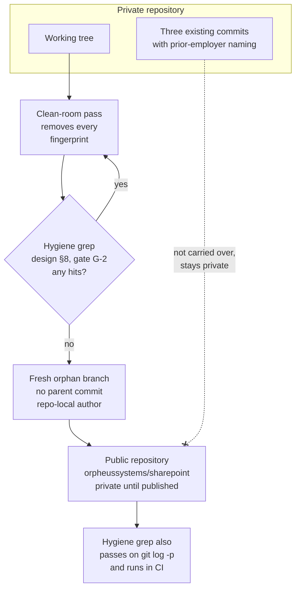

# 7. Fresh orphan branch for the public repository

## Date: 2026-10-22

## Status

Accepted

---

## Problem

The repository carries naming from a previous employer (a utilities package,
a path alias and a URL, listed in design §8) in its working tree and in its
three existing commits. The anti-goal is that nothing in the public
repository identifies a previous employer or a real client; the acceptance
criterion is that the case-insensitive hygiene grep defined in design §8
returns nothing. The terms themselves are deliberately not repeated here.

---

## Decision

The public repository `orpheussystems/sharepoint` will **start from a fresh
orphan branch**. The three existing commits are not carried over, so the grep
criterion applies to history as well as to the working tree. New commits use
the repo-local author `Kiril Iliev <kiril.iliev@orpheussystems.com>`. The
clean-room pass removes every prior-employer fingerprint before the first
public commit; `LICENSE` was initially MIT © 2026 Orpheus Systems (superseded by ADR-009: Apache-2.0 with NOTICE) and `package.json`
`author`, `repository`, `homepage` are set accordingly.

---

## Considered Options

| Option | Summary | Pros | Cons |
|--------|---------|------|------|
| ✅ **Orphan branch** | New history from a clean tree | History provably clean; simple | Loses the (small) existing history |
| History rewrite (`git filter-repo`) | Scrub identifiers from existing commits | Keeps history | Error-prone; residual risk in commit messages and blobs; three commits are not worth it |
| Publish as is | No change | None | Violates the anti-goal |

---

## Consequences

**Positive:**
- The hygiene grep can be applied to `git log -p` as a gate.

**Negative / Trade-offs:**
- The private skeleton history stays private; nothing of value is lost.

**Risks:**
| Risk ID | Description | Impact (E/H/M/L) | Mitigation |
|---------|-------------|------------------|------------|
| R-HYG-1 | A fingerprint survives in the working tree at the time of the orphan commit | H | Gate G-2 grep before the first public commit |

---

## Amendments

**2026-10-23** — The decision is unchanged.

- The repository is prepared as a private repository on the owner's account
  first, and moves to the `orpheussystems` organisation as
  `orpheussystems/sharepoint` before it is made public. Documentation uses
  relative links, so the move needs no edits.
- The public branch's history was rewritten once more on 2026-10-22, before
  publication, so that no local-only plan or spec file ever appears in it.
- The hygiene criterion is now a CI step: `npm run hygiene`
  (`scripts/ci/hygiene.js`) fails the build on tenant hosts, tracked `.env`
  files, local-only paths, banned names and tokens. See `docs/ci.md`.

---

## Related

- Related ADRs: —
- Related requirements: NFR-03, NFR-06
- Related documents: design §1, §8; Phase G gate G-2
- TOGAF phase: Preliminary / A — Architecture Vision
- Decision maker(s): Kiril Iliev (owner)
- Stakeholders: Public repository visitors; Orpheus Systems
