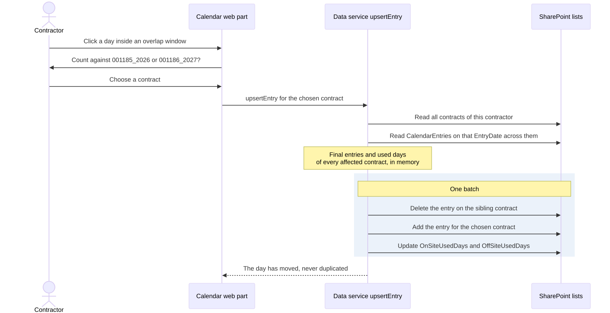
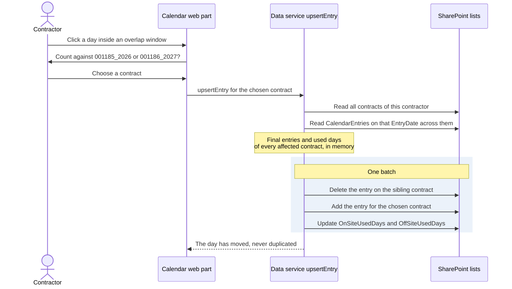

# 8. One calendar entry per contractor per date across contracts

## Date: 2026-10-22

## Status

Accepted

---

## Problem

Contract periods may overlap ("bridge" contracts, e.g. `1185` until 31 Jan,
`1186` from 15 Jan), but as far as counting goes exactly one contract is
active for a contractor on any given day. A calendar entry therefore always
references a contract, never just a person. Without a rule, the same day could
be counted against two contracts and the timesheets would overstate days.

---

## Decision

The data service enforces **one `CalendarEntries` row per contractor per
`EntryDate` across all of that contractor's contracts**. When the contractor
clicks a day inside an overlap window the web part asks which contract the
day counts against ("Count against 001185_2026 or 001186_2027?"); choosing a
contract **moves** the entry to it; it never duplicates it. `EntryDate` and
`Contract` are indexed; `Title` is `<ContractCode> <yyyy-MM-dd>`.

---

## Considered Options

| Option | Summary | Pros | Cons |
|--------|---------|------|------|
| ✅ **Service-enforced uniqueness, move on overlap** | Invariant in `IDataService`; UI dialog on overlap | Works identically for Local and SharePoint; no platform feature needed; explicit user choice | Not enforced by SharePoint itself; a direct list edit can break it |
| SharePoint unique-value column on `EntryDate` | Platform enforcement | Native | Would be unique across all contractors, not per contractor; wrong scope |
| Allow duplicates, de-duplicate on report | Count later | Simple writes | Ambiguous data; stats panel and PDF would disagree with the list |
| Entry references the person, not the contract | Simpler model | Fewer joins | Cannot attribute days to a contract at all |

---

## Consequences

**Positive:**
- Totals, remaining days and the PDF are unambiguous.
- Bridge contracts are a first-class, demonstrable scenario (fixtures include one).

**Negative / Trade-offs:**
- Direct edits through the list UI bypass the invariant (see ADR-005 hardening).
- `upsertEntry` must look across the contractor's contracts, not only the
  selected one.

**Risks:**
| Risk ID | Description | Impact (E/H/M/L) | Mitigation |
|---------|-------------|------------------|------------|
| R-DATA-1 | Duplicate rows created outside the web part | M | Service de-duplicates on read as a safeguard; RM-2 hardening; optional later validation |

---

## Related

- Related ADRs: ADR-003, ADR-005
- Related requirements: FR-02
- Related documents: design §6.1, §6.2, §6.4; Phase B BR-1/BR-2; Phase C (data)
- TOGAF phase: C — Data Architecture
- Decision maker(s): Kiril Iliev (owner)
- Stakeholders: Contractors; contract managers; builder
