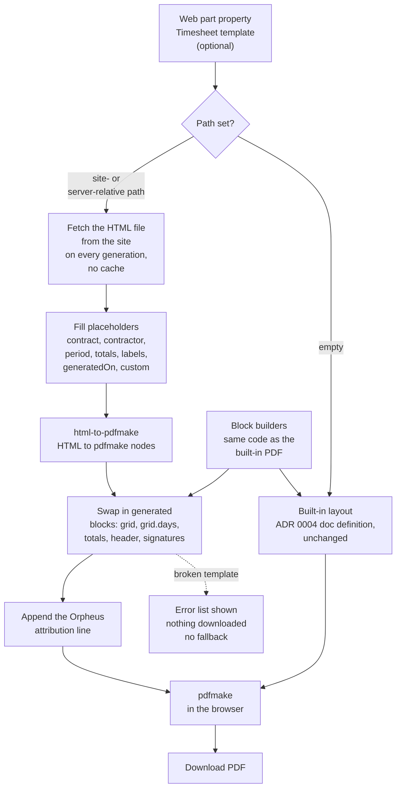

# 10. HTML template for the timesheet PDF

## Date: 2026-10-22

## Status

Accepted

---

## Problem

The built-in timesheet layout (ADR 0004) is fixed in code. Organisations that use the web part
want their own page: a logo, other header fields, different signature boxes, footnotes. Each
such request is a code change and a release. The colour-coded grid and the totals must keep the
exact look and numbers of the built-in PDF, and the solution still has no server component.

---

## Decision

We will let a site owner supply the page as an **HTML file stored on the SharePoint site**,
and render it **client-side with html-to-pdfmake** into the same pdfmake pipeline as ADR 0004.

- A web part property (`Timesheet template (optional)`) holds a site-relative or server-relative
  path. Empty means the built-in layout, whose doc definition is unchanged (guarded by a golden test).
- The file is fetched on every generation; no cache.
- Placeholders `{{contract.*}}`, `{{contractor.*}}`, `{{period.*}}`, `{{totals.*}}`, `{{labels.*}}`,
  `{{generatedOn}}` and `{{custom.<key>}}` insert text. Blocks `{{grid}}`, `{{grid.days}}`,
  `{{totals}}`, `{{header}}` and `{{signatures}}` are **generated by the same code as the built-in
  PDF** and swapped in for their element, so the grid cannot be broken by a template.
- Five optional contract columns (`ConsultantPosition`, `Vendor`, `Lot`, `ApproverName`,
  `TemplateFields`) feed the extra values. They are added by a separate script.
- Images are PNG/JPEG from the same site or `data:` URLs; SVG goes inline.
- The Orpheus attribution line is appended to every template-rendered PDF.

Authoring guide: `docs/timesheet-templates.md`.

---

## Alternatives considered

| Option | Summary | Pros | Cons |
|--------|---------|------|------|
| ✅ **html-to-pdfmake over a SharePoint-hosted template** | Convert the filled HTML to pdfmake nodes; swap in generated blocks | Vector, searchable text; no server; reuses pdfmake and the existing builders | CSS subset; Roboto only |
| html2canvas + jsPDF | Render the HTML to a canvas and place the image on a page | Any CSS works | Raster output, blurry text, large files, no searchable text; rejected in ADR 0004 for the same reasons |
| Headless Chromium on a server | Print HTML to PDF in a service | Full CSS fidelity | Needs Azure or similar hosting, auth and cost; breaks the no-server rule |
| HTML-rendered grid | Let the template draw the grid itself from data | Maximum freedom | Every template re-implements the colour rules and totals; easy to get numbers wrong on a signed document |

---

## Consequences

**Positive:**
- Layout changes are a file edit by a site owner, with no release.
- Numbers and grid look the same in every layout because the code draws them.
- Still fully client-side; works in workbench and production.

**Negative / Trade-offs:**
- Only the html-to-pdfmake subset of HTML works: inline `style`, no `<style>` blocks, no scripts.
  Authors learn it by trial.
- Roboto is the only font.
- The attribution line is always appended and cannot be removed by a template.
- The new columns are read tolerantly: a site without them still works and the values are empty.
- A broken template gives **no fallback** to the built-in layout. The user sees the error list
  and nothing is downloaded. This avoids a signed document silently changing layout, but the
  site owner must fix the file or clear the setting.
- The built-in PDF now shows the contract header on every page. The refactor to share the block
  builders exposed a bug where one set of header nodes was reused on every page and pdfmake
  mutated them, so the header was dropped from page 2 on. Fixing it changed the built-in output
  on multi-page periods.
- The template frame (title, logo, signatures) does not repeat per page; only the grid's day
  header does.
- The template and its images are read with the viewer's permissions, so they must be readable
  by all web part users.
- Provisioning of the new columns is a separate idempotent script, not part of the main site
  template (ADR 0006), so it is a second step for sites that want it.

**Risks:**
| Risk ID | Description | Impact (E/H/M/L) | Mitigation |
|---------|-------------|------------------|------------|
| R1 | html-to-pdfmake adds to the lazy PDF chunk | L | It loads only with pdfmake in the `orpheus-timesheet-pdf` chunk, never in the main bundle |
| R2 | A template editor changes a signed document's look | M | Store the file where only site owners can edit; the guide says so |
| R3 | The `Vendor` column ID clashes with an existing site column | L | The script checks all names and IDs first and stops before any change |

---

## Related

- Related ADRs: ADR 0004 (`0004-client-side-pdf-pdfmake.md`), ADR 0006 (`0006-idempotent-pnp-powershell-provisioning.md`)
- Related documents: [timesheet template guide](../../docs/timesheet-templates.md)
- TOGAF phase: C — Application Architecture
- Decision maker(s): Kiril Iliev (owner)
- Stakeholders: site owners and client IT who author templates; contract managers and contractors who download timesheets; Orpheus Systems (maintainer)
