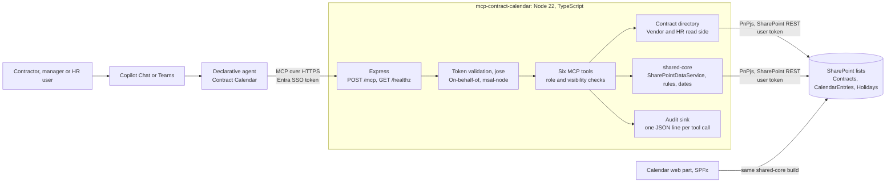

# 11. Custom MCP server in TypeScript as the agent's action layer

## Date: 2026-10-22

## Status

Proposed

---

## Problem

Contractors and contract managers want to talk to the contract calendar: "book me on-site days
from 01.12 to 05.12", "how many on-site days are left on my contract". The agent has to write to
the same three SharePoint lists as the calendar web part (Contracts, CalendarEntries, Holidays) and
must keep the same invariants.

Those invariants are not CRUD. `SharePointDataService.upsertEntry` in `shared-core`, in one call,
rejects weekends and holidays for the contract's country, rejects dates outside the contract
period, deletes any entry on that date across the contractor's other contracts (ADR 0008: one
entry per contractor per date), adds the new entry and recomputes `OnSiteUsedDays` /
`OffSiteUsedDays` on every affected contract. An agent that writes list items through a generic
tool would have to replay this from prose instructions, per day, over several tool calls, with the
model deciding which existing entry to delete. That drifts from the web part and corrupts the
used-days counters.

Three questions follow: do we need our own server at all, in which language, and through which
SharePoint API.

---

## Decision

We build our own MCP server, `packages/mcp-contract-calendar`, in **TypeScript on Node 22**, and it
reaches SharePoint through **SharePoint REST via PnPjs v4**, reusing `shared-core`
(`SharePointDataService`, `deriveRoles`, `rules.ts`, `dates.ts`) unchanged. The server adds only
what the web part does not have: role and visibility checks for the agent's users (including HR),
the vendor read side, range orchestration (`book_days` over a date range, `needs_choice` on
overlap) and the audit event. Every write goes through `IDataService.upsertEntry` / `deleteEntry`.

The server speaks stateless Streamable HTTP (`POST /mcp`) and exposes six tools:
`get_my_contracts`, `list_contracts`, `get_calendar`, `book_days`, `remove_days`, `get_holidays`.
The Microsoft 365 guidance is to keep a plugin under ten tools; above that, selection quality drops
([MCP and API plugins](https://learn.microsoft.com/microsoft-365/copilot/extensibility/overview-plugins)).

---

## Considered Options

### Off-the-shelf routes (do we need our own server?)

Checked during the research on 2026-10-22
(`docs/research/2026-10-22-sharepoint-contract-agent.md`). Each was rejected for the reason in the
last column.

| Route | What it offers | Why not |
|---|---|---|
| Copilot Studio first-party SharePoint MCP server (`mcp_SharePointRemoteServer`) | List item create, update, delete; columns; sites | Preview. Microsoft marks the application-specific Microsoft 365 MCP servers as backward compatibility only, not for new projects ([reference](https://learn.microsoft.com/microsoft-copilot-studio/mcp-sharepoint-tools)). Generic CRUD, no business rules. |
| Work IQ MCP (`create_entity`, `update_entity`, `delete_entity`) | The replacement for the above | Preview. Mutations are blocked by tenant policy by default ([tool reference](https://learn.microsoft.com/microsoft-365/copilot/extensibility/work-iq/mcp/tool-reference)). Documented hosts do not include the Agents Toolkit declarative agent route. Generic CRUD again. |
| Copilot in SharePoint skills | Repeatable workflows inside a site | "Skills can't connect to external systems or execute custom code" ([skills](https://learn.microsoft.com/sharepoint/copilot-in-sharepoint-skills)). Rules would live in prose. Needs a Copilot licence per user; reachable only from Copilot in SharePoint. |
| Copilot Studio agent with SharePoint connector actions or agent flows | No custom hosting | The rules would be rebuilt in Power Automate, a second implementation next to `shared-core`. Billed per message in Copilot Studio capacity. Reasonable fallback if hosting a server is not wanted. |
| API plugin (OpenAPI) straight at SharePoint REST or Graph | No server to host | Same rules-in-prose problem. The documented pattern is an API you own, secured with Entra SSO, that then calls SharePoint ([Entra SSO](https://learn.microsoft.com/microsoft-365/copilot/extensibility/plugin-authentication-entra-sso)). |
| SharePoint agent builder, `.agent` files | Lives in the site | Q&A over content, no actions. The `.agent` format stops working after March 2027 ([upgrade agents](https://learn.microsoft.com/sharepoint/upgrade-sharepoint-agents)). |
| ✅ **Own MCP server** | Our rules, our tools | Hosting and an Entra app registration to maintain |

MCP over an API plugin for our own server: both are supported as declarative agent actions with
the same Entra SSO configuration. MCP is the Agents Toolkit default, gets dynamic tool discovery
(no repackaging when a tool changes) and can later return MCP Apps widgets
([build MCP plugins](https://learn.microsoft.com/microsoft-365/copilot/extensibility/build-mcp-plugins)).

### Language

| Option | SDKs | Pros | Cons |
|---|---|---|---|
| ✅ **TypeScript, Node 22** | Official MCP TypeScript SDK; PnPjs v4 with `@pnp/nodejs` | Imports `shared-core` directly: one implementation of the booking rules for the web part and the agent. Same PnPjs library, same `mapContract` / `CONTRACT_SELECT`, same date helpers. Runs in the repo's existing Podman toolchain. | Module-loading friction: `shared-core` is CommonJS, `@pnp/sp` is ESM-only (works through Node 22 `require(esm)`, not under Jest; see the server README). The MCP SDK's zod-driven generics exhaust tsc memory, so tools are registered through a loosely typed wrapper. |
| C# / .NET | Official MCP C# SDK ([.NET and MCP](https://learn.microsoft.com/dotnet/ai/get-started-mcp)); PnP Core SDK for SharePoint ([PnP Core SDK](https://learn.microsoft.com/sharepoint/dev/sp-add-ins-modernize/from-csom-to-pnp-libraries)) | Mature hosting story, strong typing, Azure Functions MCP samples exist | `upsertEntry`, `isBlocked`, `contractsCoveringDate`, `computeTotals`, `computeRemaining` and the date rules would be written a second time. Two implementations of one invariant drift, and the used-days counters are the first thing to break. |
| Python | Official MCP Python SDK; Microsoft Graph SDK (no PnP-level SharePoint library) | Quick to write | Same duplication as C#, and SharePoint access only through Graph (see the API table). |

The rule-duplication argument decides it. ADR 0003 made `IDataService` the single place where the
booking rules live; a server in another language would split that place in two.

### SharePoint API

| Option | Pros | Cons |
|---|---|---|
| CSOM | Full object model, batching through `ExecuteQuery` | .NET only for a server (the JavaScript CSOM is browser-bound); legacy client; does not fit a TypeScript server |
| Microsoft Graph list items | One endpoint for all of Microsoft 365 | Filtering on a non-indexed column needs the `Prefer: HonorNonIndexedQueriesWarningMayFailRandomly` header, and the header name describes the result. "When filtering on indexed fields, the service can only filter one indexed field at a time" ([list items](https://learn.microsoft.com/graph/api/listitem-list)), while our role filters combine `ContractorId`, `ContractManagerId` and `Status`. JSON `$batch` holds at most 20 requests ([JSON batching](https://learn.microsoft.com/graph/json-batching)). `shared-core` does not speak Graph, so everything would be rewritten. |
| ✅ **SharePoint REST through PnPjs v4** | What `SharePointDataService` already uses: same queries, same `$batch` semantics for delete-then-add, same mappers. Multi-column OData filters on indexed columns. | Tied to SharePoint Online; needs a delegated SharePoint token (the on-behalf-of exchange in the identity ADR) |

---

## Consequences

**Positive:**
- The agent and the web part enforce the same invariants from the same compiled code. A rule
  change in `shared-core` reaches both.
- Tools are unit-tested against `LocalDataService` and fixtures with no tenant.
- The server is a plain HTTP app in a container: it runs under Podman locally and on Container
  Apps, App Service or AKS later.

**Negative / Trade-offs:**
- We host and patch a service, and own an Entra app registration.
- PnPjs adapters (`createSpfi`, `SharePointContractDirectory`, `agentRoles`, `contextFactory`) are
  thin and not unit-tested, because Jest cannot load ESM-only `@pnp/sp`. They are covered by the
  live demo only.
- `upsertEntry` recomputes totals per call. A five-day booking does that five times; acceptable
  at demo volume, to watch against the roughly 10 second action timeout.
- `shared-core` cannot change while the web part work is in flight, so the vendor and HR read side
  lives in the server package.

**Risks:**
| Risk ID | Description | Impact (E/H/M/L) | Mitigation |
|---------|-------------|------------------|------------|
| R-AGT-1 | `upsertEntry`'s batch is not transactional: the delete of a sibling entry can succeed while the add fails | M | `book_days` reports the day as failed; the fix belongs in `shared-core` (listed in `packages/agent-contract-calendar/docs/architecture-amendments.md`) |
| R-AGT-2 | Tool count grows past ten and selection quality drops | L | Keep one tool per user-visible action; fold variants into parameters (as `get_contractor_calendar` was folded into `get_calendar`) |
| R-AGT-3 | The SDK upgrade path changes the `registerTool` typing again | L | Wrapper is in one file (`src/mcp/createMcpServer.ts`); `npm run typecheck` runs separately from Jest |

---

## Related

- Related ADRs: ADR 0003 (`IDataService`), ADR 0005 (filtering over item-level permissions),
  ADR 0008 (one entry per contractor per date), `0012-declarative-agent-entra-sso-obo.md`,
  `0014-three-layer-audit-for-agent-actions.md`
- Related documents: the contract agent design document of 2026-10-22 (not published) (sections 4, 5, 6),
  `docs/research/2026-10-22-sharepoint-contract-agent.md` ("Why a generic SharePoint tool is not
  enough", decisions D1 and D2), `packages/mcp-contract-calendar/README.md`
- TOGAF phase: C — Application Architecture
- Decision maker(s): owner
- Stakeholders: contractors; contract managers; HR; builder
