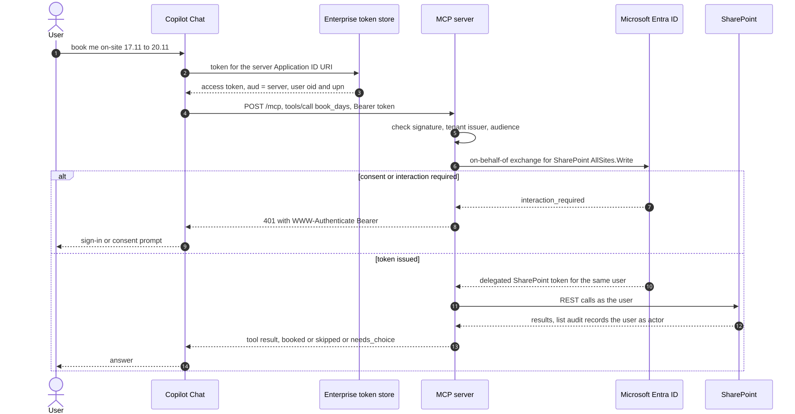
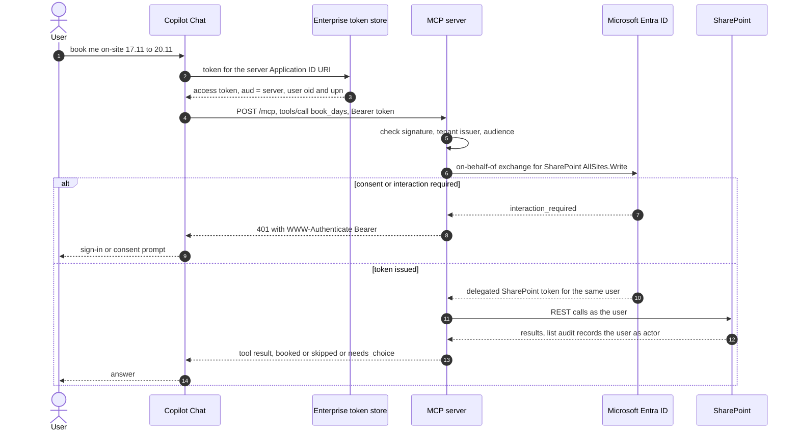

# 12. Declarative agent with Entra SSO and on-behalf-of to SharePoint

## Date: 2026-10-22

## Status

Proposed

---

## Problem

The MCP server (`0011-custom-mcp-server-in-typescript.md`) needs a front end that users already
have open, and it has to know who is calling. The web part's model depends on the identity of the
signed-in user: `deriveRoles` decides contractor, manager or admin from the user's SharePoint id,
the role filters of ADR 0005 use it, and SharePoint list permissions apply to that user. Whatever
sits between Copilot and SharePoint must carry that identity through, and the SharePoint audit log
must show the real person as the actor of each change.

---

## Decision

The front end is a **declarative agent** built with the **Microsoft 365 Agents Toolkit**
(`packages/agent-contract-calendar`). Its only action is a `RemoteMCPServer` plugin (plugin manifest
v2.4) with dynamic tool discovery, secured with **Microsoft Entra SSO** (`OAuthPluginVault` auth
reference).

The server:

1. Validates the incoming bearer token itself (jose, RS256): signature from the tenant's keys,
   issuer pinned to the tenant (v1 `sts.windows.net` and v2 `login.microsoftonline.com` forms),
   audience equal to the server's Application ID URI or client id (v1 and v2 tokens differ).
2. Exchanges it **on behalf of the user** (msal-node) for a delegated SharePoint token with
   `AllSites.Write`. The provisioning app registration, which has `AllSites.FullControl`, is not
   reused.
3. Calls SharePoint as that user. `deriveRoles` and the role filters run unchanged; HR is added as
   membership of a SharePoint group (see `0013-vendor-column-and-hr-group-for-the-agent.md`).
4. On a consent or interaction error from the exchange returns HTTP 401 with
   `WWW-Authenticate: Bearer`, so Copilot shows the sign-in prompt
   ([Entra SSO](https://learn.microsoft.com/microsoft-365/copilot/extensibility/plugin-authentication-entra-sso)).
   Other failures return 500.

The server never uses app-only access to SharePoint.

---

## Considered Options

### Front end

| Option | Summary | Pros | Cons |
|--------|---------|------|------|
| ✅ **Declarative agent, Agents Toolkit, MCP plugin** | Manifest-only agent in Copilot Chat and Teams | Custom actions work in Copilot Chat without a Copilot licence ([prerequisites](https://learn.microsoft.com/microsoft-365/copilot/extensibility/prerequisites)); dynamic tool discovery; sideload from VS Code | Developer mode debug cards need a licensed user; the SharePoint page placement waits for the Agent Chat web part |
| Copilot Studio agent | Low-code agent with connectors | SharePoint channel exists | Rules re-implemented in flows; per-message billing |
| Custom engine agent (Agents SDK, own orchestration) | Full control of the model loop | Any model, any UI | We would own orchestration, safety and hosting of the bot; far more than six tools justify |
| SharePoint `.agent` file | Site-local Q&A agent | Simple | No actions; retires March 2027 |

### Identity to SharePoint

| Option | Summary | Pros | Cons |
|--------|---------|------|------|
| ✅ **Entra SSO to the server, on-behalf-of to SharePoint** | Delegated token for the same user | SharePoint permissions and `deriveRoles` apply unchanged; SharePoint audit shows the real user | One app registration with exposed API, identifier URI, redirect URI, pre-authorised token store client; admin consent; a client secret or certificate for the exchange |
| App-only (certificate) to SharePoint | Server acts as itself | No consent prompts; simpler token handling | The server would have to re-implement who-may-see-what with full site access; every SharePoint audit record would show `app@sharepoint` instead of the person ([audit log activities](https://learn.microsoft.com/purview/audit-log-activities)); one leaked credential exposes every list |
| OAuth authorization code to a separate SharePoint app | User signs in to SharePoint through the plugin | Delegated | Copilot gets a SharePoint-audience token, so the server cannot validate a token meant for itself; mixes two audiences in one plugin |
| No auth (`None`) | Development only | Fast local loop | No user, so no roles; allowed only with `DATA_MODE=local` and rejected by config otherwise |

The audit actor decides app-only. With on-behalf-of, `ListItemCreated` / `ListItemDeleted` in
Purview name the contractor who asked; with app-only they name the app, and the per-person trail
has to be rebuilt from our own log alone.

---

## Consequences

**Positive:**
- Visibility is the web part's: a contractor sees own contracts, a manager sees managed ones, HR
  and admins see all; a user with no role sees nothing.
- Writes by non-contractors are refused in the server (`forbidden`), not only by agent instructions.
- Consent problems surface as a sign-in prompt instead of an opaque error.

**Negative / Trade-offs:**
- Owner steps in Entra: identifier URI, `oAuthConsentRedirect` redirect URI, pre-authorised
  Enterprise token store client, admin consent for `AllSites.Write`
  (`packages/agent-contract-calendar/README.md`).
- The OBO exchange needs a client secret locally; Key Vault and a certificate in the Azure target.
- The contractor Contribute-on-Contracts gap from ADR 0005 is unchanged: SharePoint would let a
  contractor edit a contract; the server, like the web part, is what stops it.

**Risks:**
| Risk ID | Description | Impact (E/H/M/L) | Mitigation |
|---------|-------------|------------------|------------|
| R-AGT-4 | Production contractors are guest users; guest access to declarative agents and Copilot Chat is not confirmed | H | Verify before promising the channel to contractors (spec section 9, open item 1) |
| R-AGT-5 | Manifest schema versions (DA 1.8, app manifest 1.30, plugin 2.4, `m365agents.yml` 1.9) were written from documentation, not from a scaffolded project | M | Compare with a freshly scaffolded "Start with an MCP server" project at first provision |
| R-AGT-6 | With dynamic discovery the plugin manifest no longer carries per-function confirmation hints for write tools | M | Agent instructions require one confirmation before `book_days` and `remove_days`; the server sets MCP tool annotations (`readOnlyHint` on reads, `destructiveHint: false` on `book_days`, `destructiveHint: true` on `remove_days`), which Copilot reads to decide confirmations |

---

## Related

- Related ADRs: ADR 0003, ADR 0005, `0011-custom-mcp-server-in-typescript.md`,
  `0014-three-layer-audit-for-agent-actions.md`, `0015-dev-tunnel-for-the-agent-demo.md`,
  `0017-sharepoint-placement-waits-for-agent-chat-web-part.md` (why the agent is not in the SharePoint side pane)
- Related documents: `docs/superpowers/specs/2026-10-22-contract-agent-design.md` (sections 4, 5
  "Identity"), `docs/research/2026-10-22-sharepoint-contract-agent.md` ("Identity and
  permissions", decisions D3 and D4), `packages/agent-contract-calendar/README.md`
- Sources: [Build MCP plugins](https://learn.microsoft.com/microsoft-365/copilot/extensibility/build-mcp-plugins),
  [Entra SSO for plugins](https://learn.microsoft.com/microsoft-365/copilot/extensibility/plugin-authentication-entra-sso),
  [Dynamic tool discovery](https://learn.microsoft.com/microsoft-365/copilot/extensibility/plugin-dynamic-tool-discovery),
  [Declarative agents overview](https://learn.microsoft.com/microsoft-365/copilot/extensibility/overview-declarative-agent)
- TOGAF phase: C — Application Architecture (security model); D — Technology Architecture (Entra)
- Decision maker(s): owner
- Stakeholders: contractors; contract managers; HR; tenant administrators; builder
