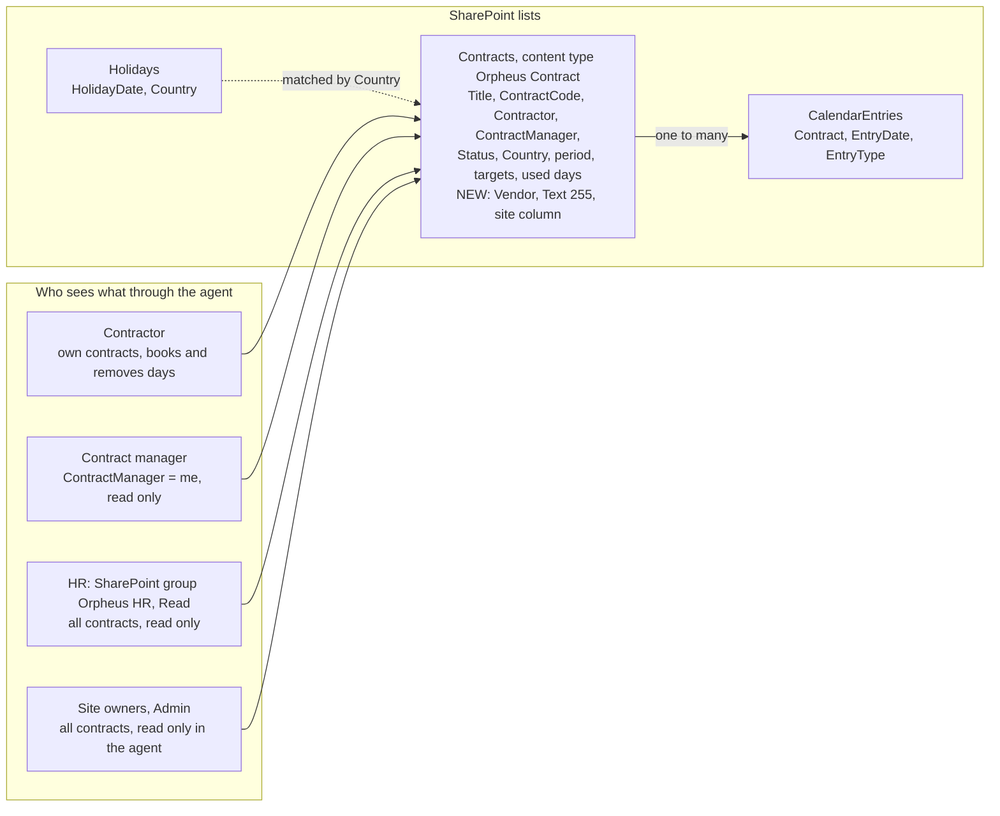

# 13. Vendor as a text column and an HR read-only group, owned by the agent's setup script

## Date: 2026-10-22

## Status

Proposed

---

## Problem

The agent serves a user the web part does not know, HR, who reads all contracts and writes nothing.
HR and contract managers also ask about **vendors**, the companies contractors work through
("show me the contracts for Ivan's vendors"). The data model has neither: Contracts has no vendor
column, and `deriveRoles` knows contractor, manager and admin only.

Two constraints shape where the change lives. `packages/shared-core` and `infra/provisioning/**`
must not change while the web part work is in flight. And the HTML-timesheet work on a parallel
branch needs the same `Vendor` column for its PDF header, so both branches must create an identical
field or the merge produces two.

---

## Decision

**Vendor column.** One text column on Contracts, defined identically on both branches:

| Property | Value |
|---|---|
| Internal name | `Vendor` |
| Type | Text, MaxLength 255 |
| DisplayName | `Vendor (service provider)` |
| Group | `Orpheus Systems` |
| ID | `{582b1c53-77a2-4a1b-918f-14e0b9eaff06}` (fixed) |
| Placement | Site column, plus a FieldRef on the `Orpheus Contract` content type with `-UpdateChildren` |

The fixed ID is what makes the two scripts compatible: whichever runs first creates the column,
the other finds a field named `Vendor` with that ID and reports "unchanged". A `Vendor` site column
with another ID or another type, the Vendor ID under another internal name, or a list-level `Vendor`
field on Contracts with another ID stops the agent's script before any write (exit 1) and names the
conflict. Only a not-found response counts as missing.

**HR role.** A SharePoint site group, default name `Orpheus HR` (configurable, `HR_GROUP`), with
the **Read** permission level. The server treats membership as the HR role: it reads
`currentUser.groups` the way `deriveRoles` reads owner membership, and matches the group title
exactly (case-sensitive). HR sees all contracts through the agent, grouped by vendor, and can
filter by manager; HR never books.

**Ownership.** Both are created by the agent's idempotent setup script,
`packages/mcp-contract-calendar/setup/Setup-AgentDemo.ps1`, which also seeds the 002xxx demo
contracts. The server reads `Vendor` through its own query (`vendorQuery.ts`, `CONTRACT_SELECT` plus
`Vendor`, mapped with `shared-core`'s `mapContract`). `shared-core` and `infra/provisioning` are not
touched. At merge, the column moves into the main provisioning template (plan 3) and the setup
script's column step becomes a no-op.

---

## Considered Options

### Vendor

| Option | Summary | Pros | Cons |
|--------|---------|------|------|
| ✅ **Text column `Vendor` with a fixed ID** | Free text on each contract | One column, no new list; same definition as the HTML-timesheet branch; trivial to filter and group | Spelling variants ("Kuker Consulting" vs "Kuker consulting") are separate vendors; no vendor metadata |
| Vendors list plus a lookup column | Normalised vendor entity | Clean data, room for vendor fields | A fourth list, a lookup, provisioning and UI for it; the HTML-timesheet branch would have to adopt it too; out of proportion for a demo |
| Managed metadata term set | Central vocabulary | Consistent names across sites | Term store permissions and setup; harder to provision idempotently; overkill now |
| Derive vendor from `ContractCode` | No new column | No schema change | The code has no vendor part; would need a naming convention nobody follows |

A Vendors list stays on the phase 2 list (spec section 9).

### HR

| Option | Summary | Pros | Cons |
|--------|---------|------|------|
| ✅ **Dedicated SharePoint group with Read** | `Orpheus HR`, membership = HR role | Read-only in SharePoint as well as in the agent; managed by site owners like any group | A second place to grant access; group title must match `HR_GROUP` exactly |
| Use site owners | Owners are already "Admin" | Nothing to create | Owners can write everything; giving HR ownership to grant read access inverts least privilege |
| Entra security group or app role in the token | Role from Entra | Central, visible in the token | Needs directory changes and token configuration; the web part's model is SharePoint-group based, so two role sources would coexist |

### Where the change lives

| Option | Pros | Cons |
|--------|------|------|
| ✅ **Agent setup script now, main template at merge** | No conflict with parallel branches; `shared-core` untouched | Two provisioning steps until merge; column definition duplicated in two scripts until then |
| Edit `infra/provisioning` and `shared-core` now | One place from day one | Breaks the "do not touch" constraint while the web part and HTML-timesheet work are in flight; merge conflicts |

---

## Consequences

**Positive:**
- Managers' and HR's questions about vendors are answered from one column, grouped by the server.
- The HTML-timesheet branch and this branch create the same field; the merge does not produce
  `Vendor` and `Vendor0`.
- The setup script is safe to rerun: a prepared site is reported unchanged.

**Negative / Trade-offs:**
- Until merge, a new site needs the main provisioning script and then the agent setup script.
- `vendorQuery.ts` duplicates part of the HTML-timesheet branch's `TEMPLATE_DATA_SELECT`; after
  merge it may reuse `getContractTemplateData` (listed in `architecture-amendments.md`).
- `Vendor` is not indexed. Filtering by vendor on a large Contracts list will need an index.

**Risks:**
| Risk ID | Description | Impact (E/H/M/L) | Mitigation |
|---------|-------------|------------------|------------|
| R-AGT-7 | The HTML-timesheet script and this one disagree on a property other than the ID (display name, group) | L | Both read the same spec table; the pre-flight compares ID and type and stops on mismatch |
| R-AGT-8 | Someone renames the HR group and HR users silently lose access | L | `HR_GROUP` is configuration; `get_my_contracts` returns the caller's derived roles, so a missing HR role shows in the first answer |

---

## Related

- Related ADRs: ADR 0005 (filtering, roles), ADR 0006 (idempotent PnP PowerShell provisioning),
  `0010-html-template-timesheet.md` (same `Vendor` column), `0011-custom-mcp-server-in-typescript.md`
- Related documents: the contract agent design document of 2026-10-22 (not published) (sections 4 O1 to
  O3, O9, O10; 5 "Vendor column", "Reading vendors and HR without touching shared-core"),
  `architecture/03-phase-c-data-architecture.md`, `packages/agent-contract-calendar/demo/demo-procedure.md`
- TOGAF phase: C — Data Architecture
- Decision maker(s): owner
- Stakeholders: HR; contract managers; site owners; the HTML-timesheet work; builder
