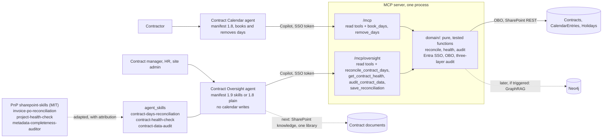

# 18. A second agent for contract oversight, built on adapted PnP SharePoint skills

## Date: 2026-10-23

## Status

Proposed

This ADR records a direction for the next iteration. **Nothing in it is built yet.** It reuses three
skills from the PnP catalog ([pnp/sharepoint-skills](https://github.com/pnp/sharepoint-skills/tree/main/Skills)):
`invoice-po-reconciliation`, `project-health-check` and `metadata-completeness-auditor`.

---

## Problem

The Contract Calendar agent (`0011-custom-mcp-server-in-typescript.md`,
`0012-declarative-agent-entra-sso-obo.md`) is built for contractors: it books and removes days, and
managers and HR can only list contracts. The owner wants agent support for oversight work as well:

- **Reconciliation.** Do the booked days match what the contract allows? Are there entries outside
  the contract period, on weekends or holidays, or over the on-site and off-site targets?
- **Health check.** Which contracts need attention, for example days running out before the end
  date, an end date close with many days left, or a contract still open after its last execution
  date? The owner also wants to know how retrieval (RAG) and, later, a graph store (GraphRAG) fit in.
- **Data quality.** Which contracts are missing a vendor, a manager, dates or targets? The vendor
  filter in `list_contracts` (`0013-vendor-column-and-hr-group-for-the-agent.md`) silently skips a
  contract with an empty Vendor.

The PnP catalog has skills for close analogues of these tasks. They cannot be uploaded and used
as they are:

1. **They target Copilot in SharePoint.** They live in the site's `Agent Assets/Skills` library and
   call that product's own tools (`list_items`, `get_list_schema`, `cat_file`,
   `update_list_items_v2`) as the signed-in user
   ([Copilot in SharePoint skills](https://learn.microsoft.com/sharepoint/copilot-in-sharepoint-skills)).
   Copilot in SharePoint needs a Microsoft 365 Copilot licence per user, and the dev tenant has none
   (research decision D7).
2. **Our lists are not protected by permissions.** Visibility is enforced by filtering in the web
   part and in the MCP server, not by item-level permissions
   (`0005-web-part-filtering-over-item-level-permissions.md`). A generic skill that reads the
   Contracts list directly would show every contractor every contract. It would also bypass the
   per-tool-call audit (`0014-three-layer-audit-for-agent-actions.md`).
3. **Their domain is different.** An invoice is not a calendar entry and a project milestone is not
   a contract target. The procedure and the output format carry over; the data and the rules do
   not.

Declarative agents have their own skills now. Manifest schema 1.9 adds `agent_skills`: folders with
a `SKILL.md` (under 20,000 characters), resources and sandboxed scripts, loaded only when a task
needs them ([Custom skills in declarative agents](https://learn.microsoft.com/microsoft-365/copilot/extensibility/declarative-agent-skills),
[schema 1.9](https://learn.microsoft.com/microsoft-365/copilot/extensibility/declarative-agent-manifest-1.9)).
The feature is a **preview for Microsoft Frontier tenants only**, allows eight skills per agent,
and is not available in tenants with Information Barriers. Skill scripts run with no network
access and cannot call MCP servers, connectors or plugins. Only the orchestrator can.

---

## Decision

1. **A second declarative agent, Contract Oversight**, in a new package
   `packages/agent-contract-oversight`. It is for contract managers, HR and site admins. It
   **never touches calendar entries**. Its only write is the reconciliation result on a contract
   (point 5). The Contract Calendar agent stays as it is, for contractors, on manifest 1.8.
2. **The same MCP server, a second endpoint.** The server gets an `/mcp/oversight` endpoint next to
   `/mcp`. It exposes the existing read tools (`get_my_contracts`, `list_contracts`,
   `get_calendar`, `get_holidays`), three new read tools and one write tool,
   `save_reconciliation`. It never registers `book_days` or `remove_days`. Entra SSO,
   on-behalf-of, role resolution and audit are the same code (`0012`, `0014`).
3. **The numbers come from the tools, not from the model.** Every calculation (used days, targets,
   burn rate, health status, completeness score) is a pure function in the server's `domain/`,
   with unit tests. The functions take thresholds from configuration. A skill only says when to call
   a tool, in what order, and how to present the result. The sandbox could run scripts, but a
   script cannot read our data and its results would not reach the audit log.
4. **The three PnP skills are adapted, not copied.** Each one becomes a skill folder in the
   oversight agent's `appPackage/skills/`, rewritten for our tools and domain. Each `SKILL.md` keeps
   a header that names the PnP source and its MIT licence, and `NOTICE` gets a third-party section.

   | PnP skill | Our skill | What it checks here | New MCP tool | Writes? |
   |---|---|---|---|---|
   | `invoice-po-reconciliation` | `contract-days-reconciliation` | Booked entries (the "invoice") against the contract (the "purchase order"): used on-site and off-site days against `onSiteTargetDays` and `offSiteTargetDays` (half days count 0.5); entries before `startDate` or after `latestExecutionDate`; entries on a weekend or a holiday of the contract's country; entries on a contract that is no longer active. Result per contract: Compliant, Over target or Cannot reconcile, with the days that caused it. There are no vendor invoices in scope (owner, 2026-10-23), so the contract plays the part of the purchase order and the booked days play the part of the invoice | `reconcile_contract_days` (read), `save_reconciliation` (write) | **Yes**, as in PnP: the result is written back to the contract after the user confirms (point 5) |
   | `project-health-check` | `contract-health-check` | Red, Amber, Green or Unknown per contract on four lines: burn rate (days used against the share of the contract period elapsed), runway (projected date the days run out against `latestExecutionDate`), end date (close to the end with days left, or past it and still open) and data (the audit result below). Keeps the PnP output shape: overall status, the four lines, what needs management attention, and evidence with a confidence level. The Amber and Red thresholds are agreed with the business first (point 7) | `get_contract_health` | No |
   | `metadata-completeness-auditor` | `contract-data-audit` | Required Contract fields (code, framework contract, contractor, manager, vendor, start and last execution date, targets, hours per day, country, status), empty or placeholder values (`TBD`, `N/A`, `-` and the rest of the PnP list), fill rate per field, and a rollup per contract manager instead of per last editor | `audit_contract_data` | No. Same rule as PnP: strictly read-only |

5. **Reconciliation is written back to the contract** (owner, 2026-10-23).
   - The agent setup script provisions four columns on Contracts, idempotently, in the same way it
     already owns the Vendor column (`0013`, `0006`): `ReconciliationStatus` (choice: Compliant,
     Over target, Cannot reconcile), `ReconciliationDetails` (plain text, the summary in one or two
     sentences), `ReconciledAt` (date and time) and `ReconciledBy` (person).
   - The flow follows `book_days`: the agent shows the result of `reconcile_contract_days` and asks
     once whether to save it. After the user confirms, it calls `save_reconciliation` with the
     contract id only.
   - `save_reconciliation` **recomputes the result on the server** and writes that. The model never
     passes a status or a text, so the stored value cannot differ from what the domain function
     says. The write goes through on-behalf-of as the user and is audited like a booking.
   - Who may save: the contract's manager and site admins. HR stays read-only (`0013`) and gets a
     polite refusal.
   - The contract form customizer shows the four columns read-only, so they change only through
     the agent.
6. **Roles for reading.** The new read tools refuse a caller who is only a contractor. A contract
   manager sees the contracts they manage, and HR and site admins see all of them. These are the
   rules `list_contracts` already follows (`seesAll` in `domain/viewer.ts`).
7. **Health thresholds are a business decision.** The Amber and Red limits for burn rate, runway
   and end date are agreed with the business before `get_contract_health` is built (owner,
   2026-10-23). They live in server configuration, not in code or in the skill. Every answer shows
   the numbers behind the colour, so a disputed colour can be checked.
8. **Two package flavours while skills are in preview.** The `skills` flavour uses manifest 1.9
   with `agent_skills` and is the target. It is tested on the owner's Frontier tenant. The `plain`
   flavour uses manifest 1.8 and puts a short version of each skill's rules in `instruction.txt`
   (limit 8,000 characters). It is for tenants without Frontier, including the dev tenant, which
   has no Copilot licence (D7). The flavour is chosen per environment in `m365agents.yml`. The
   agent gives the same numbers in both because the logic is in the tools. Only the presentation is
   less consistent without skills.
9. **Retrieval happens in stages.** For the health check, RAG means two things. The Red, Amber and
   Green status comes from `project-health-check`. Retrieval-augmented generation is staged:
   - **Now: grounding through tools.** The evidence is structured data in three lists, and the MCP
     tools are the retrieval layer. There is no index, embeddings or second store. An answer can only
     cite what a tool returned, the same rule the contractor agent follows.
   - **Next, when contract documents come into scope** (statements of work, amendments, status
     reports): the agent's SharePoint knowledge capability, scoped to one document library, before
     any store of our own. Unlicensed users pay for it through pay-as-you-go
     (`0017-sharepoint-placement-waits-for-agent-chat-web-part.md`).
   - **Later, only if a trigger is met: GraphRAG.** The trigger is questions that need three or more
     hops across documents and relations, such as contractor, vendor, framework contract, amendment
     and incident, at a size where list queries stop being enough. The store choice follows the
     Orpheus benchmark of
     [Neo4j vs PostgreSQL + Apache AGE vs Cosmos DB](https://orpheussystems.com/lounge/graphrag-storage-neo4j-age-cosmos-db)
     (2026-10-21). Our stack has no PostgreSQL, so this would be a greenfield graph and **Neo4j** is
     the default, with embeddings on the nodes so a write stays one transaction. **PostgreSQL + AGE**
     applies only if PostgreSQL enters the stack for another reason, for example as the audit store.
     **Cosmos DB for Gremlin is excluded.** It was slowest at every depth, it is billed per hop, and
     it has no vector search and no transactions across requests. The graph store would join the
     Azure target in `0016-azure-target-apim-container-apps-terraform.md` and get its own ADR.

---

## Considered Options

### Where the new capabilities live

| Option | Summary | Pros | Cons |
|--------|---------|------|------|
| ✅ **Second declarative agent on the same MCP server** | Contract Oversight agent, own manifest and skills, `/mcp/oversight` endpoint | Booking tools are not reachable from the oversight agent at all; the contractor agent is not affected by a preview feature; its own eight-skill budget; conversation starters and instructions fit the audience; auth, audit and domain code are shared | A second app package to provision and publish; two agents for users who are both manager and contractor |
| Extend the Contract Calendar agent | Add the tools and skills to the existing agent | One agent, one package | Mixes booking and oversight in one set of instructions, which makes wrong tool choice more likely; the agent would need manifest 1.9, so the contractor flow depends on a Frontier preview |
| Upload the PnP skills to the site's Agent Assets library | Copilot in SharePoint runs them over the lists | No code; the skills work almost unchanged | Needs a Copilot licence per user; reads the lists directly and so shows all contracts to everyone (ADR 0005); no audit through our server; Copilot in SharePoint is not where this audience works |
| Only longer instructions, no skills | Put everything in `instruction.txt` | Works on every tenant today | The 8,000 character limit; all three procedures load on every turn; this is the fallback flavour, not the target |

### Where the calculations run

| Option | Pros | Cons |
|--------|------|------|
| ✅ **MCP tools, pure functions in `domain/`** | Same numbers on every call; unit tests; covered by the audit; can be reused later by the field customizer (for example a Red, Amber or Green badge) | Each new check needs server code and a release |
| Skill scripts in the sandbox | Logic ships inside the skill | No network, so a script cannot read our lists; the model would have to pass all the data into the script; nothing reaches the audit |
| The model calculates from raw tool output | No new tools | Models make mistakes in arithmetic over dates and half days; results differ between calls and cannot be unit-tested |

### Retrieval for the health check

| Option | Pros | Cons |
|--------|------|------|
| ✅ **Tools now, SharePoint knowledge next, GraphRAG only on a trigger** | No new store while the data is three small lists; each stage has a clear trigger | Questions about documents wait for the second stage |
| GraphRAG now (Neo4j) | Ready for multi-hop questions | A second database to host, secure and back up for a graph of a few hundred contracts, two to three hops deep. The benchmark found everything except Cosmos under 100 ms at 42,000 nodes, so the graph only pays off at a scale we do not have |
| Vector index only (Azure AI Search) | Good for finding the right paragraph | Weak exactly where the questions are, which is relations between contracts, people and vendors |

---

## Consequences

**Positive:**
- Managers and HR get reconciliation, health and data-quality answers in chat, with the same
  role rules and audit as booking.
- The last reconciliation of each contract is stored on the contract, with who saved it and when,
  so it can be shown in list views and later in the field customizer.
- The oversight agent cannot change calendar entries. Its one write stores a value the server
  computed, after a confirmation.
- The PnP skills give a tested procedure and output format; we write the domain rules, not the
  conversation design.
- The `domain/` functions can later feed the web part and the field customizer, for example a
  health badge next to the remaining-days bars.

**Negative / Trade-offs:**
- A second app package, plugin manifest and set of conversation starters to maintain.
- Two package flavours until skills leave preview, tested on two tenants: `skills` on the
  Frontier tenant, `plain` on the dev tenant.
- Adapted skills drift from the PnP originals; updates upstream are not picked up automatically.
- Four more columns on Contracts for the setup script, the form customizer and the demo data.
- A saved reconciliation goes stale as soon as days are booked or removed after it. `ReconciledAt`
  shows how old it is; the agent does not re-save on its own.
- `get_contract_health` cannot be finished until the business agrees the thresholds.

**Risks:**
| Risk ID | Description | Impact (E/H/M/L) | Mitigation |
|---------|-------------|------------------|------------|
| R-AGT-17 | Custom skills stay Frontier-only, or change shape before general availability | M | The `plain` flavour works without them; the logic is in the tools, so a skill format change only touches presentation |
| R-AGT-18 | A manifest 1.9 package with `agent_skills` fails to provision on a tenant without Frontier | M | `skills` is provisioned only to the Frontier tenant; every other environment gets `plain` |
| R-AGT-19 | Health thresholds (what counts as Amber or Red) do not match how a client manages contracts | M | Thresholds agreed with the business and kept in configuration; the answer always shows the numbers behind the colour |
| R-AGT-22 | A saved reconciliation is wrong or out of date and is read as the current state | M | The server computes what is saved, never the model; `ReconciledAt` and `ReconciledBy` are stored with it; every save is in the audit log |
| R-AGT-20 | A user who is both contractor and manager opens the wrong agent | L | Clear agent descriptions and starters; each agent says what it cannot do and names the other one |
| R-AGT-21 | GraphRAG is started before its trigger is met | L | The trigger is written down here; a graph store needs its own ADR and a measurement on our own query shapes, as the benchmark recommends |

---

## Owner answers (2026-10-23)

| Question | Answer | Where it lands |
|----------|--------|----------------|
| Write the reconciliation result back to the contract? | Yes | Decision 5 |
| Health thresholds for Amber and Red | To be agreed with the business | Decision 7; still open |
| Is there a Frontier tenant for the `skills` flavour? | Yes | Decision 8 |
| Are vendor invoices in scope? | No, there are no real invoices | Decision 4; no fourth skill |

**Still open:** the health thresholds. This ADR can move to Accepted once they are agreed and
the `skills` flavour has provisioned on the Frontier tenant.

---

## Related

- Related ADRs: `0005-web-part-filtering-over-item-level-permissions.md`,
  `0006-idempotent-pnp-powershell-provisioning.md`,
  `0011-custom-mcp-server-in-typescript.md`, `0012-declarative-agent-entra-sso-obo.md`,
  `0013-vendor-column-and-hr-group-for-the-agent.md`, `0014-three-layer-audit-for-agent-actions.md`,
  `0016-azure-target-apim-container-apps-terraform.md`,
  `0017-sharepoint-placement-waits-for-agent-chat-web-part.md`, ADR 0009 (Apache-2.0 with NOTICE)
- Related documents: `docs/research/2026-10-22-sharepoint-contract-agent.md` (decision D7),
  [PnP sharepoint-skills](https://github.com/pnp/sharepoint-skills/tree/main/Skills),
  [Custom skills in declarative agents](https://learn.microsoft.com/microsoft-365/copilot/extensibility/declarative-agent-skills),
  [GraphRAG storage benchmark](https://orpheussystems.com/lounge/graphrag-storage-neo4j-age-cosmos-db)
- TOGAF phase: C — Application Architecture / E — Opportunities and Solutions
- Decision maker(s): owner
- Stakeholders: contract managers; HR; site admins; contractors (unchanged agent); builder
