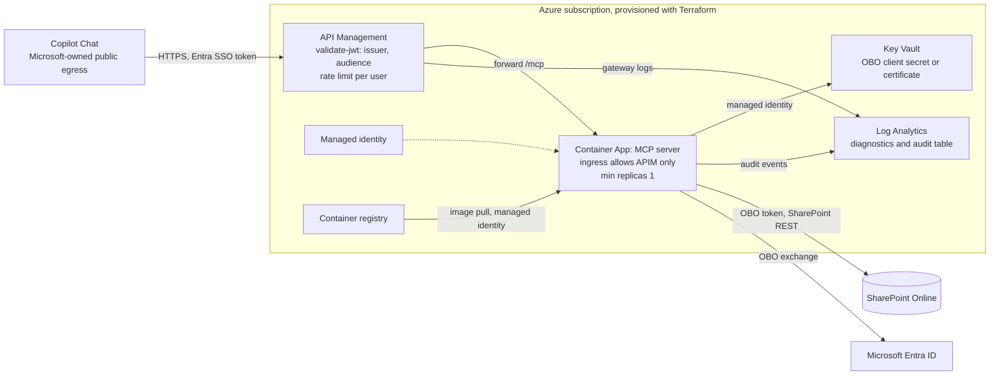

# X. Azure target: API Management in front of Container Apps, provisioned with Terraform

## Date: 2026-10-22

## Status

Proposed

This ADR records the target hosting for a client deployment. **Nothing in it is built in this
version**: the demo runs the server locally behind a dev tunnel
(`XXXX-dev-tunnel-for-the-agent-demo.md`).

---

## Problem

For a client, the MCP server needs a host that is always reachable by Copilot, starts fast enough
for the roughly 10 second action timeout
([MCP and API plugins](https://learn.microsoft.com/microsoft-365/copilot/extensibility/overview-plugins)),
keeps the OBO credential out of configuration files, ships audit events to a store with retention,
and is reproducible per client tenant. The owner also asked for an API gateway in front and for
infrastructure as code.

The inbound side has a constraint that rules out the usual "make it private" answer. The caller is
Copilot itself, running in Microsoft's cloud. A declarative agent's plugin call arrives from
Microsoft-owned public egress, not from the client's network, and the pages read for the research
document no fixed IP range for it. A private endpoint would make the server unreachable to its only
caller. Network injection, which keeps agent traffic inside a customer virtual network, is a
feature of Foundry Agent Service (agents injected into a delegated subnet), not of Microsoft 365
declarative agents
([Foundry agent networking](https://learn.microsoft.com/azure/foundry/agents/concepts/networking-options)).
So the edge stays public and the protection moves to identity and the gateway.

---

## Decision

Target topology, all of it described in Terraform (one module set, one state per client
environment):

1. **API Management** is the only public entry. An inbound `validate-jwt` (or
   `validate-azure-ad-token`) policy checks issuer and audience before anything reaches the server
   ([validate-jwt](https://learn.microsoft.com/azure/api-management/validate-jwt-policy),
   [protect an API with Entra ID](https://learn.microsoft.com/azure/api-management/api-management-howto-protect-backend-with-aad)),
   and a per-user rate limit keyed on the token's `oid` caps runaway loops. The server keeps
   validating the token itself; the gateway is defence in depth, not a replacement.
2. **Azure Container Apps** runs the same image as Podman does locally. Ingress allows only API
   Management (IP restriction rules on the gateway's outbound addresses,
   [IP restrictions](https://learn.microsoft.com/azure/container-apps/ip-restrictions)). `minReplicas`
   is 1, so there is no cold start inside the action timeout.
3. A **managed identity** on the Container App pulls the image from the registry and reads **Key
   Vault**, which holds the OBO client secret or, preferably, a certificate. No secret in app
   settings.
4. **Log Analytics** receives container logs and a **dedicated audit table** for the per-tool-call
   events (`XXXX-three-layer-audit-for-agent-actions.md`), with its own retention.

---

## Considered Options

### Compute

From the research's hosting comparison
([choose an Azure service for MCP](https://learn.microsoft.com/azure/container-apps/mcp-choosing-azure-service)):

| Option | Summary | Pros | Cons |
|--------|---------|------|------|
| ✅ **Azure Container Apps, minReplicas 1** | Our image, Express + MCP SDK unchanged | Same image as local Podman; logs to Log Analytics out of the box; ingress IP restrictions; plain HTTP app, portable to App Service or AKS | One small replica always billed |
| Azure Functions Flex Consumption | Functions host with MCP extension or self-hosted SDK handler | Official MCP hosting template ([host MCP SDK servers](https://learn.microsoft.com/azure/azure-functions/scenario-host-mcp-server-sdks)) | Second toolchain (Functions Core Tools); always-ready instances billed to avoid cold start ([Functions scale](https://learn.microsoft.com/azure/azure-functions/functions-scale)) |
| App Service | Container on a plan | Familiar | Plan sizing; fewer per-app ingress controls than Container Apps |
| AKS | Kubernetes | Full control | Cluster operations for one small service |

### Edge

| Option | Summary | Pros | Cons |
|--------|---------|------|------|
| ✅ **API Management in front** | Gateway with token validation and rate limit | Rejects bad tokens before our code; throttling per user; one place for headers and logging; a stable host name across server moves | Cost of an APIM tier; one more hop inside the timeout |
| Container Apps ingress only, built-in auth | Easy Auth on the app | Cheaper, fewer parts | No rate limiting; less control over token rules |
| Private endpoint or internal environment | No public endpoint | Strong network isolation | Copilot cannot reach it: the caller is on Microsoft's public egress |
| Front Door with WAF | Global edge | WAF rules | Adds cost and complexity; JWT validation still needed behind it |

### Infrastructure as code

| Option | Pros | Cons |
|--------|------|------|
| ✅ **Terraform** | Owner's choice (O6); same tool across Azure and Entra (azuread provider) for app registration, Key Vault and APIM; state per client | State storage to manage |
| Bicep | Azure-native, no state file | Entra objects need Graph Bicep extension or scripts; the owner chose Terraform |
| Agents Toolkit `m365agents.yml` | Already used for the agent package | Covers the Microsoft 365 app and SSO registration, not Azure infrastructure |

---

## Consequences

**Positive:**
- No code change between demo and target: the image, `AUTH_MODE=entra` and the environment
  variables are the same; only the URL in `MCP_SERVER_URL` changes.
- A client tenant is reproducible from Terraform plus the setup script.
- Audit events land in a queryable table with retention chosen by the client.

**Negative / Trade-offs:**
- Running cost: one warm replica, an APIM tier, Log Analytics ingestion.
- APIM adds latency inside the 10 second budget; to measure on the target.
- API Management's outbound addresses must be kept in the Container App's allow rules if the tier
  or region changes.

**Risks:**
| Risk ID | Description | Impact (E/H/M/L) | Mitigation |
|---------|-------------|------------------|------------|
| R-AGT-9 | Cold path (APIM, OBO, SharePoint batch) exceeds the action timeout | M | `minReplicas: 1`; measure a five-day `book_days` on the dev tenant first (verification log) |
| R-AGT-10 | A future Microsoft feature publishes fixed egress ranges and clients ask for IP allow-listing at APIM | L | Add an APIM `ip-filter` policy then; the design does not depend on it |
| R-AGT-11 | Client has no Azure subscription for this (spec section 9, open item 2) | M | Functions Flex or App Service under an existing subscription; the server is portable |

---

## Related

- Related ADRs: `XXXX-custom-mcp-server-in-typescript.md`, `XXXX-declarative-agent-entra-sso-obo.md`,
  `XXXX-dev-tunnel-for-the-agent-demo.md`, `XXXX-three-layer-audit-for-agent-actions.md`, ADR 0002
  (Podman, no Node on the host)
- Related documents: `docs/superpowers/specs/2026-10-22-contract-agent-design.md` (sections 4 O6, 6
  item 4, 9), `docs/research/2026-10-22-sharepoint-contract-agent.md` ("Hosting", decision D5),
  `architecture/05-phase-d-technology-architecture.md`
- TOGAF phase: D — Technology Architecture
- Decision maker(s): owner
- Stakeholders: client IT and security; tenant administrators; builder
