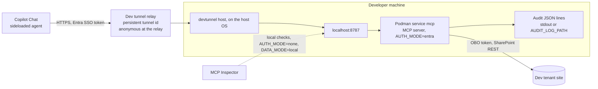

# X. Dev tunnel for the agent demo

## Date: 2026-10-22

## Status

Proposed

---

## Problem

The demo runs on the developer tenant, and the owner decided that nothing is deployed to Azure in
this version (spec O5). The MCP server runs in Podman on the developer's machine on port 8787. Copilot
calls plugins from Microsoft's cloud and needs a public HTTPS URL; it cannot reach `localhost`. The
URL is baked into the agent package (`MCP_SERVER_URL`), so a URL that changes on every restart means
re-provisioning the agent each time.

---

## Decision

Expose the local server through a **persistent Microsoft dev tunnel**:

```powershell
devtunnel user login
devtunnel create <tunnel-id> --allow-anonymous
devtunnel port create <tunnel-id> -p 8787 --protocol http
devtunnel host <tunnel-id>
```

A persistent tunnel keeps its host name across restarts, so the agent is provisioned once with
`MCP_SERVER_URL=https://<tunnel-host>/mcp`. On the first run the "Connect via browser" URL is opened
once and confirmed, as the Microsoft 365 debugging guide describes
([debug MCP and API plugins locally](https://learn.microsoft.com/microsoft-365/copilot/extensibility/plugin-debug-local)).

Anonymous access is set on the tunnel because Copilot is not a dev tunnels client and cannot sign
in to the relay. That access is about the relay only. The server still runs with `AUTH_MODE=entra`:
every request without a valid token for its audience gets 401, and `createApp` refuses to start in
`entra` mode without the auth middleware. `AUTH_MODE=none` is allowed only with `DATA_MODE=local`
(fixtures, no SharePoint) and is used with MCP Inspector, never through the tunnel.

The `devtunnel` CLI runs on the host OS; the server runs in the `mcp` compose service
(`COMPOSE_PROJECT_NAME=orpheus-agent`), published on host port 8787.





---

## Considered Options

| Option | Summary | Pros | Cons |
|--------|---------|------|------|
| ✅ **Persistent dev tunnel** | `devtunnel create` once, `devtunnel host` per session | Microsoft's tool, used by the Agents Toolkit and the plugin debugging docs; stable host name, so the agent is provisioned once; free; no Azure | Public URL while hosted; up only while the developer machine is on |
| Temporary dev tunnel (`devtunnel host -p 8787`) | New tunnel each run | No setup | Host name changes every run, so `MCP_SERVER_URL` and the agent package change every run ([CLI reference](https://learn.microsoft.com/azure/developer/dev-tunnels/cli-commands)) |
| ngrok or Cloudflare Tunnel | Third-party tunnels | Work the same way | Another account, tool and data processor in the request path, outside the Microsoft tooling the Agents Toolkit already uses |
| Deploy to Azure now | The target in `XXXX-azure-target-apim-container-apps-terraform.md` | Production-like | Owner decided against it for this version; subscription question still open |
| Tunnel access restricted to the tenant (`--tenant`) | Relay requires Entra sign-in | Tighter | Copilot cannot present a dev tunnels token, so it cannot reach the server |

---

## Consequences

**Positive:**
- The full path (Copilot, Entra SSO, OBO, SharePoint) is exercised on the dev tenant with code
  running locally, with breakpoints and logs at hand.
- Same server, same configuration shape as the Azure target; only the URL differs.

**Negative / Trade-offs:**
- Anyone who knows the tunnel URL can reach the server. They still need a valid token for its
  audience, but the server is exposed to unauthenticated traffic and to load while hosted. Stop
  `devtunnel host` when not demoing; delete the tunnel when the demo work is done.
- The demo depends on one machine being on and connected.

Why not for clients: a tunnel is a developer convenience with no SLA, no gateway, no rate limit, no
managed secret store and no central log. The OBO client secret sits in a local `.env`. Audit events
go to stdout or a local file. A client deployment uses the Azure target, where API Management,
Key Vault and Log Analytics cover each of these gaps.

**Risks:**
| Risk ID | Description | Impact (E/H/M/L) | Mitigation |
|---------|-------------|------------------|------------|
| R-AGT-12 | Tunnel left hosted and URL shared or guessed | M | Entra validation in the server; stop hosting after the session; delete the tunnel at the end |
| R-AGT-13 | `AUTH_MODE=none` combined with a tunnel by mistake | H | Config rejects `AUTH_MODE=none` with `DATA_MODE=sharepoint`; with local data only fixture data is exposed; the demo procedure starts the tunnel only after an `entra` start |

---

## Related

- Related ADRs: `XXXX-azure-target-apim-container-apps-terraform.md`,
  `XXXX-declarative-agent-entra-sso-obo.md`, ADR 0002 (Podman, no Node on the host)
- Related documents: `docs/superpowers/specs/2026-10-22-contract-agent-design.md` (sections 4 O5, 6
  item 5), `packages/agent-contract-calendar/demo/demo-procedure.md`,
  `packages/mcp-contract-calendar/README.md`
- Sources: [Dev tunnels security](https://learn.microsoft.com/azure/developer/dev-tunnels/security),
  [Dev tunnels FAQ, persistent tunnels](https://learn.microsoft.com/azure/developer/dev-tunnels/faq)
- TOGAF phase: D — Technology Architecture
- Decision maker(s): owner
- Stakeholders: builder; demo audience
