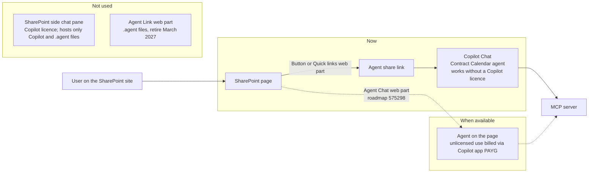

# X. SharePoint placement of the agent waits for the Agent Chat web part

## Date: 2026-10-23

## Status

Accepted

---

## Problem

The Contract Calendar agent runs in Microsoft 365 Copilot Chat and Teams (ADR 0012). The owner wants
it inside SharePoint as well, next to the Contract Calendar web part, ideally in the site's chat side
pane. The demo tenant has no Microsoft 365 Copilot licence (research decision D7), and the agent is
a declarative agent with an MCP action, published to the organisation's app catalog.

Microsoft is changing how agents appear in SharePoint
([Upgrade agents in SharePoint and OneDrive](https://learn.microsoft.com/sharepoint/upgrade-sharepoint-agents)):

- The SharePoint side chat pane opens Copilot in SharePoint and `.agent` files. Copilot in
  SharePoint needs a Microsoft 365 Copilot licence per user. Agents built outside `.agent` files
  "can't be used in the site's chat pane", so they cannot be set as the site's main agent.
- `.agent` files, the Agent Link web part and the current immersive viewer stop working after
  March 2027.
- The **Agent Chat web part** ([roadmap 575298](https://www.microsoft.com/microsoft-365/roadmap?id=575298))
  is the announced way to put a declarative agent on a SharePoint page. It is "coming soon". Usage
  by unlicensed users is consolidated under Copilot app pay-as-you-go (PAYG).

So there is no supported way today to show this agent in the SharePoint side pane, with or without
a licence, and the supported page placement is not released yet.

---

## Decision

1. **No side-pane integration and nothing built on `.agent` files or the Agent Link web part.** A
   declarative agent cannot be the side pane's agent, and the `.agent` route retires in March 2027
   (research decision D8).
2. **Now:** link to the agent from the SharePoint page with a **Button** or **Quick links** web part
   that opens the agent's share link in Copilot Chat. Users get the full agent, unlicensed, in a new
   tab. This is what the demo shows next to the web part.
3. **When the Agent Chat web part ships:** add it to the Contract Calendar page with this agent, and
   update this ADR and the demo procedure. Check then how unlicensed use is billed (Copilot app
   PAYG) and whether the tenant must enable PAYG first.
4. **No Copilot licence is bought for this.** A licence enables Copilot in SharePoint, but that
   still cannot host this agent in the side pane.

---

## Considered Options

| Option | Summary | Pros | Cons |
|--------|---------|------|------|
| ✅ **Link now, Agent Chat web part later** | Button or Quick links web part to the agent's share link; replace with the Agent Chat web part when released | Works today without a licence; no throw-away code; follows Microsoft's announced path | Opens a new tab instead of chatting on the page |
| Agent in the SharePoint side chat pane | Set the agent as the site's main agent | Native look | Not possible for declarative agents built outside `.agent` files; side pane needs a Copilot licence |
| `.agent` file with the Agent Link web part | Build a SharePoint agent and link it | Chat on the page today | Q&A over content only, no MCP actions; retires March 2027 |
| Buy one Microsoft 365 Copilot licence | Licence the demo account | Copilot in SharePoint for the presenter | Still cannot host this agent in the side pane; cost; owner decided against a licence for now (D7) |
| Custom SPFx chat web part calling the MCP server | Our own chat UI on the page | Full control | Re-implements Copilot orchestration, auth and safety; duplicates what the Agent Chat web part will provide |

---

## Consequences

**Positive:**
- Nothing to rebuild when the Agent Chat web part ships; the same published agent is placed on the
  page.
- No licence cost for the demo; the agent stays usable by unlicensed users in Copilot Chat.

**Negative / Trade-offs:**
- In the demo the agent opens in a separate tab, not beside the calendar web part.
- The final placement depends on a Microsoft release with no date.

**Risks:**
| Risk ID | Description | Impact (E/H/M/L) | Mitigation |
|---------|-------------|------------------|------------|
| R-AGT-14 | Agent Chat web part ships later than needed for a client | M | The link placement keeps working; the agent itself is unaffected |
| R-AGT-15 | Unlicensed use through the Agent Chat web part requires PAYG billing | M | Check billing when it ships; document it for clients before placing the web part |

---

## Related

- Related ADRs: `0012-declarative-agent-entra-sso-obo.md` (agent and channels),
  `0011-custom-mcp-server-in-typescript.md` (why not `.agent` files or SharePoint skills)
- Related documents: `docs/research/2026-10-22-sharepoint-contract-agent.md` (decisions D7, D8),
  `packages/agent-contract-calendar/demo/demo-procedure.md`
- Sources: [Upgrade agents in SharePoint and OneDrive](https://learn.microsoft.com/sharepoint/upgrade-sharepoint-agents),
  [Agent Chat web part, roadmap 575298](https://www.microsoft.com/microsoft-365/roadmap?id=575298),
  [Agent capabilities and licensing models](https://learn.microsoft.com/microsoft-365/copilot/extensibility/prerequisites#agent-capabilities-and-licensing-models)
- TOGAF phase: C — Application Architecture
- Decision maker(s): owner
- Stakeholders: site owners; contractors, contract managers and HR using the site; demo audience
