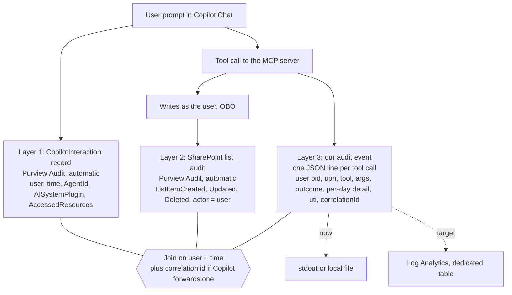

# X. Three-layer audit for agent actions

## Date: 2026-10-22

## Status

Proposed

---

## Problem

The owner's requirement for production is full audit with traceability: for any change to a
contract's days, show who asked, what the agent did and what changed in SharePoint. An agent adds a
step that the web part does not have. The user writes a sentence, the model turns it into a tool
call, the server turns that into list writes. Each step can go wrong differently (the model
resolves a date wrongly, the server skips a holiday, SharePoint rejects a write), and each has to be
visible afterwards. No single log covers all three.

---

## Decision

Audit in three layers, two of which Microsoft 365 records without any code.

1. **Copilot interaction (automatic).** Every prompt to a declarative agent produces a
   `CopilotInteraction` record in Purview Audit with the user, time, `AppHost`, agent id and name,
   `AISystemPlugin` (our plugin's name, id, version) and `AccessedResources`. Agents with dynamic
   tool discovery are covered
   ([audit for Copilot](https://learn.microsoft.com/purview/audit-copilot),
   [dynamic tool discovery](https://learn.microsoft.com/microsoft-365/copilot/extensibility/plugin-dynamic-tool-discovery)).
2. **SharePoint change (automatic).** `ListItemCreated`, `ListItemUpdated`, `ListItemDeleted` /
   `ListItemRecycled` on CalendarEntries and Contracts
   ([audit log activities](https://learn.microsoft.com/purview/audit-log-activities)). Because the
   server writes with an on-behalf-of token, the actor is the real user, not `app@sharepoint`.
3. **The tool call (our code).** One JSON line per tool call, written by `runTool` in
   `src/audit/audit.ts`:

   | Field | Content |
   |---|---|
   | `time` | ISO timestamp of the call |
   | `correlationId` | `x-ms-correlation-id` or `request-id` header if Copilot sends one, otherwise a new UUID |
   | `serverVersion` | package version |
   | `user` | `oid` and `upn` from the token, `spUserId` from SharePoint |
   | `tool`, `args` | tool name and the arguments as received |
   | `outcome` | `ok`, `needs_choice` or `error` |
   | `errorCode` | `not_found`, `forbidden`, `invalid_input` or `internal` |
   | `detail` | the per-day arrays `booked`, `skipped`, `failed`, `removed`, `notFound` |
   | `tokenId` | the token's `uti` claim |

   No prompt text and no free text beyond the arguments. In this version the line goes to stdout
   or to the file in `AUDIT_LOG_PATH`. The target is a dedicated Log Analytics table with its own
   retention (`XXXX-azure-target-apim-container-apps-terraform.md`).

The layers join on user plus time, and on the correlation id if Copilot forwards one. Whether it
does is checked on the dev tenant with `LOG_REQUEST_HEADERS=true`, which logs the first request's
headers with credentials redacted.

---

## Considered Options

| Option | Summary | Pros | Cons |
|--------|---------|------|------|
| ✅ **Purview (layers 1 and 2) plus our event to Log Analytics** | Use what Microsoft records, add only the missing step | Two layers free and tamper-resistant; our event answers "what did the tool decide per day"; Log Analytics retention set by the client | Three stores to correlate; layer 3 lives outside Purview |
| Purview only | Rely on `CopilotInteraction` and `ListItem*` | No code | Neither record says "book_days 01.12 to 05.12 skipped 08.12 holiday, moved 03.12 to the other contract"; skipped and failed days leave no trace at all |
| Our log only | Server logs everything | One place | Loses the prompt record and the platform-level change record; our log is only as trustworthy as our server |
| Also push tool calls into Purview (`contentActivities`) | Fourth layer through the Purview API for AI apps | Tool calls next to the Copilot record | Designed for prompt and response content of custom AI apps; part of it billed pay-as-you-go; Copilot already logs the prompt ([Purview APIs](https://learn.microsoft.com/purview/developer/use-the-api)). Kept as an option if compliance requires it |
| Application Insights traces | Diagnostics pipeline | Already common | Sampling and short retention defaults; audit mixed with diagnostics |

---

## Consequences

**Positive:**
- For any changed day there is a prompt record, a change record with the real user, and our record
  of the decision, including days that were skipped or failed and therefore never reached
  SharePoint.
- The audit event has a test (`audit.test.ts`) and is written even when the tool throws.

**Negative / Trade-offs:**
- Retention differs per layer. Purview Audit Standard keeps 180 days; E5 users get one year for
  SharePoint and Entra records; longer needs Audit Premium
  ([search the audit log](https://learn.microsoft.com/purview/audit-search)). Contractors on a
  non-E5 licence get 180 days. Our table is set separately.
- The join to layer 2 relies on the SharePoint item ids in `detail` (`booked[].entryId`,
  `removed[].entryId`). A failed write has no item id; it is matched by contract, date and user.
- A failed audit write is reported on stderr and does not fail the tool call; the tool result wins.

**Risks:**
| Risk ID | Description | Impact (E/H/M/L) | Mitigation |
|---------|-------------|------------------|------------|
| R-AGT-14 | Copilot forwards no correlation id; joins rely on user plus time | M | Log request headers once on the dev tenant; if none, document the join window |
| R-AGT-15 | `ListItem*` records for agent writes do not show our app's client id, so agent and web part changes look the same in layer 2 | M | Verify on the dev tenant; layer 3 still distinguishes them |
| R-AGT-16 | In the demo, stdout or an `AUDIT_LOG_PATH` outside the mounted workspace is lost with the container | L | Point `AUDIT_LOG_PATH` into the mounted repository folder for the demo; the target writes to Log Analytics |

---

## Related

- Related ADRs: `XXXX-declarative-agent-entra-sso-obo.md` (on-behalf-of, actor),
  `XXXX-azure-target-apim-container-apps-terraform.md` (Log Analytics table)
- Related documents: `docs/superpowers/specs/2026-10-22-contract-agent-design.md` (sections 4 D6, 5
  "Logging and evidence", 9), `docs/research/2026-10-22-sharepoint-contract-agent.md` ("Audit: three
  layers, two are free", decision D6), `architecture/10-requirements-management.md`
- TOGAF phase: Requirements Management (audit and traceability); D — Technology Architecture
- Decision maker(s): owner
- Stakeholders: compliance; HR; contract managers; tenant administrators; builder
